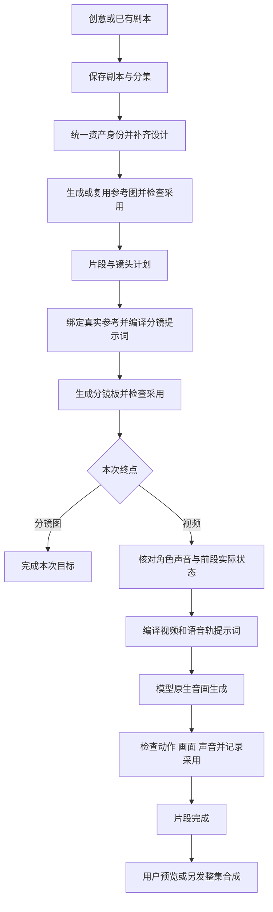

# AI 导演台完整方案

> v1.1 · 2026-10-22 · Codex 与 Claude App 联合评审定稿（方案层）。**本地首版已实现（独立功能分支提交，未发布）**：测试响应模式下整条用户流程跑通；Agnes 真实剧本、分集、资产图及分镜首帧已验，视频受厂商队列满阻塞。实现状态见 §14，验收记录见 [本地验收记录](audits/ai-director-local-acceptance-20261022.md)。
> 本文是 AI 导演台的总方案与评审入口。提示词正文、制作样例、源码对照作为附件；产品范围、操作流程和采用规则以本文为准。v1.1 将导演作品确定为 aiavatar 内独立的服务端制作对象，取代 v1.0 共用画布文档／镜头真值的设想，既有画布规则不变。

评审过程与取舍见 [Claude 联合评审记录](audits/ai-director-claude-review-2026-10.md)。定稿不代表生成效果已经验收。

## 1. 产品目标与已经确定的方向

让用户从一句创意或已有剧本出发，在一个工作台完成：

**AI 写剧本 → 拆分集 → 提取角色／场景／道具 → 准备参考资产 → 生成宫格分镜 → 生成带声音的视频片段 → 整集预览与导出。**

产品采用 **作品列表 + 一个制作工作台**。一级入口名为 **AI 导演台**；工作台只有 **剧本 / 资产 / 分镜** 三个主要入口。分集是工作范围，视频制作放在分镜片段卡内。项目设置、预览和导出放顶部，助手按需展开。

四个核心原则：

1. **采用的资产是依据，采用的分镜板是视觉检查点。** 先把各镜画面确定，再让视频模型执行动作，减少每段重新设计人物和场景。
2. **提示词与实际素材绑定一起交付。** 写了“图1”“林夏”不等于上传了对应图片；模型实际收到的文件与提示词编号必须一致。
3. **一键连跑在后台推进。** 可以关闭页面，完成项保留，受阻项说明原因，只重做必要部分。
4. **优先原生音画生成，声音参考挂在角色资产上。** 不增加独立“音画同步”必经页面；绑定参考和效果通过分别表示，有需要时再使用重配音／对口型修复。

开发目标是当前平台。沿用 aiavatar 的账号、开通、模型、资产存储、任务和计费能力；新增导演台入口，不删除现有画布、人物库或其他平台业务，不部署两套参考工程作为新的业务基础。

## 2. 参考产品怎么用，哪些结论仍有限制

| 参考 | 采纳的内容 | 不直接照搬的内容 |
|---|---|---|
| 已认可的 dj.diguvip 工作台 | 三工作区、左侧分集、片段卡、多镜头视频、关联资产弹层、批量与单卡设置并存 | 不因页面有入口就假定后台能力或实际生成效果已验证 |
| AID Studio | 剧本／分集／资产组织、镜头组、宫格与视频提示词对应、缺项补齐思路 | 浏览器跨阶段 Runner、必要引用降级为文字、已有部分资产就跳过提取 |
| ViMax | 主形象派生、机位基准、参考筛选、首帧／动作／尾帧拆分、候选比较 | 固定横屏／参考数量、相对最好即合格、单候选不检查 |
| 本仓 web-drama 短剧画布 | 已有剧本、角色／场景、分集片段、声音描述和合成的业务实现 | 不据此迁移或关闭 drama，不跨产品直接混写项目数据或绕过开通规则 |

实际走查了《给文森特》和《家庭会议》。后者可见一张卡为 15 秒／6 镜，分镜图为六格，视频提示词写时间轴、宫格映射、资产引用和对白。角色资产有音色描述及音频上传入口，查看的角色尚未填写。

视频预览曾报无法播放，未验证成片质量、跨片段声音或实际后台绑定；在所看项目中未找到整集拼接／导出入口。因此整集交付属于本平台需要接通的范围，不冒充参考站点已验证能力。没有取得对方隐藏系统提示词，本文提示词是依据可见实例和源码方法重新编写。

## 3. 用户界面与最短操作路径

### 3.1 作品列表

每张作品卡显示封面、名称、集数、最近编辑时间和制作进度，支持新建、打开、重命名。新建时输入创意或导入剧本即可；风格、语言和比例有默认值，模型取平台当前可用配置，不要求先填一页参数。

默认建议：真人写实、9:16、中文。已有项目和用户明确选择优先，不能在后台偷偷改成默认值。

### 3.2 工作台结构

```text
返回作品列表  作品名称  保存状态   风格·比例·语言   项目设置  预览/导出
                       本集一键生成到分镜图 ▼    运行进度/暂停
剧本 | 资产 | 分镜
左侧：分集目录          右侧：当前工作区
```

三个入口是可自由切换的工作区，不是必须逐页点“下一步”的向导。暂时缺少上游输入时仍可查看和编辑，只有依赖它的生成操作受阻。

| 工作区 | 默认内容 | 主要操作 |
|---|---|---|
| 剧本 | 分集目录、梗概、可编辑正文 | AI 写作、导入、拆分集、局部改写、改名／排序 |
| 资产 | 角色／场景／道具分类，当前采用图和就绪状态 | 提取／补提取、批量出图、上传替换、选择版本、导入已有资产 |
| 分镜 | 当前集的片段卡 | 编辑提示词／关联资产、生成分镜图、生成视频、预览、重做、采用版本 |

剧本拆集后，分集正文是编辑来源，总览由同一正文组合；不能另存一份整剧全文与分集文本互相漂移。改写只针对当前选择，已有人工作品不会被连跑默默覆盖。

资产区支持“本集使用／全剧资产”筛选，切换分集不重新造一套同名角色。角色详情包含身份、造型、参考图以及按需配置的声音；场景详情含布局与场次状态；道具详情含外观及重要状态。

### 3.3 片段卡是视频制作的中心

一张卡代表一个可独立生成的视频片段，内部有多个镜头。默认展示：

- 序号、短标题、剧情摘要、状态，例如“15 秒 · 6 镜”。
- 当前采用的分镜图，以及生成后的视频预览。
- 分镜图提示词、视频提示词两个明确字段，支持原位展开与编辑，不能混成一段。
- 关联角色／场景／道具缩略图；弹层能查看和替换实际采用版本。声音绑定在说话角色下可见。
- 模型、计划时长、执行时间；批量设置与单卡覆盖并存，不先认定这些是应隐藏的冗余。
- 阶段主操作、失败原因、历史版本、上传替换与重新生成。

默认呈现当前采用版本，历史候选按需展开；重新生成不覆盖满意的旧结果。片段内镜头计划可展开核对时间、画面与对白，但首版不强制另做一个专业单镜剪辑工作台。改镜头计划须标记相应分镜图和视频待更新。

单卡时长是整个片段时长，不是每镜时长。首版立即执行，定时执行后置；不会将已有任务的时间信息误作视频时长。模型、时长、提示词与关联资产保留容易找到的位置，不未经使用验证就全部收进“更多”。

### 3.4 顶部预览与导出

区分三种结果，不能用同一个“已完成”混淆：

| 结果 | 行为 |
|---|---|
| 分镜预览 | 按片段／镜头顺序查看采用图片与计划；没有视频也能用 |
| 片段连播 | 播放当前集已采用视频；缺段明确标记，不默默跳过后宣称整集完成 |
| 整集导出 | 按明确顺序和采用版本创建合成任务；完成后下载成片，也可单独下载已有片段 |

导出使用本次快照。后来换视频或改顺序，旧成片保留并显示来源已更新，不自动覆盖；已有高级剪辑工程按差异处理。首版以顺序合成、保留片段声音和必要音量／接缝处理为界，不扩展为专业剪辑系统。实际支持的处理仍须验证；声音身份问题不能靠音量归一解决。

## 4. 制作对象：各自管什么

| 对象 | 内容与用途 |
|---|---|
| 作品 | 全剧设置、剧本及分集、共用资产、运行记录 |
| 分集 | 正文、摘要、场次与有序片段；名称／集号可改，身份 ID 稳定 |
| 场次 | 某一空间在当前时间、天气与剧情状态下的使用 |
| 资产身份 | 角色、物理场景、道具，跨集复用 |
| 资产变体 | 经采用的换装、年龄阶段、场景状态或道具外观变化 |
| 媒体版本 | 真实图片／音频／视频、来源、检查结果；当前采用与历史候选分开 |
| 片段 Clip | 原文范围、叙事目标、时长、镜头列表、依赖、分镜板与视频结果 |
| 镜头 Shot | 时间区间、机位、画面、动作、对白、开始／结束状态及宫格位置 |
| 分镜板 Board | 属于一个片段的图片版本；首版一格对应一个镜头 |
| 制作任务 Run | 冻结的输入、模型和提示词版本、实际素材绑定、费用与执行进度 |

**三个状态不能混为一谈：** 模型任务成功只表示拿到了结果；质量检查表示通过／不通过／无法判断；采用表示用户或已授权策略选中了哪个版本。最好的一张仍可能不合格。

## 5. 提示词体系：统一计划，分工编译

### 5.1 八类职责

Agent 是工作职责，不等于八个常驻助手或每次八轮调用。编号、文件校验、预算与状态恢复由程序处理。

| 职责 | 核心提示词要求 | 交付给下一步 |
|---|---|---|
| A1 编剧 | 先故事目标、人物动机与因果，再分场写作；只改授权范围 | 完整可编辑剧本及来源版本 |
| A2 分集 | 按剧情拆分，保留原文顺序、对白与动作，不重新改写全文 | 分集与原文段落映射 |
| A3 资产统筹 | 区分原文事实和制作设计；先统一角色，再关联场景／道具 | 资产身份、变体、缺项与设计建议 |
| A4 分镜导演 | 切片段，逐镜安排时间、空间、动作和对白；区分代表图与首帧 | 一份供图片与视频共用的片段计划 |
| A5 参考指导 | 从真实可用版本选择最少且足够的参考，说明沿用／不沿用什么 | 有用途和适用镜头的引用建议 |
| A6 提示词编译 | 不改剧情，分别编译资产图、分镜图、视频及声音指令 | 实际提示词与引用／镜头映射 |
| A7 质量检查 | 依据实际媒体逐项判断；单候选也验收，证据不足不假装通过 | 通过／不通过／无法判断及证据 |
| A8 修复指导 | 找到问题根源，只建议重做必要步骤，不能自行追加预算 | 修复对象、原因、操作与保留成果 |

共用提示词规则：尊重人工内容；来源事实、设计提案、计划状态与观察事实分开；只用已提供 ID 和引用；必要素材缺失就报告；按契约完整输出，截断或非法结构不进入下一步。仅装配当前任务需要的上下文，不每次把全剧和所有历史素材发给模型。

默认不为每个职责都调用一次模型：已有确定的采用版本由程序解析和编号，A5 只在候选多、用途不明或引用冲突时参与判断；不允许为满足上限自动删必要素材。A6 对结构清楚的已批准计划可按模板编译，复杂表达才调用模型。A8 只在需要解释和修复的异常时调用。A4 提供需求与用户锁定版本，A5 不重新选择另一套相互冲突的参考。

### 5.2 五类媒体提示词的标准写法

下列是制作模板，变量取自采用的设计与计划。示例引用号必须经第 6 节真实绑定后才能使用。

**角色图：身份特征＋当前造型＋清楚可辨的视图。**

```text
制作【角色】的【半身/全身/所需角度】参考图，风格【风格】。
身份特征：【脸型、发型、体型及少量辨识特征】；当前造型：【衣服与关键配饰】。
自然中性表情，关键特征无遮挡，适合识别的受光和简洁背景。
仅一个角色，不添加剧情动作或未指定配饰。有采用基准时沿用其身份，只改变批准的造型或视角。
```

**场景图：固定布局＋相机位置＋场次光线。**

```text
制作【场景】的空间参考，固定关系：【入口、窗、主要家具、通道】。
相机位于【位置】，朝向【锚点】，清楚展示本镜可见的空间关系。
本场时间与光源：【时间、光源位置和方向】。不出现人物或临时剧情道具。
新机位仍是同一空间，不能水平镜像房间来代替反打；未知区域先按采用设计补齐。
```

**道具图：外观＋可辨角度＋当前状态。**

```text
制作单件【道具】参考图，外观【轮廓、材质、颜色、尺寸关系、辨识细节】。
状态为【闭合/展开/完整等】，采用能看清关键特征的角度和光线。
不出现人物或使用动作，不生成重复物件、未指定文字或商标。
```

**分镜图：一份参考清单＋逐格静态画面＋跨格不变量。**

```text
生成【列×行】分镜板，整板【比例】，每格【比例】，按左到右、上到下阅读。
图1提供【角色身份与造型】，图2提供【空间布局】，图3提供【道具外观】。
资产档案中的多视角代表同一资产，不复制档案排版、背景或多个角色。
第1格：【镜头、景别、机位、人物位置/视线、一个静态时刻、道具状态】。
后续各格按同一结构描述，不把一整段动作画成残影或小拼图。
各格沿用同一身份、造型、空间和光源；允许机位造成合理的画面左右变化。
不添加人物、剧情、字幕或图内镜号。格子与镜头映射由系统保存。
```

**视频：采用分镜板＋逐镜动作过程＋对白与声音绑定。**

```text
生成【总时长】秒、【最终比例】的剧情片段，共【镜数】镜。
图1为采用分镜板，格子按【顺序】对应镜头；图2起为本次实际绑定的角色、场景和道具参考。
最终每一时刻呈现一个完整镜头，不显示宫格或资产资料板。
【开始—结束时间】，对应【格子】：【景别/机位】，从【开始状态】经【动作】到【结束状态】；相机【运动】。
逐镜写出必要切换、道具转移与视线，不把代表图中的完成状态当作动作起点。
语音轨：【时间/镜头】【角色】说“【原文台词】”，【本句情绪/语速/重音】。
声音身份按实际音频参考绑定；只说本段台词，不复制样本旧台词或朗读参考说明。
环境声：【必要声音与时间】；配乐：【明确要求】。
保留【关键连续状态】，不追加人物、剧情或未要求的字幕。
```

提示词不保证模型严格执行秒数、身份或空间。生成后必须检查。人工改动提示词涉及剧情、镜头顺序、对白或道具状态时，应同步修订片段计划并提示关联图／视频待更新；只改措辞不反向覆盖剧本。系统不得为了让计划与提示词表面一致而静默重写人工输入。

### 5.3 分镜板的特殊规则

- 先确认资产和计划，再生成分镜板；画面与计划冲突先处理图或计划，不用视频提示词掩盖。
- 宫格整板、单格、最终视频的比例分开。2×2 单格 9:16 的整板可为 9:16；3 列×2 行单格 16:9 的整板为 8:3，不计格缝。
- 参考数量、像素、布局和时长取实际模型能力，不固定照搬某工程的“8 张”或横屏假设。
- 初始小样使用受支持的 2×2 板和 1–2 个说话角色；这不是产品永久四镜上限。未经端点规格和真实小样验证的布局／视频路径不开放。3×2 不能以错误整板比例硬生成；单格生成后程序拼板属于另一个需验证和报价的方案，不默认作为免费回退。
- 裁切单格不会增加真实细节；如果整板分辨率不足，不能声称另有“高清单格原图”。需要补真实更清楚的图、调整布局或进入人工待确认。
- 有经过验证的宫格参考能力时，按同一镜头计划生成多镜视频；不支持时准备真正的逐镜首帧。路径转换涉及费用／计划变化必须可见。
- 代表图可能是动作中段或结束：拿起后的信封图不能直接作为“开始拿起”的单镜首帧。逐镜路径也不能把 3 秒子镜硬发给最短 4 秒的模型。
- 逐镜回退只有在实际模型、时长、参考和声音能力都支持时成立；不支持短镜头时必须重新安排计划并报价，不能静默把每镜拉长。模型种子配置与历史生产记录不是当前在线能力真值。

## 6. 资产引用：从用户选择一直对应到模型输入

### 6.1 一次引用需要说清楚的内容

每条绑定至少能追溯：**哪个资产 → 哪个造型／状态 → 哪个媒体版本 → 用于哪些镜头 → 沿用哪些特征 → 本次请求中的位置。** 文件从平台存储解析，权限、类型和可读性由系统校验，不让模型编造 URL。

例如同一片段在两次请求中的编号可以不同：

| 业务素材 | 生成分镜图时 | 生成视频时 |
|---|---|---|
| 林夏采用造型 | 图1 | 图2 |
| 旧书店采用空间 | 图2 | 图3 |
| 红信封采用外观 | 图3 | 图4 |
| 该片段采用分镜板 | 尚未生成 | 图1 |
| 林夏采用声音样本 | 不传 | 音频1 |

编号由最终素材清单统一产生，再用于提示词，禁止沿用上一次请求的旧编号。不同供应商若采用不同引用语法，由适配层转换；“图1／音频1”不是所有模型通用的隐式参数。

同类编号复用现有 `VideoGenSpec.referenceLabels` 规则，不另写一套顺序。结构化提示词默认关闭供应商可选自动改写；无法关闭时保留可获取的有效提示词并检查映射，无法观察则明确标记，不假设输入原文就是最终执行文本。全能参考中的前段尾帧是普通参考素材，不能因为文字写了“首帧”就成为首帧参数；参考生成和首尾帧模式的能力分别核验。

### 6.2 选择和缺失处理

- 用户选定版本优先；同机位、同场次状态的已确认图可以复用。大素材库先按元数据筛选，再按需要看图。
- 一张图可承担多个用途，但必须确实覆盖所需身份／布局；不能为凑数量把多个看不清的人塞在一张图里假装齐全。
- 缺必要角色／场景／道具图，阻止对应生成并定位缺项；其他无依赖片段继续。声音-only 角色不要求人物图。
- 超过参考上限时先提出减少非必要图、补合适参考或拆片段等方案，不能静默丢掉必要资产。
- 素材更新不改已提交任务；旧结果保留来源快照，相关下游提示待更新。
- 存储只保留受控文件 key 和版本；签名地址临时生成，到期重签，不把 URL 当资产身份。

## 7. 声音连续性：绑定稳定参考，本句表演可变

### 7.1 产品行为

角色详情中提供“声音”：声音描述、采用样本、试听和更换。默认不把声音配置做成第四个工作区。不会说话的角色无需配置；只做到分镜图时，声音缺失不拦流程。

连续出有对白的视频时，默认使用固定角色声音基准：

1. 已有采用声音样本：每段复用同一版本，按说话角色精确绑定。
2. 首次没有样本：优先用户上传、既有 `DapVoice` 版本的真实试听／采样文件；仍无素材时可显式用平台配音生成一次短试音，试听采用后供视频参考。试音计费进入本次预算，不变成每段必经配音步骤。
3. 用户选择仅按文字声音描述试作：允许生成样片，明确“未绑定声音参考”，不标记为已保障跨段音色。连续制作需要基准时停在该角色，避免未经试听整剧铺开。

首次试听是有缺口时的处理点，不是每段都弹确认。已有声音基准的作品可直接在授权预算内连跑。声音检查需要实际音频和适用模型或人工试听；没有能力判断时保留“未验证”。

### 7.2 提示词与参考规则

```text
音频1只为【角色A】提供音色、口音和声音身份；音频2只为【角色B】提供声音身份。
只说当前语音轨指定的新台词，不复制样本台词、背景音乐或噪声，不交换说话角色。
当前镜头中【角色A】以【本句情绪/语速】说“【台词】”；可见发言者口型配合。
```

固定样本不随每次生成自动更换，避免一段偏差接着传给下一段。情绪、轻声、喊叫和语速可以变化，但声音身份不应变成另一个人。换装也不自动换音色；跨年龄等变化必须建立明确的声音变体。

参考音频选干净、单人、有效语音，不机械截文件最前几秒。实际长度、格式和数量按当前端点合同校验；不能套用参考站点的 3 秒 UI 限制，也不能把其他语音服务的 voiceId 塞入不支持它的视频接口。

多个角色的样本同时检查单段长度、数量和总时长，按实际有效语音分配，不硬编码平均分成 15/N 秒。需要逐人声音参考且超过上限时，调整经批准的片段计划。混合视频提取声音不作为首版默认来源；后续只有确实清楚的单人语音或有经验证的分离能力才考虑。界面说“已绑定声音参考”，跨片段一致性需另行检查。

原生音画是制作策略，不代表所有视频模型都支持声音参考。原生声音／参考音色／多人物声音绑定分别核验。超出能力先调整方案，不自动退回另一个付费配音流程。

## 8. 一键连跑：把上述内容连成可恢复的制作任务

### 8.1 启动入口

顶部按钮明确显示范围和目标，例如“本集一键生成到分镜图”。首版允许整部剧／本集／选中片段到分镜图；到视频限定本集或选中片段，整剧视频批量后置。默认停在分镜图，用户明确选到视频时才进入视频费用。

启动面板先显示 **范围、目标、估价与预算上限**，模型／设置摘要可见，手动检查和采用策略按需展开。模型可继承项目默认，单卡覆盖明确列出。先文字规划再形成媒体报价，超出预算才停；未知镜头数量不包装成精确总价。定时后置。

自动模式可采用空缺的新草稿、获授权的设计补齐和检查通过的新候选；不覆盖已有人工作品或采用结果。单纯“模型返回成功”不能自动采用。手动模式在关键阶段让用户检查后推进。

### 8.2 后台执行顺序



检查按下一节分级；阻断项不通过或必要项无法判断，不沿正常箭头自动推进，非关键美学建议集中汇总。只需文字时不要求媒体模型；只到分镜图时不要求视频或声音能力。

### 8.2a 检查分级，避免不必要停顿

| 等级 | 例子 | 执行规则 |
|---|---|---|
| 硬契约 | 文件／归属／实际绑定／规格／预算 | 不满足必停，不能靠人工忽略越权或不支持的请求 |
| 关键内容 | 主角身份、必须出镜对象、核心道具状态、必要剧情动作／对白 | fail 阻止相关下游；unknown 先补证据，仍无法判断则待确认 |
| 非关键质量 | 不影响剧情的构图偏好、色调微差、表演审美 | 提醒并在阶段结束汇总，不阻断无问题分支 |

关键项在镜头计划采用时明确，来源于用户要求与剧情，不由生成器或质检模型事后自行降级。待确认项可批量审阅；人工决定单独记录，不能改写成“AI检查通过”。未确认的动作状态不能作为依赖它的后镜已发生事实。

模型对关键项 fail 或 unknown 时，用户可以查看证据并逐项人工确认，也可拒绝／重做。人工确认记录具体媒体版本、检查项、确认的实际结束状态和原因，作为独立的人工证据允许后续依赖继续；只点“喜欢这个候选”不等于确认全部动作。若实际结果确实偏离原计划，须先采用对应计划修订。硬契约仍不能绕过。

每项自动补证据最多追加一次检查，仍不明确就集中待审，避免无限反思。自动采用策略作为能力开关，在阶段 0 记录关键项 unknown 与误判比例、人工抽查一致程度及每段检查成本，达到书面记录的启用标准才默认开启；不默认宣称视觉模型可靠。未经校准时使用阶段待审，不把未经检查的媒体自动标成可用。

### 8.3 依赖、并行与状态

独立资产和独立场次可以并行。当前段依赖前段的动作结果时，必须先确认前段真实结束状态；计划写了“信封交给乙”不代表生成视频真的完成了交接。前段结果与下一段分镜冲突，定位下一段待更新，不偷偷重生成或沿用错误画面。

| 前台状态 | 意义与可用操作 |
|---|---|
| 待开始／排队 | 尚未执行，可查看计划、取消尚未受理的范围 |
| 进行中 | 展示当前阶段、完成数量、已知费用，不伪造精确剩余时间 |
| 待补齐 | 缺参考或配置，直接定位资产／片段 |
| 待确认 | 设计冲突、无法判定、首次音色试听或预算变化，处理后继续 |
| 部分完成／失败 | 成功结果保留，展示具体失败对象与原因 |
| 已暂停 | 停止派发新步骤；在途任务仍查询与结算，不能谎称全部已停止 |
| 目标完成 | 所选范围满足本次目标；只做到分镜图不显示“成片完成” |

“重试失败项”“继续剩余”“重新制作”含义不同：前两者复用有效成果，后者会创建新的媒体候选及费用。供应商受理状态未知时先查原任务，不能用“重试”再买一份。

### 8.4 预算、局部修复和断点续跑

- 初始冻结输入与预算；逐阶段校验余量。计价、冻结和结算沿用既有任务系统，工作流不建第二份账本。
- 默认一张候选也要检查；多候选由用户选择，择优和合格判断分开。
- 建议自动修复上限为每个逻辑失败对象追加一次媒体生成，受总预算约束；新 attempt 不能重置额度。付费检查同样计入预算。
- 引用错误修引用，证据不足补检查，图正确而视频错误只重做相关视频。不能让修复 Agent 自行换模型、改剧情或加钱。
- 生成指纹包含内容、参考与模板版本、实际提示词、模型及规格；检查另有规则版本。只改变检查规则时复用媒体重新检查。
- 任务持久化，服务重启和关页后可恢复。重复点击、网络重放使用同一受理身份，不重复提交或扣费；新一轮生成明确区分。
- 首版不做定时；未来开放时到点复核版本、权限、模型和预算。新派发挂在事务提交后，避免 worker 读不到任务。
- 按现有执行器／所选 Skill 的步数与并发上限拆成持久化后台批次，父级制作任务记录对象、阶段、批次依赖与总预算；不把整剧硬塞进一个超长计划，也不新增积分账本。
- 报价使用平台实际配置，不能复制厂商“第七张起加价”等公式。预算列出文字／提示词调用、资产图、分镜图、视频、音频试音、检查及修复费用；当前明确的媒体报价与预留成本分开。
- 调用量按计划列清单：N 个片段通常需要 N 次分镜图生成和 N 次分镜检查，到视频再有 N 次视频生成及相应视听检查；资产、分步文字任务另计。A5/A8 为条件调用，不固定每段七轮。没有当前模型价格和实测重试率时不写虚假的固定每集金额。
- 初始连跑限额建议：同一用户在同一端点最多 2 个在途子任务、跨端点合计最多 4 个，均由后台可配并受端点更低上限限制；批量候选按实际子任务计数。父任务保留尚未放行的工作，不一次把整剧灌进公共队列。后续按容量测试调参，不能按项目拆分绕过用户限额；未知受理的任务仍计在途，直到核实终态。

## 9. 人工修改、版本与完整性

| 修改 | 影响范围 | 不自动做的事 |
|---|---|---|
| 改本集剧情 | 标记涉及资产提取范围、片段计划和媒体待更新 | 不重写其他集、不立即收费重跑 |
| 改角色参考图／造型 | 列出引用该版本的片段，允许选择更新范围 | 不把历史视频换脸、不修改在途输入 |
| 改场景布局／道具外观 | 标记相关机位、分镜板、视频待更新 | 不默默沿用冲突的旧参考 |
| 改声音基准 | 后续任务使用新选版本，旧片段提示可能音色不同 | 不自动重做全剧声音 |
| 改片段提示词／时长 | 保存新版本，必要时复核镜头计划、分镜或对白时长 | 不通过删词／加速掩盖装不下的内容 |
| 改项目风格／比例／模型 | 显示受影响范围，重新校验能力和估价 | 不强行改变所有历史结果 |
| 改顺序／采用视频 | 新导出读取新快照，旧成片保留 | 不覆盖已经手工剪辑的工程 |

运行期间改稿：已受理媒体按冻结输入完成，结果进入旧版本候选；受影响且未派发的步骤暂停待确认。未受影响分支可继续。后台不得把旧结果覆盖到刚改过的正文、计划或采用版本上。

## 10. 与当前平台的接入边界

本节是拟定实现原则，不是新增接口／表结构已存在的声明。

### 10.1 复用和新增

| 复用当前平台 | 导演台需要补齐 |
|---|---|
| 账号、aiavatar 开通、模型与费用配置 | 导演台作品列表与三工作区 |
| 资产 key、媒体候选与采用服务及权限规则 | 服务端导演作品、分集、片段、多镜计划、分镜板及采用指针 |
| 原生媒体任务、后台执行、恢复与结算 | 八类任务模板和完整跨阶段编排 |
| 全能参考中的图片／音频输入路径 | 按角色自动解析声音版本并绑定，视觉／声音联合检查 |
| 现有成片合成和高级工程能力 | 按导演台明确范围与顺序生成整集快照 |

现有能力仍需针对本流程适配验收，不能因为有通用执行器就标记“一键导演已完成”。不修改 vendored 画布来承载固定流程；尽量把接入放现有业务层与适配层。

### 10.2 已有资产与短剧能力的复用映射

| 导演台需要的内容 | 既有基础与本次边界 |
|---|---|
| 项目内角色／场景／道具使用关系 | 导演作品保存剧情身份、别名、出场关系和采用引用；同名不自动合并，不另建平行的全局资产库 |
| 个人资产目录 | `IpLibraryRecord` 是目录入口，继续引用其对应媒体，不误当媒体文件或所有资产身份的唯一实体 |
| 独立场景／道具版本 | 扩展现有资产库服务：以 `IpLibraryRecord.id` 作为库内逻辑身份，管理不可变版本项（版本 ID、媒体 key、采用设计快照、来源任务），当前采用仅为指针；文件与任务仍属原存储／任务服务，不新建平行媒体库 |
| 人物与造型 | 可用的 `DapAvatar`／`DapLook` 通过原服务和归属校验引用；`DapLook` 要有 avatarId，独立场景／道具不能为了套表而伪装成角色造型 |
| 声音参考 | 引用有效 `DapVoice` 及确切版本／文件；旧记录没有 profileVersion 时仍以具体记录与不可变文件快照标识，不虚构版本号 |
| 剧本、分集片段、合成 | 对照 `web-drama`／drama canvas 既有实现提取可共享服务，适配导演片段语义，不另写同功能的厂商客户端 |
| 媒体生成与计费 | 复用原生媒体任务与账本；如果 `IpRun` 或现有入口强依赖 `IpProject`，显式新增归属适配或抽取共用服务，不能替换 ID 绕过检查，也不建隐形画布作为第二真值 |

`web-drama` 与导演台首版并存：前者继续服务其既有短剧用户和产品开通，后者是 aiavatar／Studio 内面向统一资产与固定制作流程的入口。本次不迁移或删除 drama 项目，不承诺跨产品无条件共享素材；权限、归属、产品计费分别校验。复用成熟能力，不把两产品的项目表双重写入。缺少的资产语义在已有资产服务内扩展，而不是复制成第二套全局人物或声音表。

场景／道具版本项由上述库服务统一写入和校验，不能由前端随意覆盖目录 payload 伪造不可变版本。历史只有单张图的记录按原图建立初始版本；其他来源的素材先显式导入并保留来源关系。项目引用 `库身份 + 精确版本`，改库内当前主图不改已提交任务。是否采用 payload 内版本列表或库服务子表属于存储实现选择，逻辑所有权和版本契约不再悬空。

### 10.2a 生成宿主与付款归属

新增统一的生成宿主语义：`hostType=director|canvas`、`hostId`、服务端解析的 owner／产品上下文与付款授权快照。类型与 ID 只负责定位，访问权由真实作品重新校验，不能信任客户端自报 owner 或 billing。director 指导演作品，canvas 指现有 `IpProject`，不以隐形画布作为导演宿主。

| 接入点 | 必须保持的约束 |
|---|---|
| 文件归属 | 按本人及已有明确授权范围检查真实 key；企业付款不自动授予他人素材访问权 |
| 任务受理／恢复 | 原生任务关联明确宿主和逻辑对象；幂等、查询与恢复均按同一归属，不靠前端节点是否存在 |
| 排队与暂停 | 沿用端点队列并增加导演父任务按批次释放；用户限额和在途对账见 §8.4 |
| 用量归因 | 记录用户、产品、宿主类型／ID、阶段及原生任务，不把导演作品误记为画布或 drama 项目 |
| 个人／企业付款 | 复用当前 billing 选择和服务端企业授权；冻结前核对，采用受理时付款快照结算，未知／在途不更换付款账户或重复扣费。权限变化后尚未受理步骤停下重验 |

以上是阶段 0 必须落到现有入口的适配清单；具体媒体任务引用和接口设计须统一实现，不留给调用端临场拼参数。既有积分账本与企业权限规则不变。

### 10.3 导演作品服务端拥有，既有画布保持原边界

导演作品采用独立的服务端结构化聚合：作品、分集、片段、镜头、分镜板及采用指针由同一服务端版本规则保存。三个工作区直接读写这份内容，后台同样使用它核对修订与落地合法采用；客户端不再承担连跑成果的必经回投。具体表结构在实现设计时定义，此处不伪造已存在的 API 或数据库。

多镜片段视频与分镜板都归片段；镜头保存格子映射，无需创建没有图的画布锚点。逐镜路径的子视频归镜头，采用整段结果后整集导出只取一次片段视频，不能混入全部子视频再重复拼接。

后台冻结每步输入，派发前检查内容修订和相关依赖；结果返回后先保存候选，在同一受控事务内核对当前基线、采用策略和检查结果，符合才更新采用指针。改稿造成基线不符时保留旧候选，停止受影响后续；未经人工确认的关键未知不写为通过。媒体任务状态及费用仍以原生任务和账本为准。

用户修改正文／计划／提示词／采用版本须携带对象修订号进行乐观并发校验；冲突保留编辑草稿并展示差异，不以后到覆盖先到。后台自动写入仅限本次授权的新草稿空位、追加候选，以及仍为空且基线未变的采用指针；不覆盖用户可编辑的既有内容和已有采用。对已有内容的 AI 修改返回补丁供显式采用，不能以任务完成替代授权。检查和采用的比较更新在事务内执行；每一步派发前再次比对输入指纹。

现有 `IpProject.doc` 继续客户端拥有、服务端整存；现有单镜分镜编辑方案不因导演台改写，也不是导演台前置。首版不做导演台与画布同源双向编辑。未来“送到画布”仅为显式快照复制，保留来源，分别编辑，不制造假同步。复制能力后置，不影响导演台独立闭环。

## 11. 用一个片段把整条链路串起来

示例剧情：林夏夜入旧书店，拿起红信封翻看，听见敲门后回头问“谁在外面？”。以下是人工设计示例，不是模型实测。

1. **剧本与分集**：保存本集正文及原文段落，保留动作、对白和事件顺序。
2. **资产**：采用林夏米色外套造型、旧书店固定布局和闭合暗红信封。缺图只补这三类；声音只在出视频时需要。
3. **片段计划**：12 秒／4 镜，依次为走近桌子、右手拿起、翻看背面、回头；记录信封从桌面转到右手，始终闭合。
4. **引用与分镜**：以三张实际采用图生成 2×2 分镜板。检查同一人、同一房间和同一信封；右手、门位置及格子顺序正确后采用。
5. **声音**：绑定林夏已有声音或采用一次短试音。暂无基准先补素材／试听，不默认从混合视频提取，也不凭“青年女声”宣称身份已固定。
6. **视频提示词**：重新编号为图1分镜板、图2角色、图3场景、图4道具、音频1声音。逐镜写动作过程，最后一镜写新台词与警惕语气。
7. **生成与检查**：检查拿起、翻转、回头是否发生，信封是否换手／复制，台词是否漏说、声音是否像同一人；看不清或听不到不能判通过。
8. **局部恢复**：若资产和分镜正确但视频把信封换到左手，只修此片段视频。若敲门声证据不足先补听，不立即再花视频费用。
9. **继续与导出**：下一片段如依赖信封状态，读取已确认结束状态；全部需要的片段就绪后，按本集采用顺序预览或合成。

完整的角色、场景、道具、分镜图和视频可提交文本见 [实操稿第 10 节](prompts/ai-director-visual-production.md#10-一套可直接评审的原创完整示例)。模板是待评测内容，实际生成前仍需替换为真实素材及支持的参数。

## 12. 交付顺序与验收

先以原型确认作品列表、三工作区和片段卡；正式实现采用小范围端到端闭环，不先造完全部页面再补数据流程。

| 阶段 | 交付 | 完成依据 |
|---|---|---|
| 0：方案与模型路径验证 | 本文、提示词、服务端内容／资产版本／生成宿主归属、个人与企业付款适配、实际端点清单，以及获明确预算后两个短片段的小样 | 验证宫格切镜、视觉身份与声音参考；记录质检 unknown／误判与成本决定自动策略；按结果选择受支持路径，不以讨论代替效果证据 |
| 1：一集到分镜图 | 剧本、资产、一个多镜片段、真实引用、分镜图及编辑恢复 | 能生成、采用、改稿、刷新和局部重做，内容不丢不串 |
| 2：后台一键连跑 | 版本快照、采用策略、预算、依赖、暂停与恢复 | 关页／重启可继续；重复点击不重复生成；失败只重做必要项 |
| 3：原生音画视频 | 分镜参考、逐镜提示词、角色声音绑定和联合检查 | 连续片段视觉／动作／声音样片评测通过；不支持能力有明确提示 |
| 4：整集交付 | 采用片段连播、整集合成、分段下载及来源更新提示 | 无漏段／重复段，声音可用，下载产物与采用快照一致 |

收费样片评测另按明确预算执行；本次整理文档不启动生成。初始小样用 2×2、1–2 个说话角色、两个相邻片段。宫格多镜不通过时，需调整计划与报价验证其他路径，不宣称逐镜自动兜底一定可用。声音参考未达标时明确记录限制，不把未经证明的跨片段连续性作为上线承诺。

三工作区的产品方向可定稿，依赖模型的具体路径需先通过阶段 0 再正式接入。首版完整交付到整集导出，分镜闭环是先行阶段，不冒充全部完成。整剧视频自动连跑、定时、混合视频取音色和双向画布编辑不在首版。

必须覆盖的验收场景：

- 长稿末集不丢失；已有角色后新增场景／道具能增量提取。
- 跨集别名和换装仍是同一角色，白天／夜晚仍是同一空间。
- 缺必要引用会阻止对应步骤，编号变化后文件与正文仍对应。
- 9:16 与宫格布局正确；代表图不误作动作首帧；多镜片段不重复拼接。
- 一个候选也检查；全部不合格不采用；无证据保留未验证。
- 同一声音样本跨两段不同台词／情绪比较，检查漏词、串角色、音色漂移和口型。
- 生成中改稿／换图／换声音不覆盖新版本；刷新、暂停、重启与未知受理不导致重复费用。
- 个人与企业付款正确归因，权限变化阻止未受理任务；一个用户整剧连跑不一次占满公共队列。
- 人工纠正质检误判有独立证据与记录，后镜只使用已确认状态，不把人工采用伪装成 AI 通过。
- 未完成范围不显示整集完成；整集导出后改顺序仍保留旧成片来源。

评测固定剧本、采用素材、模型配置及预算，记录内容覆盖、引用准确、视觉／声音一致性、关键动作、人工修改量、费用和耗时。不能以“接口成功”“JSON 合法”或一个漂亮结果证明整体质量。

## 13. 文档分工与待验证项

| 文档 | 用途 |
|---|---|
| 本文 | 产品范围、用户流程、引用、连跑、声音、版本、兼容与交付总方案 |
| [Agent 提示词正文](prompts/ai-director-agents-v1.md) | 八类职责的完整系统提示词、输入输出和检查规则 |
| [视觉与声音实操稿](prompts/ai-director-visual-production.md) | 五类媒体模板、真实界面观察、完整原创例子 |
| [工作流详细稿](ai-director-workflow-plan.md) | 交接对象、依赖、修复、模型路径与更多评测用例 |
| [AID／ViMax 对照](audits/ai-director-reference-comparison-2026-10.md) | 固定源码版本、采纳理由及不照搬的部分 |
| 现有分镜编辑方案（另行维护） | 现有画布的单镜编辑设计；与导演台独立，不作为导演台前置，不随本分支提交 |

待实际验证：所选端点对宫格多镜头和声音参考的遵循效果；跨片段声音与动作连续性；真实模型下的整集音频接缝和导出。原生任务归属、改稿保护、后台暂停 / 恢复与导出在测试响应模式下已跑通（见 §14），不代表真实模型效果已验收。

<a id="implementation-status"></a>

## 14. 本地实现状态（2026-10-22，独立功能分支提交，未发布）

2026-10-26 本地增量（未发布）：作品设置新增 `settings.textModel`，空值沿用后台默认。候选及 Token 售价复用 Studio `script` 场景；剧本、拆集、资产提取、分镜脚本和一键制作估价/执行均使用所选端点，受理后端点与售价快照不随设置变更。设置面板展示每千 Token 输入/输出售价与每次最大冻结额；固定模型策略仍由后台控制。AI 初次生成或重新生成的剧本被采用时，同步用非空 `title` 更新作品名；未采用、失败或空标题保持原名，重写历史保留旧名。

| 范围 | 状态 |
|---|---|
| 入口与结构 | Studio 主导航「AI 导演台」`/director`；作品列表 + 剧本 / 资产 / 分镜三工作区（左侧竖栏），一条状态线（下一步或一键制作进度）；剧本页全部集一个可展开列表，分镜页分集标签，资产全剧共用 |
| 数据 | 服务端独立导演作品（V65 `director_work`，内容 JSON + 对象修订号）；原生任务复用 `ip_run`（`host_type=director`），计价 / 冻结 / 付款 / 结算 / 幂等走原链路 |
| 剧本 | AI 写剧本、粘贴、直接作为一集、AI 拆集（段落区间回指原文，不改写正文）；可重新生成剧本（`regenerate`，旧稿进 `scriptHistory` 最多 3 版，集与片段清空、资产保留；已有分镜图 / 视频候选时拒绝） |
| 资产 | AI 按全剧一次提取，结果先进「确认资产」弹窗（勾选、改名、标出与已有资产对上的项），保存后才入库、与已有资产合并；一键制作遇到待确认清单会停下等保存。手动添加、出图 / 上传 / 历史版本 / 确认；角色音色单独配置（「角色音色」弹窗：文字描述 + 可选参考音频，上传或 Studio 声音库；描述写进视频提示词语音轨）；角色出图为横版设定集（全身三视图、头部正左右侧、喜怒哀乐四宫格、面部特征特写、半身展示）；角色图只能由系统生成，用户照片只能设为形象参考，在生成设定图时作为图1，只取长相；可从个人资产库导入角色、场景、道具（`asset.import`），场景、道具带图直接用，角色的图当形象参考，同名合并不覆盖已有的图 |
| 分镜 | 规划片段（镜头数与时长来自所选视频模型）、片段问题就地标出、编辑镜头 / 拆分、分镜图提示词与视频提示词可见可改、引用清单 |
| 视频 | 全能参考模式：采用的分镜板 + 资产参考图 + 说话角色声音样本；首帧出片模式（只支持首帧的模型）：一镜一段、分镜画面作真正首帧、不带参考图和声音（有声音需显式确认）；先报价再提交 |
| 版本与改稿 | 生成结果回投比对输入指纹 / 修订基线，变了只进历史或留待替换；采用版本与当前设置不一致时标原因并给重新生成入口；未保存修改切走不丢 |
| 一键制作 | 默认做到分镜脚本（分集、提取资产、片段规划，每段的镜头、分镜图提示词与视频提示词写好，不出图）；也可做到分镜图（整剧或本集）或片段视频（按集）；后台推进、最多 2 个在途、预算硬上限、参考图与分镜图生成后停下等确认 |
| 成片 | 连播预览（缺段跳过并标明）、整集导出（Studio 合成，0 积分，记录所用版本，换过就标旧） |
| 与方案的差异（首版简化） | 文字任务一次调用完成（未拆故事计划 / 分场两步）；A5 参考选择由程序完成；视觉自动检查未接，用人工确认；自动修复重试未做，失败项由用户重试；提示词在代码常量，未进后台提示词配置；定时执行不做 |
| 真实验收 | Agnes 已完成创意 → 单场剧本 → 指定一集 → 3 项资产图 → 1 个 4 秒镜头与分镜首帧；已修复默认篇幅冲突及真实视频局部重试回放旧失败任务。视频被厂商队列拒绝，暂不能标整条真实出片通过 |
| 未验证 | 真实视频生成、播放与导出；全能参考模型的宫格与声音遵循、跨镜连续性；企业付款下的连跑；长剧本分块 |
