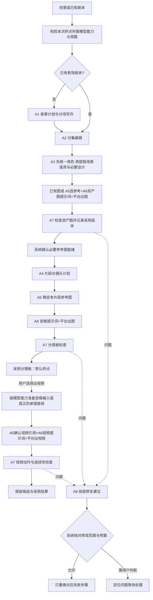

# AI 导演台：工作流评审稿 v0.2

> 2026-10-22。方案详细附件。本地首版已按总方案实现（独立功能分支提交，未发布，测试响应模式跑通，Agnes 真实出图已验，视频受厂商队列阻塞），实现状态以[总方案 §14](ai-director-plan.md#implementation-status)为准。前台沿用当前平台，入口名「AI 导演台」。
> 总评审入口：[AI 导演台完整方案](ai-director-plan.md)。本文作为工作流详细附件；产品范围、声音策略与片段媒体归属以总方案为准。
> v1.1 总方案对齐：导演作品由服务端独立拥有，既有画布不变；整剧连跑首版到分镜图，本集／选中片段可到视频；定时后置；声音样本优先上传、既有 DapVoice 或明确短试音；质检按硬契约／关键内容／非关键质量分级。
> 配套：[八类 Agent 的完整提示词](prompts/ai-director-agents-v1.md)。本文先说明用户怎么做，再说明后台怎么接。
> v0.2 根据 [AID／ViMax 源码对照](audits/ai-director-reference-comparison-2026-10.md) 修订。仍是方案，不代表已经优于参考工程的实测效果。

## 1. 用户只走五步，页面只有三个工作区

**写剧本 → 拆分集 → 准备资产 → 做分镜 → 出视频。**

| 工作区 | 用户看到的内容 | 主操作 |
|---|---|---|
| 剧本 | 总剧本及分集目录；可直接编辑正文 | 生成剧本／拆分集，随当前阶段变化 |
| 资产 | 角色、场景、道具；明确当前选用的参考图 | 补齐参考图 |
| 分镜 | 每集的片段卡；宫格图、关联资产、图／视频提示词及视频预览 | 生成分镜／生成视频，随卡片状态变化 |

写作助手、历史候选、生成设置和运行明细按需展开。视频仍在片段卡内，不再增加一个独立工作台。

声音采用用户本轮倾向：支持所需能力的模型直接生成音画，不设置独立“音画同步”必经步骤。角色资产内按需配置声音描述与采用声音样本，视频提示词按镜头写对白和表演；跨片段复用同一声音基准。重配音／对口型仅作为需要时的修复能力。声音样本绑定已接入，声音连续性仍待实测，不能仅凭原生音轨认为声音连续。模板见 [视觉与声音提示词实操稿](prompts/ai-director-visual-production.md)。

默认真人写实、9:16、中文；模型取平台可用配置。单片段覆盖设置时显示标记。无需手动拖节点或理解 Agent 分类。

## 2. 一键连跑的默认行为

- 范围可选本集、选中片段、整部剧；整部剧首版仅到分镜图，到视频限本集／选中片段。主按钮明确写「本集一键做到分镜图」。
- 默认终点是分镜图；生成视频由用户明确选择。
- 已有剧本、已采用设计、已选图片和有效结果直接使用。
- 手动模式先检查再下一步；自动模式使用启动时选定的采用策略，不逐项弹确认。
- 可自动采用的仅限：空缺处的新草稿、已授权的设计补齐、通过检查的新候选。已有人工内容和已选结果不被自动替换。
- 候选关键项不合格或补证据后仍无法判断时停在具体对象；其他无依赖的分支继续。非关键美学提醒汇总不阻断；人工可逐项核实误判，记录具体媒体和实际状态，不改写成 AI 通过。
- 没有视觉检查模型时明确显示未验证。用户仅选用喜欢的结果，不等于核实关键内容；要继续依赖这些内容的下游任务，须逐项人工核验具体媒体、关键检查项与实际结束状态，保存独立证据，不改写成“AI 检查通过”。自动模式不能绕过此停点，详见总方案 §8.2a。
- 所有后台步骤由平台调度；页面只展示进度和发出操作。

## 3. 后台工作流



实线表示正常推进条件已满足；失败／unknown 不沿正常路径自动前进。图中的 retry 由系统定位原步骤，不从全流程起点重跑。

开始前只检查本次终点需要的能力：到剧本不要求生图模型，到分镜图不要求视频模型。视频单独启用时再检查具体规格；不让无关能力缺失阻断用户写剧本。
在图片花费前核对图像用途与已选模型；用户若已指定后续视频模型，提前把它的时长／多镜头限制传给片段规划。估价不能假定全部内容已知：逐阶段报价，在启动时同意的预算内推进，超限就停。

### v0.2：把工作做细，但不增加用户步骤

- **写剧本内部两步**：先形成故事目标、人物关系、剧情节拍，再分场写正文；已有完整剧本跳过创作。中间计划可按启动时的策略自动采用，不增加长向导。
- **提取按依赖分工**：角色先识别并分配正式身份，场景和道具随后引用这些身份；同阶段独立项目可并行。提取完成由源版本、覆盖范围和三类结果共同判断，不以“已经有一些资产”跳过。
- **造型从主形象派生**：新衣服、侧面／背面视图继承已采用身份基准；只为镜头确实需要且缺失的视角出图。跨年龄保留同一叙事身份，但采用相应年龄造型。
- **先按场次切片段，再逐片段细化**：避免一次让模型输出整季的全部镜头、引用和提示词。每个结果回指原文动作与对白，系统验明无漏项后才显示本集完成。
- **图片参考按用途传递**：A5 说明借用身份、布局还是机位，并指出不要继承的旧姿态；A6 只编译这份结论，不再另做一轮独立选图。
- **宫格与首帧分开**：画面最能说明剧情的时刻可能不是动作起点。逐镜视频必须拿到匹配真正起始状态的首帧，不能无条件裁宫格当首帧。

### 阶段间真正传递什么

| 交接 | 传递内容 | 进入下一步之前 |
|---|---|---|
| 编剧 → 分集 | 已保存的剧本版本、系统段落 ID | 正文完整，未覆盖新的人工作品 |
| 分集 → 资产 | 分集正文引用、剧情摘要、跨集已有资产 | 原文覆盖完整，无漏段或重复归集 |
| 资产 → 片段计划 | 资产身份／造型／场次、选定图片版本 | 所需视觉资产已准备；纯声音资产独立标记 |
| 片段计划 → 宫格 | Shot 顺序、时间、构图、静态时刻、精确参考绑定 | 必要引用有效、模型支持请求规格 |
| 宫格 → 视频 | 同一计划、采用的 Board、实际请求引用、视频提示词 | Board 版本匹配且通过所需检查 |
| 前段 → 后段 | 计划依赖，以及实际检查得到的结束状态／参考帧 | 计划和观察分开，事实不明时等待处理 |

批量返回按稳定 clipId／shotKey 归位，不能仅按模型数组顺序更新。重排或删片段后，旧任务仍归旧输入范围，不把后面的结果错填到前一张卡。

系统先冻结输入版本；Agent 只提出内容和建议，不能自行采用新版本、写任务成功或扣积分。

### 分镜图与视频的两种连续性

只生成分镜图时，可以依据统一计划保持各段设计一致，但页面不声称视频动作已验证。
进入视频生成后，对依赖上一段动作的下一段，必须先取得上一段已确认的真实结束状态。
如果真实结果与下一段计划冲突，保留原图，标记相关计划／分镜图待更新；不能静默沿用错误画面。
互不依赖的场次和资产可以并行，受同一端点并发上限与总预算约束。
机位复用按场次建立局部依赖图；不同场景允许多个独立基准，不强行以全剧第一镜为唯一根。来源图必须已生成并获准使用；系统检查引用无环，不让两个待生成镜头互相等待。
首版不为建立机位默认额外生成一段“过渡视频”；优先复用已有参考或生成一张所需基准图。额外媒体步骤必须有明确用途并进入预算。

## 4. 系统必须兜住的规则

这些是执行条件，不以“模型在提示词里被提醒过”代替代码校验。

1. **引用真实**：回查项目访问范围、资产版本、文件归属和可访问性；受控重签地址。文本中的人物名不能代替文件绑定。
2. **数据不丢**：总剧本和分集共享正文来源；采用拆集结果后，分集正文是编辑真值，总览由它们组合。修改总览也通过同一内容命令保存。
3. **版本不串**：任务保存计划、剧本、参考图、提示词、模型配置及实际请求快照；生成途中发生改稿时，旧任务结果保留为旧候选，不覆盖新稿。结构化分镜默认关闭可选的供应商提示词改写；不可关闭时，能取得的有效提示词另行留档，无法取得则明确标为不可观察，仍按原制作要求检查结果。
4. **规格正确**：验证镜头时间覆盖、格子映射、参考数量、画幅、尺寸、声音和时长。未知能力按不可用处理，不靠提示词声称支持。
5. **结算唯一**：冻结、提交、查询、结算沿用原生任务链；工作流只存任务关联和进度。供应商受理未知先查单，不发起新一轮生成。
6. **逐项恢复**：输入指纹未变且满足当前验收策略的结果复用；失败只重做必要节点。新尝试有新 attempt；网络重放沿用原幂等键。
7. **停止可解释**：停止后不再派发，已受理任务继续查询并按实际结果结算；重新继续时先处理在途任务。
8. **未来定时可恢复**：首版立即执行，定时后置。未来保存 scheduledAt 与内容快照；到点重新校验访问、模型、预算和版本。若内容已变化，要求确认，不能混用新旧正文。scheduledAt 与 durationSec 分开。

建议的首版自动修复策略：每个失败对象最多追加一次媒体重生成，并受用户启动时设置的总预算约束；不自动换模型、不追加预算。网络重放、状态查询不计作新生成尝试；视觉检查等付费请求仍计入预算。此数值是评审建议，未启用。

### 候选与检查的费用控制

- 默认一张候选、一次必要验收；用户主动选多候选时才批量生成。只有一个候选照样检查质量，只省去候选间排名。
- 程序先查文件、规格与绑定，失败就不调用视觉模型。视觉模型先看整板和必要参考，细节不足时再补单格原图或动作区间，不每次重发整剧。
- 保留每个候选的生成结果、失败原因、检查结果及采用理由，多个候选部分失败不抹掉成功项。默认一次补生额度按原逻辑对象累计，不能通过创建新 attempt 重置预算。
- 复用指纹包括内容与参考版本、实际提示词及模板版本、模型／适配配置、规格；检查结果另含检查规则和检查模型版本。生成输入没变而规则变了，只重检，不先重新生图。
- 没有候选需要择优不等于无需验收；VLM 无法判断不等于生成失败。先补证据，再考虑重生成。

## 5. 宫格与模型能力的关系

- Clip 是生成片段，Shot 是其中的镜头，Board 是这些镜头静态画面的布局。
- 系统分别保存 boardAspectRatio、cellAspectRatio、videoAspectRatio。等大无间隙网格时，整体比例 = 列数 × 单格宽 : 行数 × 单格高；有分隔带则按实际像素另算。
- 2×2、每格9:16的板，整体可以是9:16；不能由此推导所有布局都应整体9:16。
- 仅在模型适配经过验证后使用 grid_reference。不能把整板当作普通首帧，期待模型自动变成正常视频。
- per_shot 路径需要有效单格关键帧和匹配的子镜时长；裁切后还要检查画面完整、比例、像素及必要人物，不把裁切成功等同于合格。
- 先比较宫格代表时刻与 firstFrameState：一致才允许裁切复用；不一致则依据已采用设计、参考与计划另外生成真正首帧。lastFrameState 保留在计划，只有所选路径确需尾帧时才生成尾帧图，避免无谓花费。
- 如果模型最短时长大于某镜头，先调整经确认的计划或换支持的模型；不静默拉长视频，也不随意改剧情。
- 视频候选最终仍关联回原 Clip；必要拼接复用平台已有能力，不新增专业剪辑工作台。

## 6. 用一个片段看看实际会产出什么

以下是手写的逻辑演示，不是模型运行结果。ID 和图片只是说明绑定关系，系统真实调用不得使用这些占位记录。

**已采用的剧情：** 夜晚，林夏进入旧书店。她从桌上拿起红色信封，翻过来看背面；听见身后的门响，她停下并回头，信封一直留在右手。

**已采用资产：** 林夏及米色外套造型、旧书店的布局、红色信封外观。书店东墙有门、北墙有书架、中央有木桌；这些布局是已采用的制作设计，不冒充原剧本事实。

**片段计划：** 8秒、4镜、2×2分镜板，最终视频9:16。本例仅在模型支持相应时长和多镜头方式时可执行。

| 镜头 | 时间 | 分镜图描绘的时刻 | 视频要发生的动作 |
|---|---|---|---|
| S1 | 0–2秒 | 林夏从东墙门内进入，木桌与红信封可见 | 她进门，走向木桌 |
| S2 | 2–4秒 | 右手刚拿起信封，信封离开桌面 | 右手伸向桌面并拿起信封 |
| S3 | 4–6秒 | 信封背面朝向林夏，她低头看 | 她用右手翻转信封并查看背面 |
| S4 | 6–8秒 | 她回头看向东墙门，右手仍握信封 | 她因身后动静停顿并回头 |

**不能直接裁图当首帧的例子：** S2 的宫格代表图是“信封已经拿起”，其视频首帧却必须是“信封还在桌上，右手尚未拿起”；尾帧才是“右手持有，桌面无副本”。S3 的首帧应是翻转之前，S4 的首帧应是尚未回头。grid_reference 把整板当动作编排参考；per_shot 则分别准备正确首帧，不能让人物从已完成动作的图开始再做一遍。

**A5 输出的绑定，经系统确认后：** R1=林夏采用的造型图片，R2=书店布局图片，R3=红信封图片。每条实际包含图片版本、文件 key、用途和请求位置。

**A6 的宫格图片提示词示意：**

```text
真人写实，夜晚旧书店。生成2×2等大分镜板，整体9:16，每格9:16，按左上、右上、左下、右下阅读。
人物身份与米色外套依据R1；空间布局依据R2，门在东墙、书架在北墙、木桌居中；红信封外观依据R3。
左上：中景，林夏刚从门内进入，视线朝向木桌，桌上的红信封可见。
右上：手部近景，林夏右手刚拿起信封，信封已经离开桌面，桌面不再有另一只信封。
左下：中近景，林夏低头看向右手持有的信封，信封背面朝向她。
右下：中景，林夏停下并回头看向门，右手仍持同一信封。
四格沿用相同身份、服装、光照及布局；每格只有一个静态时刻。图内不绘制镜号、字幕、对白气泡或水印。
```

**A6 的视频提示词示意（仅针对已验证支持宫格参考的适配）：**

```text
依据已采用分镜板B1制作8秒、9:16的真人写实片段。分镜板用于指定镜头，视频每一时刻只显示一个完整画面，不显示宫格。
0–2秒：对应左上格，中景，林夏从门内走向木桌。
2–4秒：切换至右上格对应的手部近景，右手从桌上拿起红信封；拿起后桌上不残留另一只信封。
4–6秒：切换至左下格对应的中近景，她用右手翻转信封并低头看背面。
6–8秒：切换至右下格对应的中景，她突然停顿，回头看向身后的门；信封始终留在右手。
保持已采用的人物、造型、场景布局和信封外观，不增加人物或剧情，不生成字幕。
```

门响只有在实际声音能力允许时进入音频指令；否则记录为未制作的声音需求，不能对用户声称成片已经有门响。

**A7 应检查：** 林夏是否同一人、右手是否真的拿起信封、是否翻转、是否回头、信封是否中途换手／消失、门与书架关系是否正确、视频是否错误保留宫格。

如果最后信封出现在左手：该候选不合格。A8 只建议修复这个 Clip 的相关动作约束并重生成视频，保留已正确的资产与分镜板。
如果仅有首尾截图：拿起与翻转动作标记 unknown，先补看动作区间，不直接重花一次视频生成费用。

## 7. 提示词与工作流的验证设计

首轮评测使用固定小剧本及版本化素材，不用“能返回 JSON”作为效果通过标准。

| 用例 | 预期 |
|---|---|
| 两集同一个人，第二集出现别名和换装 | 同身份、不同造型；不重复建人 |
| 同一房间白天与夜晚 | 同布局、不同场次状态 |
| 旁白只有声音 | 记录音频依赖，不阻止流程去等待人物图 |
| 缺少关键道具图 | 对应片段阻止生成，列出具体缺项 |
| 必要参考数超过模型限制 | 提出可行调整，不丢引用硬跑 |
| 新候选都不像原人物 | 可以排序，但无候选通过 |
| 正反打使人物换到画面另一侧 | 按机位、空间及视线判断，不机械判错 |
| 视频漏做交接动作／道具换手 | 视频不通过；静态分镜通过不替代视频验收 |
| 任务期间用户改稿或换图 | 老结果进入历史，不覆盖新版本 |
| 页面关闭、服务重启、部分失败 | 恢复真实任务，只推进剩余有效步骤 |
| 供应商受理未知 | 查询／对账，不新建付费生成 |
| 库里已有一个角色，但新稿增加场景与道具 | 按改动范围补提取，不跳过整个资产阶段 |
| 同人物换装／需要侧脸，已采用基准存在 | 继承身份并补必要差异，不重造人物 |
| 参考清单由原来的第2、5张筛成两张 | 正确映射到请求位置，提示词与实际图片顺序一致 |
| 宫格代表图是拿起之后，视频要表达拿起过程 | 逐镜模式生成真正的起始帧，不用错误的动作终态当首帧 |
| 只生成一个候选 | 仍执行质量检查，不因无需排名自动通过 |
| 选择9:16图片，宽小于高 | 按实际规格验证，不套用横屏限定 |
| 生成内容没变，仅检查规则升级 | 复用媒体并重新检查，不重复花生图费用 |
| 相同数据在模型输出中发生顺序交换 | 以稳定 ID 归位，不按数组顺序错写结果 |

先做结构和依赖验证，再做少量真实模型验证；记录提示词版本、模型配置、输入快照、候选、逐项检查、人工评价及费用。未进行的验证明确写“未验证”。
真实比较时固定同一小剧本、素材、模型及预算，对比 v0.1 与 v0.2 的原文覆盖、人物／道具一致性、动作完成率、人工修改次数、成本与耗时；候选顺序随机化后人工复核。没有这一步，不能声称 v0.2 的实际质量已提高。

## 8. 本轮交付边界

已交付八类 Agent 的提示词正文、输入输出草案、工作流、采用和修复规则、片段示例与评测设计。
尚未实现接口、数据库、Skill 注册、提示词后台配置或 UI，也没有生成真实图片／视频。
后续先把“剧本 → 资产 → 分镜图”做成可验证闭环，再启用匹配模型能力的视频路径。
