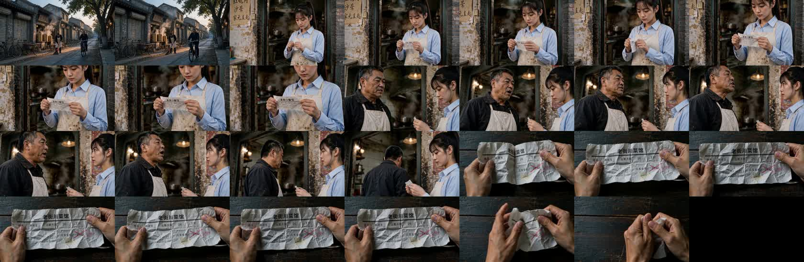
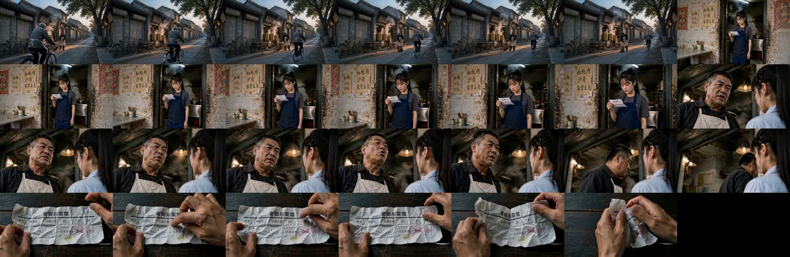
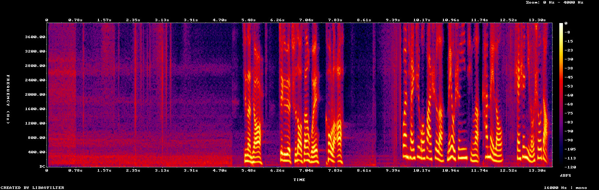
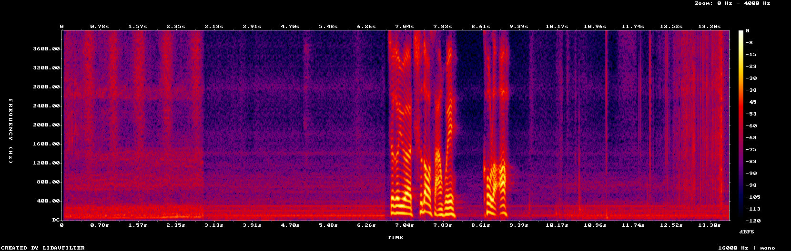

# 导演台 H3 优化稿超长与中文提示词被念出（《扣钱》cl45，2026-10-31）

用户反馈：导演台一段 14 秒 H3 全能参考视频，成片末尾有不需要的声音。这份记录是只读取证的结果和据此做的修改。

## 1. 线上事实（只读核对）

| 项 | 值 |
|---|---|
| 片段 | 作品 `DW-85f0902c…`，片段 `cl45`，4 镜 14 秒，参考图 6 张（分镜 2×2 + 静儿、餐馆老板、两个场景、工资条），无声音参考 |
| 提示词优化任务 | `IPR-e78abf62…`，端点 `ai-studio-jusuan-qwen38`，冻结 58、实扣 12、退回 46 积分 |
| 优化稿 | 模板 8198 字符，填进台词 8226，`usable=false`（超过 7000） |
| 视频任务 | `mvj_51278d7fd499`，`optimize_prompt:false`，发出的是 758 字中文原文，候选记 `promptChoice=original` |

优化稿各段长度：

| 段 | 字符 | 英文词 |
|---|---|---|
| subject_definitions | 2403 | 402 |
| summary | 557 | 86 |
| retention_analysis | 1551 | 229 |
| detailed_description | 3276 | 551（官方建议 350–500） |
| overall_soundscape | 286 | 44 |

主体说明与保留说明合计 3954，占全文近一半：五个资产的中文描述被逐条翻译进主体说明，保留说明又把同一串特征列了一遍。
只把保留说明里 fully_preserved 的行截到关系标记，全文是 7029，仍超 29 字符；所以主要靠给模型篇幅预算，截断只做兜底。

## 2. 成片（下载后本机分析，工作文件不入库）

- 画面：第三镜老板在画面里开口说话（和分镜图、动作描述一致，和提示词里「画面里只有静儿」「老板在画外说」相反）；镜头切换约在 1 / 5 / 9 秒，要求是 3 / 6 / 10 秒。
- 声音（频谱）：5.4–8.0 秒是清晰人声，和老板张嘴对得上；9.7–13.5 秒又有一段约 4 秒、十几个音节的清晰人声，这时画面只有一双手在揉工资条。
- 转写（本机 whisper large-v3 与 small，两者一致）：前一段是台词「这个月迟到三回 扣了啊」；末段含混，两个模型都听出「没有声音」。
  0–5 秒转出的「请不吝点赞订阅…」是 whisper 对近静音的常见幻听，不算。

判断：末段很可能是 H3 把中文原文【声音】段里「餐馆老板 没有声音参考，按人物身份自然配音。」念了出来 ——「没有声音」在 758 字提示词里只出现在这一句，约 18 字对上约 16 个音节。
转写本身含混，不算逐字确认；同类现象 A/B 实测见过一次（F3 念出「陈默的设定图」，`director-h3-video-prompt-ab-2026-10.md` §6）。修好与否要靠新成片复验。

## 3. 第三镜矛盾的原因

资产名「餐馆老板」，别名里有「老板」；分镜写的是「老板站在静儿面前…说完，转身走」。旧的出镜判断只认全名，认不出老板，
于是写成「画面里只有静儿」，又把他判成画外（「餐馆老板在画外说…画面里的人嘴闭着」）。优化稿忠实照抄了这个错误。

## 4. 修改（分支 `fix/h3-prompt-system-notes`，本地未发布）

1. **中文视频提示词第 4 版**（`DirectorPrompts.videoPrompt`，`VIDEO_PROMPT_FORMAT=4`）：去掉写给系统的话 ——
   「参考图N 是X的设定图，图里的人像都是X一个人」「X 没有声音参考，按人物身份自然配音」「只借声音，说的是上面引号里的台词」「人物只说引号里的台词」。
   保留谁照哪张图、谁的声音照哪段音频、哪格对应哪镜；「画面里没有字幕」并进风格那一句。第 3 版原样冻结为 `videoPromptV3` 核对旧视频。
2. **出镜判断**（`castOfShot`）：按名字和资产别名认；称呼所在小句有画外线索词（门外、传来、声音、想起…），或一个称呼对上几个人，记作分不清，
   这时只写「X说：「…」」，不写「画面里只有」「画外」「嘴闭着」，片段上给一条提示。第 2、3 版用的旧判断 `castOf` 冻结不改。
   写分镜的提示词要求人物用资产名或别名，画外的声音在 action 里写清从哪来。
3. **改写篇幅预算**（`H3PromptRewrite.LENGTH_REF / LENGTH_BASE`，规则修订号 `RULES` 记进任务输入、不进指纹）：主体说明每项至多两句、只写识别特征；
   保留说明每个标签一行、不重列特征；全文约 850 词。只是目标，是否收得下仍以填完台词的全文为准。
4. **超长兜底**（`trimFullyPreserved`）：只把 fully_preserved 行后面的重复说明删掉再量一次；部分保留、属性迁移、音频复制的说明一律不动，仍超就标不可用。
5. **重新优化**（任务类型 `video-prompt`）：只出新稿、不带 `then`、不接着出视频，完成后清掉旧的「用原文 / 用优化稿」选择；失败时旧稿保留。
6. **用稿记录**：提交视频时在候选上固定 `promptUsed / promptReason / draftState / rewriteRunId / rewriteCost`；一键制作因超长改用原文时发通知。

## 5. 用新方法重跑 cl45（2026-10-31 夜，本机直连聚算，未经线上 Studio）

用线上 cl45 的作品数据跑新代码，生成第 4 版中文稿与改写输入；改写模型与线上同一端点同一模型（`qwen38-27b`，温度 0.6、输出上限 8192）；
H3 请求与线上原任务同参数（全能参考、768p、16:9、14 秒、`optimizePrompt=false`、同一组 6 张参考图同顺序），提示词换成新的英文优化稿。
钱走的是聚算账号，没有经过本仓计费，也没有改用户作品。

**改写（真调 4 次）**

| 次 | 全文字符 | 正文词数 | 结果 |
|---|---|---|---|
| 1 | 3490 | 287 | 可用；分镜图标成 `weak_reference` |
| 2 | 3316 | 304 | 可用，但**整份稿没提分镜图** |
| 3（约定补「每份参考素材都要有一行」后） | 4501 | 307 | 可用，无提示；分镜图 `fully_preserved` |
| 4（同上） | 3625 → 4017 | 339 | 又漏了分镜图，代码按素材清单补回后可用，只记一笔 |

线上那次是 8226。篇幅预算一收紧，模型会把参考素材整份漏掉（4 次漏 2 次），所以加了第二个提交：约定写明每份参考素材都要有一行，漏写的由代码按交给模型的素材清单补回英文说明。
分镜正文仍在 290–340 词，低于官方建议的 350 词，约定里写了「不少于 350」也没完全做到，暂不再加码。

**成片（用第 3 次那份，H3 任务 `job_a836be15…`，385 秒出片，1344×768，13.7 秒）**

| | 线上（中文原文） | 新方法（英文优化稿） |
|---|---|---|
| 切镜 | 约 1 / 5 / 9 秒 | 约 3 / 6.5 / 10 秒（要求 3 / 6 / 10） |
| 第三镜 | 老板出镜说话（提示词却写画外） | 老板出镜说话，静儿背身听 |
| 人声 | 5.4–8.0 秒台词 + **9.7–13.5 秒多出约 4 秒人声** | 只有 6.8–9.2 秒台词，第四镜没有人声 |

仍要留意的两处：
- 两个转写模型都把这句听成「这个月吃到散灰（散回）扣了啊」，线上原版转写是准的。这句的发音要人工听。
- 第三镜里静儿是浅色衬衫，第二镜是深灰 T 恤加深蓝围裙（设定图），同一条片里不一致。线上那条静儿全程浅色衬衫。可能来自分镜图第三格，没有查证。

## 6. 没做 / 待验证

- 只验证了这一段、一次出片；台词密集片段和画布非全能参考模式的改写还没真调。
- 本仓线上还没发布这两个提交；线上 Studio 里点生成仍是旧逻辑。

- 首帧出片模板（`framePrompt`，非 H3）结尾仍有「只说上面列出的台词，不增加人物或剧情，不生成字幕」，这次没动（改了会让已有首帧视频被标需更新），见 TODO。
