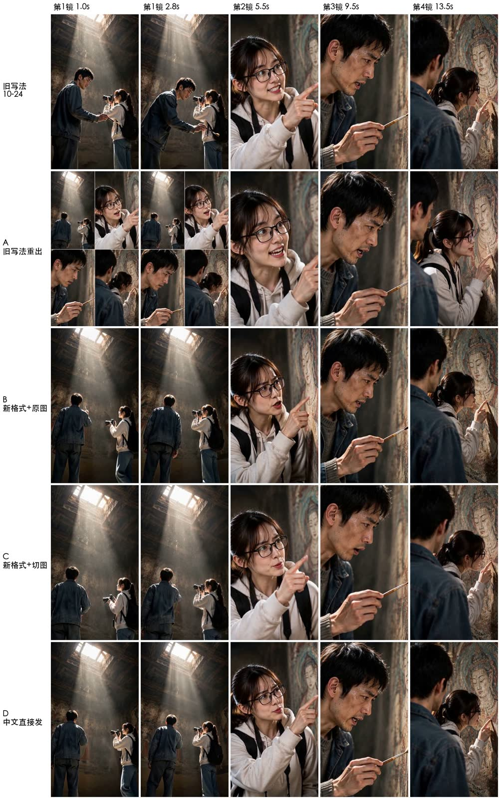
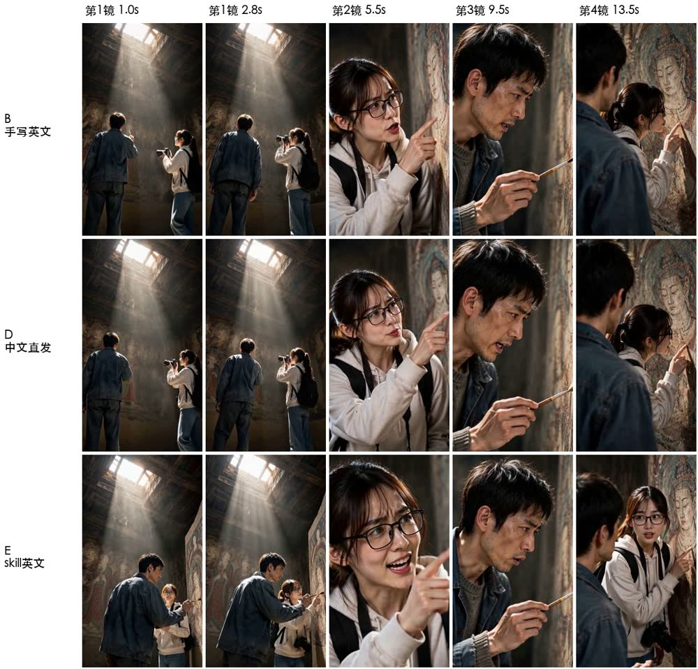
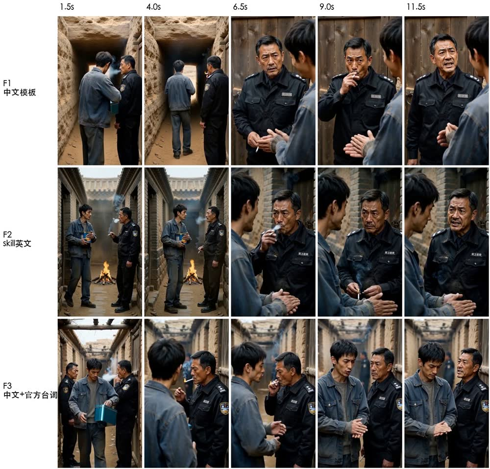

# 导演台视频提示词对比实测（H3，2026-10-26）

> 用线上作品《敦煌飞仙的玄幻故事》（`DW-173602e27bff47cfbc55`）第 2 集第 1 段「飞仙之眼」（`cl56`，15 秒、4 镜、两人三句对白），
> 同一份分镜脚本、同一个模型（聚算 `minimax-h3`，全能参考、768p、9:16、15 秒），只换提示词写法或参考图，各出一条比较。
> 结论用于 `DirectorPrompts.videoPrompt` 的改版。每种写法只有 1–2 条样本，看方向，不当统计结论。

参考依据：聚算 H3 文档站 <https://price.jusuanhub.com/> 的《H3 提示词入门》《H3 一致性入门》（官方三字段 / 六段结构、台词写进说话那一句、画外音闭嘴、排他句、正向写法、参考图像素预算）。

## 1. 做了什么

| 编号 | 提示词 | 参考图 | 厂商改写 |
|---|---|---|---|
| 10-24 旧片 | 导演台旧模板（[prompt-A.txt](director-h3-video-prompt-ab-2026-10/prompt-A.txt)）| 宫格整图 + 两张角色设定集 | 关 |
| A | 同上，重出一条 | 同上 | 关 |
| B | H3 六段结构，英文画面描述，台词原文写进说话那一句，每镜写明画面里只有谁，第 1 镜写清站位（[prompt-B.txt](director-h3-video-prompt-ab-2026-10/prompt-B.txt)）| 同 A | 关 |
| C | 同 B，只改参考图说明 | 宫格切成 4 张单格 + 两人各一张正脸、一张全身（共 8 张） | 关 |
| D | B 的内容整份写成中文结构（[prompt-D.txt](director-h3-video-prompt-ab-2026-10/prompt-D.txt)）| 同 A | 开（**超时，厂商退回原文出片**） |

A→B 只换提示词，B→C 只换参考图；D 原想测厂商智能优化，结果 `promptOptimization.status=timeout`、`promptSource=original_fallback`，实际测成了「中文结构化提示词直接发」。
出片走服务器上直连聚算（请求形状与导演台一致），未进入任何用户账本。

## 2. 结果

| | 第 1 镜（两人同框全景） | 第 2–4 镜 | 台词 |
|---|---|---|---|
| 10-24 旧片 | 穿模：陈默转身对着林小雅，刷子穿进她身体 | 正常 | 三句完整，落在对的镜头 |
| A | 前 4.4 秒画面就是 2×2 宫格，四格一起动 | 正常 | 三句完整 |
| B | 两人分开站，无宫格、无穿模；陈默没在刷壁画 | 正常，切镜与台词对齐 | 三句完整 |
| C | 同 B | 正常 | 三句完整 |
| D | 同 B | 正常 | 三句完整 |

台词核对用 whisper large-v3 转写 + 0.25 秒音量窗确认人声起点（转写段落的起点会粘到 0 秒，单看它会误判）。
五条的语速都在每秒 6–7 字，高于文档建议的每秒约 4 字，但都没被截断。

## 3. 结论

1. **出事的是两人同框的第 1 镜，根子在提示词，不在参考图。** 旧模板两条都出事（一次穿模、一次把宫格当画面拍出来），
   新结构三条都没有；A 与 B 参考图完全相同。旧模板里「禁止出现格线、多格并排」没有起作用 —— H3 没有负面提示词，
   否定句只是弱约束。
2. **切宫格、换单人参考图（C）这一段看不出差别**，可以缓做。
3. **中文还是英文这一段看不出差别（D ≈ B）。** 起作用的是结构：每镜画面里有谁、站位朝向、台词写进说话那一句、听的人闭嘴、宫格只取构图。
   导演台因此直接发中文，用户看到的就是发出去的，不加翻译步骤。
4. **厂商智能优化不可靠**：这次超时退回原文；2026-10-20 还出现过改写器把中文台词删到只剩两个字（见 `docs/ip-studio-video-modes.md` 末节）。导演台继续关着。
5. **这一段没复现「台词不对」**，需要另找台词更长、说话人不在画面里的片段验证。
6. 新结构的剩余问题：第 1 镜「两人分开站」压过了「刷壁画」这个动作，分镜脚本的动作要写得更具体。

## 4. 落到代码

- `DirectorPrompts.videoPrompt` 改成中文 H3 结构：【人物】【分镜参考】【画面】【声音】【配乐】无；不写否定清单、画幅和总时长。
- 「这一镜画面里有谁」目前按镜头描述里点到的角色名认（`castOf`），分镜脚本补出镜人 / 站位字段之后改读字段。
- 旧模板保留为 `legacyVideoPrompt`，只用于核对旧格式生成的视频，不让换模板把已采用的视频都标成「已修改」；新生成的视频候选记 `promptFormat`。
- 未做（后续）：分镜脚本补每镜出镜人、站位朝向视线、每镜台词字数上限、环境声；台词多的片段复测。

## 5. 新模板对照官方自检（2026-10-26 补）

用新模板生成《敦煌飞仙》四段（飞仙之眼、深夜通话、通道对话、空室异响），按《H3 提示词入门》第 10 章 14 项与《H3 一致性入门》6 项逐条核对；
再把「飞仙之眼」「深夜通话」交给聚算独立优化接口（`POST /media/prompt-optimizations`，只返回改写稿、不出片）当官方写法的对照。

**模板本身已经达标的**：分段结构；台词原文写进说话那一句；画外音标「在画外说」并让画面里的人闭嘴；听的人闭嘴；只有一人时写「画面里只有」；
切镜写时间点；不写「禁止」清单、画幅和时长；每段【人物】锚点句一字不差地复用；配乐写无。

**没达标的，大多来自分镜脚本的内容，不在模板**：

| 官方要求 | 现状（举例） |
|---|---|
| 每镜台词约每秒 4 字，超过约 9 字/秒会被静默截断 | 「通道对话」第 2 镜 7 秒里两人三句共约 69 字（约 10 字/秒）；「飞仙之眼」第 2 镜 3 秒 25 字 |
| 双人对话拆成说 → 答 → 听，不让两人同时动嘴 | 「通道对话」三句台词都塞在同一镜 |
| 运镜写成类型 + 幅度 + 速度，一镜一个 | 机位多写目的：「展现尘埃翻滚与人物渺小感」「捕捉面部表情变化」；还有二选一：「再反打或双人构图」「主观视角或过肩镜头」 |
| 感受翻成看得见、听得见的东西 | 「氛围压抑」「压迫感」「惊恐之色」「疲惫而坚定」 |
| 图已定义的外貌，文字不再描述（文字会压过照片） | 画面 / 动作里写「眼窝深陷，胡茬凌乱」「头发凌乱」 |
| 台词带音色、语气 | 分镜没有语气字段，只能写「某某说」 |
| 环境声写这个场景里真实存在的声源（声画同界） | 没有环境声段；「空室异响」靠丝绸摩擦、吊扇吱呀制造悬念，【声音】只写了「这一段没有对白」 |
| 多人时写视线、朝向、站位 | 分镜没有站位字段（已在 TODO） |
| 一段一件事 | 分镜规则要求加「生活化冗余动作」，动作越多越容易互相抢 |
| 风格句写类型 + 质感 + 色彩 + 一个明确光源 | 只有「真人写实风格。」 |

**官方优化器对照**：两段都改成英文六段式，补上了**环境声**（洞窟回声、刷毛擦过墙面、衣料摩擦；口袋放手机、呼气），
把「渺小感」这类说法换成看得见的东西，台词原文、说话人编号（S1/S2）和闭嘴都保留了。
但它**删掉了排他句**（「各只出现一个」「画面里只有林小雅」），**删掉了切镜时间点**，还按图重新描述了外貌，而且描述错了：陈默的灰色毛衣写成了 grey shirt。
所以照搬改写器并不可取：它补的环境声和「抽象说法转成看得见的」值得学，模板里排他句和切镜时间要保留。

**改进清单**（分镜脚本为主）：
1. 每镜台词不超过「秒数 × 4」个字，超了拆到下一镜或下一段；双人对话一镜一句，说 → 答 → 听。
2. 机位改成运镜：固定 / 推 / 拉 / 摇 / 移 / 跟，加幅度、速度，一镜一个；不写二选一，不写「展现 / 营造 / 捕捉」这类目的。
3. 动作和画面里不写外貌，不写抽象情绪词，减少冗余小动作。
4. 每镜补出镜人、站位朝向视线；每句台词补语气；每段补环境声（这段场景里真实存在的 1–3 个声源）。
5. 模板：加【环境声】段；风格句带上场景的光源和色调。是否去掉与动作重复的「画面」描述，需要另做对比。

## 6. 官方 skill 改写对比（2026-10-26 晚）

MiniMax 官方公开了 H3 提示词写法 skill（github.com/MiniMax-AI/MiniMax-H3，`.claude/skills/h3-prompt-writing`：SKILL.md + `references/base-en.txt` + `references/ref-en.txt`，适用 MiniMax H3 Community License）。
它是给改写模型看的写法规范，聚算智能优化的输出与它同形。这一轮用线上同款 Qwen3.8 27B，以 skill 全文作系统提示词（约 1.05 万 token），
输入中文模板提示词 + 参考图清单 + 资产设定文字，改写成英文六段式，再出片比较。厂商改写一律关闭。

| 编号 | 片段 | 提示词 | 参考图 | 台词 |
|---|---|---|---|---|
| E | 飞仙之眼（15 秒、三句 65 字） | skill 改写英文（[prompt-E-skill.txt](director-h3-video-prompt-ab-2026-10/prompt-E-skill.txt)） | 同 B、D | 三句完整；第一句提前到全景里开口 |
| F1 | 通道对话（12 秒、两人三句 74 字，第 2 镜 7 秒约 69 字） | 中文模板（[prompt-F1-zh.txt](director-h3-video-prompt-ab-2026-10/prompt-F1-zh.txt)） | 陈默、老赵设定图（该段尚无分镜图） | **陈默整句没了**，只剩老赵两句，夹着两声「难受」 |
| F2 | 同上 | skill 改写英文（[prompt-F2-skill.txt](director-h3-video-prompt-ab-2026-10/prompt-F2-skill.txt)） | 同 F1 | **三句完整、逐字**；模型把第一句挪进第 1 镜，三句铺满 12 秒（约 6 字/秒） |

观察：

1. **台词放得下时，写法差别不大**：E 与 B、D 相当（E 里陈默真的在刷壁画，但两人贴得很近、第一句提前开口）。
2. **台词超量时，官方台词写法明显更稳**：同一段、同一组参考图，中文模板吞掉一整句，skill 版三句全说完。差别集中在台词那一句的写法：
   skill 版是 `<Subject 2> (S1) speaks in a rough, gravelly voice: <d>[Chinese] …</d>`（说话人编号 + 音色 + `<d>` 标签），
   中文模板是「老赵说：「…」」。样本各一条，可能有随机成分。
3. **改写模型会写错说话人编号**：两段都漏过 `(S1)/(S2)`，「通道对话」补了要求重试一次仍漏一句。上线的话，台词和编号必须由代码填，模型只留占位。
4. **改写模型会误解原文**：分镜写「火光一明一灭」（烟头），改写成 a flickering firelight source，F2 在通道中间生出一堆篝火；场景也从沙土洞窟通道变成了带瓦檐的砖巷。F1 的场景更贴原文。
5. 无论哪种写法，**台词密度都要在分镜脚本里控制**：F2 保住了台词，靠的是挪镜头、提语速，并不是 7 秒说完了 69 字。

下一步候选：在中文模板里直接用官方台词写法（「老赵（S1，嗓音粗哑低沉）说：<d>[Chinese] …</d>」），不经翻译，单独测一条，
看能否拿到 F2 的台词完整度而没有翻译误解；不行再上「skill 改写 + 代码填台词 + 校验」的整条链。

### 6.1 补测 F3：中文模板 + 官方台词写法

F3 与 F1 只差台词那一句：`老赵（S1，嗓音粗哑低沉）说：<d>[Chinese] …</d>`（[prompt-F3-zh-d.txt](director-h3-video-prompt-ab-2026-10/prompt-F3-zh-d.txt)），
音色描述取自 F2 改写模型写的英文，其余文字、参考图、时长与 F1 相同。上面「通道对话」对比图的第三行即 F3。

| | 台词 | 多余的话 | 人物 |
|---|---|---|---|
| F1 中文模板 | 陈默整句没了 | 开头一段听不清的「叫我时当发小」 | 正常 |
| F2 skill 英文 | 三句完整 | 无 | 正常（多了篝火，见上） |
| F3 中文 + 官方台词 | 三句完整 | **第一句里夹进「陈默的设定」**（两个转写模型都听到，约 0.9 秒） | **第 1 镜出现两个老赵**，第 2 镜背景多出穿制服的人 |

判断：

1. 说话人编号 + `<d>` 标签确实让台词更完整（F2、F3 都三句全，F1 丢一句）。
2. 但提示词正文是中文时，模型分不清哪些中文是要念的：F3 把【人物】段里「陈默的设定图」念进了台词，F1 开头也有一段念错的话。
   F2 正文是英文、只有 `<d>` 里是中文，没有这个问题。这正是官方规范要求「正文写英文、台词保留原语言」的道理。
3. F3 的双人重复与写法的关系不确定（同一组参考图下 F1、F2 都没有），样本各一条。

结论：台词多的片段，**英文正文 + 中文 `<d>` 台词**最稳。走这条路就要有改写步骤，所以要同时堵住改写的两个坑：
台词与说话人编号由代码填；分镜脚本里的描述写具体（「烟头的火光一明一灭」，不写「火光一明一灭」），减少改写误解。
