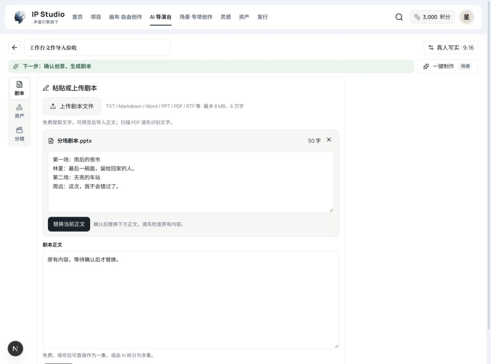

# 导演台剧本文件导入验收（2026-10-25，本地未发布）

范围：导演台新建作品的「导入剧本」及已有空稿作品的「粘贴或上传剧本」。支持的文件、大小、字数和编码真值见 `docs/ai-director-plan.md` §3.1。

## 自动检查

- 后端离线编译通过。
- `StudioStoryImportServiceTest`、`StudioStoryImportControllerTest`、`DirectorScriptImportControllerTest`：14 项通过，0 failures/errors。真实生成的 DOCX、PPT、PPTX、PDF、RTF 和旧 DOC fixture 验证文字读取；覆盖中文编码、段落顺序、6 万字边界、不截断、旧画布 24000 字边界、扫描/加密/受限 PDF、损坏/空/大文件、PPT 页数限制与登录要求。
- 新增 `director-script-file.test.tsx`：5 项通过，覆盖两个真实入口的上传、预览、确认替换、编辑保存、创意/剧本分开保留、错误保留原文、取消后的迟到结果丢弃。与剧本编辑、模板来源两个相邻测试一起定向运行：21 项通过。
- `pnpm typecheck:all`、`pnpm typecheck:admin`、`pnpm check:api-contract`、`git diff --check` 通过。
- 一次全量 web-aiavatar 回归：1209 通过、3 失败。失败项为 `select-field-wiring.test.ts`（admin 审核页现有原生 select）、`studio-script-editor.test.tsx` 的保存错误文案、`studio-template-source.test.tsx` 的视频预览。未修改本次范围以外的功能：干净 main `6c6392a4` 定向重跑这 3 文件，16 通过、1 失败，仅原生 select 检查稳定失败；本分支后两个文件与新增导入用例定向运行全部通过。因此不宣称全量前端测试通过。

## 真实浏览器及本地 HTTP

隔离环境：Chrome → `127.0.0.1:3017` → 新建的本地 Spring Boot `127.0.0.1:18083`，独立内存 H2，开发种子账号。仅本地验证临时关闭 enrollment guard；生产鉴权和开通规则未改。测试结束已关闭这两个临时服务并还原 Next 自动生成的 tsconfig 变更。

1. 新建作品 → 导入剧本 → 上传真实 `夜市剧本.docx`：读取两场中文对白，全文预览 50 字；点击「使用文件内容」后追加人工编辑，再创建作品 `DW-4431c71d6d1f450597c5`。刷新后人工追加的「【手动修改后保存】」仍显示，已保存状态正确。
2. 创意新建作品 `DW-5ce297c49a53438e90f4` → 工作台切「已有剧本？粘贴或上传」，先输入原有正文。
3. 上传无文字层的 PDF：HTTP 400，明确提示扫描件先识别文字；原有正文仍在，没有自动保存、替换或新增生成任务。
4. 上传真实两页 `分场剧本.pptx`：HTTP 200，按页顺序提取两场对白，全文预览 50 字；原有正文保留，只有点击「替换当前正文」才改编辑框。
5. 点击「保存剧本」→ PATCH 200 → 刷新，PPT 提取正文完整保留，状态为已保存。
6. 前后积分均 3000；未点击拆分、生成、一键制作，未调用模型或生产服务。

此次仅提交代码并合入主线，不发布新功能、不重启生产。生产上线需同时发布 server 和 web-aiavatar；现有格式错误修复和数据库应急扩容的发布状态不由本功能改变。
