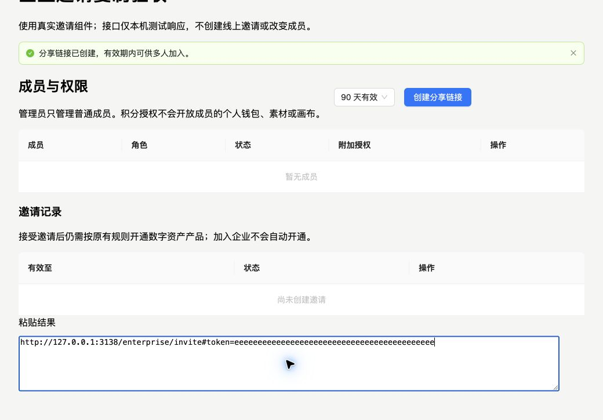

# 企业邀请链接复制修复 · 生产发布

- 2026-10-23，Release ID `20261023-enterprise-invite-copy`，仅 `web-aiavatar`。
- 功能合入并推送 main，从干净 main `a2fd814a3c752e73915ca4642ca0d10b9a9d0597` 构建；未携带原工作区其他未发布改动。
- Studio BUILD_ID：`wp4Wio8nlYxg2hIF3d72x`，本地与线上一致。
- 企业页脚本 `app/enterprise/page-fbdb5ca3383043ed.js` 本地、远端和公网下载 SHA-256 一致：`5766e44cca0db1f1104b0a2a37239f19bd80d1cefc1a600236459a39fb36d87e`。
- 后端未发布、未修改企业规则/邀请码/有效期/成员。生产 mock/dev-login 关闭，OIDC 与企业入口构建配置沿用现网。

## 问题与修复

用户反馈点「复制邀请链接」后粘贴仍是一张图片。旧按钮直接访问 navigator.clipboard.writeText：API 缺失会同步抛错，拒绝则只在弹窗外显示失败信息；用户看不到，原剪贴板内容仍保留。

现在优先使用原生纯文本复制；不支持或拒绝时，选中弹窗内真正可见的链接框，通过 copy 事件清除其他格式并写入 text/plain。备用路径必须同时得到 copy 命令成功和实际文本写入事件，才显示成功。两条路径都失败则保留完整选择，在弹窗内提示手动复制；不显示假成功，不打开额外 prompt。复制期间防重复点击，创建邀请的 API、幂等键和有效期原样保留。

## 验证

- 22 项相关回归通过，涵盖原生异步成功、拒绝后降级、完整纯文本、缺少实际 copy 事件、失败选中链接、重试不创建新邀请、原有企业工作区与链接形状。
- 工作区/后台类型、后端离线编译、API 契约检查通过。
- 使用真实 EnterpriseManagement 组件与 Ant Design 弹窗构建隔离浏览器验收页，接口只返回本地无效测试邀请；未创建线上企业或邀请、未更改成员。
- 正常路径读回剪贴板为 text/plain 并用系统 Cmd+V 粘贴完整链接；API 缺失和 API 拒绝两条路径分别粘贴不同测试 token（d 与 e），确认写入新内容而非旧链接。旧版本 API 缺失时保留了预置图片。
- 不等同于微信客户端真机验收：本轮在 Chrome 前台模拟剪贴板缺失/拒绝，使用系统实际粘贴。浏览器自动化页级 clipboard 读回不作为旧式 execCommand 路径的唯一判据。
- 正式构建/部署/verify 全绿，服务 active，企业页公网 HTTP 200；公网脚本与正式制品逐字节一致。该提交未产生 GitHub 自动 workflow run，未冒称 CI。

