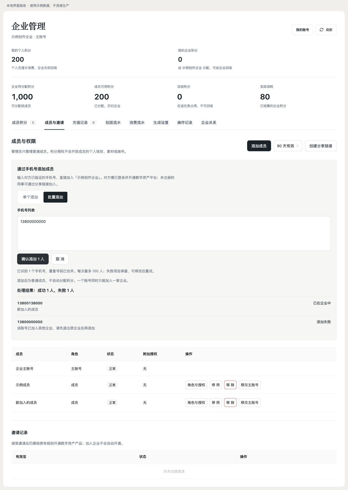
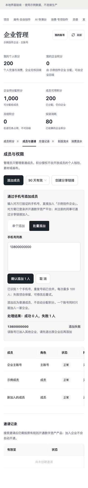

# 企业成员手机号添加与界面检查 · 2026-10-29

状态：本地实现与验证完成；本记录不代表生产发布。范围为 Studio `/enterprise`、企业成员 API 及其契约；保留原邀请链接与产品开通规则。

## 用户操作

进入「成员与邀请 → 添加成员」，选择「单个添加」或「批量添加」。单个填写手机号；批量按行、中文/英文逗号或分号粘贴，每批最多 100 个，自动合并重复号码。批量逐项显示处理结果，失败号码留在输入框，可修改后重试。已成功关系重复提交幂等返回。

仅主账号与管理员可添加。目标为本产品已有、手机号已验证、状态有效且已开通 aiavatar 的账号。没有产品档案的同事可走原分享链接；本功能不创建账号中心身份或自动开通。默认普通成员、无附加管理授权、企业钱包零余额，不改变个人钱包与资产；已在其他企业或已停用的成员会明确失败。

## Impeccable 检查与修正

- 刷新按钮采用已有品牌次按钮，40px 桌面高度，44px 手机高度，具备焦点、禁用与刷新中反馈。
- 原全页刷新会卸载管理内容，现保留表单状态并刷新当前分类；读取失败保留上次完整快照，明确显示旧数据提示，避免新企业名称配上旧企业余额。
- 添加为内联表单，单个/批量操作共用权限与输入规则；错误保留输入，提交锁防重复。部分失败通过逐项结果展示，不冒充全部成功。
- 桌面与手机遵守 `html[data-layout]`。390px 下文档 scrollWidth 为 390，单个/批量切换及提交按钮均为 44px；长表格在自身容器横向滚动。
- 沿用现有深墨、纸白及浅灰令牌、Ant Design 表格/输入和页面焦点规则。设计 hook 无确定性问题。
- 现有 DESIGN.md 比 design.json 新的上下文提示未在本轮做旁支修复。

## 验证

- `EnterpriseFoundationTest`：23/23 通过（真实 Spring/JPA/H2，含 MockMvc）。覆盖权限、手机号与开通、普通角色及零余额、个人余额不变、同企业幂等、跨企业及停用拒绝、与邀请并发、批量去重/独立提交/逐项失败、100 条边界与 HTTP 路由。
- 企业管理/工作区/流水前端组件：31 项通过；覆盖单个失败保留、批量部分成功/只重试失败项、输入去重/100 人限制、切换保留草稿、刷新完整快照及既有财务/邀请交互。
- `pnpm typecheck:all` 通过（包含 admin）；更新后的 web-aiavatar 专项类型检查通过。
- `pnpm check:api-contract` 通过。既有非本功能 handler 警告保留。
- wire mirror：本企业 DTO 的 20 对记录/接口字段一致。全局命令仍因 TODO 已登记的 clip 4 组历史字段漂移失败，本轮未修改 clip。
- 浏览器：使用当前真实工作区/成员组件、实际 Ant Design 与页面 CSS，在独立示例数据适配器中检查 1280px 桌面与 390px 手机。已实际点击模式切换、批量提交、部分成功、失败输入保留及刷新保留；不连接生产、不读取真实手机号。
- 线上 URL 在当前浏览器会跳转统一账号中心登录。本轮未进行生产身份登录、线上加人或发布；未跑 MySQL 专项，不把 H2 与示例页面验收写成生产验收。

