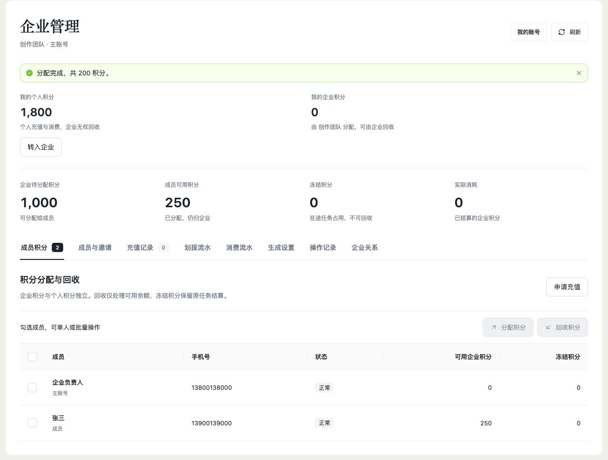
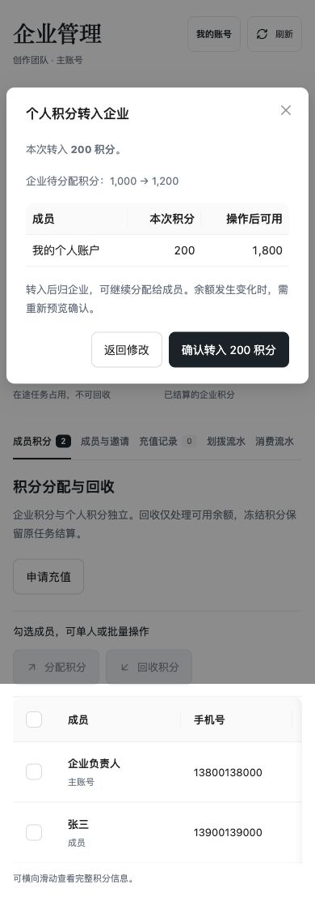

# 企业主账号积分转入与成员手机号 · 本地验收

日期：2026-10-31（用户时区）。本记录覆盖开发与本地验收；生产状态以发布记录为准。原工作区其他改动单独保留。

## 交付范围

- 企业 owner 在“我的个人积分”点击“转入企业”，输入积分并预览确认后进入企业待分配账户，再沿用原有分配给成员。
- 所有个人可用普通积分均可转入，保留 gift/license/recharge 来源；无新增权限项或审批。转出/转入关联账本和批次同事务，不重复计算充值或积分发行。
- `points/deposit[/preview]` 复用现有 items、确认指纹及 clientRequestId。余额变化须重新预览；不确定失败以原请求重试，避免重复扣款。
- 两张成员列表增加手机号，复用产品档案与原列表范围。暂无手机号使用明确空态，审计不记录号码。
- 企业及全部企业钱包先锁，个人钱包后锁。充值来源在企业内以 owner-deposit 转账标识跟随分配/冻结/释放，不当作新现金订单。
- 无表结构变化或新迁移；后台划拨记录正确显示“个人转入企业”。后续上线范围包含 server、web-aiavatar 与 admin 的方向展示。

## 验证进度

- 全工作区串行类型检查与独立 admin 类型检查通过。
- API 契约检查通过，保留既有非本次接口警告。
- 企业相关 DTO 字段镜像通过。全局 wire-mirror 被已有 clip 四组字段漂移阻断；未改 clip，后续定向检查与测试单独运行。
- 前端工作区/成员管理/流水共 35 项回归通过，含转入入口、原请求重试、刷新和手机号展示。
- 11 月 1 日浏览器验收：当前真实工作区/成员/流水组件、实际 Ant Design 与 CSS，在本地示例 API 适配器中完成桌面与 390px 手机操作。个人 2,000 → 转入 200 → 个人 1,800、企业 1,000 → 1,200；继续分配 200 → 企业 1,000、成员 50 → 250。手机端也确认转入成功，流水标为“个人转入企业”。
- 两张成员列表均可见完整示例手机号；手机文档宽度 390px、转入按钮高度 44px，表格容器 358px / 内容 660px，横向滚动限于表格。
- 浏览器使用示例数据，未登录生产、未充值/转动真实积分。既有账号中心同步逻辑未改，未重新测试真实短信/生产手机号换绑或 MySQL。
- 后端回归共 91 项通过：EnterprisePointsServiceTest 24、EnterpriseFoundationTest 23、EnterpriseRechargeServiceTest 15、EnterpriseLifecycleScenarioTest 29。涵盖原桶守恒、转入后分配、并发幂等、余额变化、冻结不可转、失败回滚、HTTP 预览/确认、成员手机号与既有财务/生命周期。最终复跑任务 `1705bd5d5fa9` 退出码 0，前两组充值/生命周期沿用本轮已通过结果。
- H2 启动保留已有 `drama_character.cast` DDL 警告，本次未改该域；企业相关测试均通过。

## 2026-11-01 最新 main 整合校验

在干净的 origin/main `8de4c93a2` 基础上整合本次企业改动，保留主线已发布的 H3 分镜、场景素材与导航功能。通过统一队列任务 `c88d556feb53`（退出码 0）完成锁文件离线安装、全工作区串行类型检查、独立 admin 类型检查、API 契约、三组企业 DTO 镜像、35 项前端回归及全部 91 项企业后端回归。无跳过用例、失败或错误；完成后从合入 main 的干净提交构建正式包，制品与线上结果见[生产发布记录](enterprise-owner-deposit-production-release-20261101.md)。
