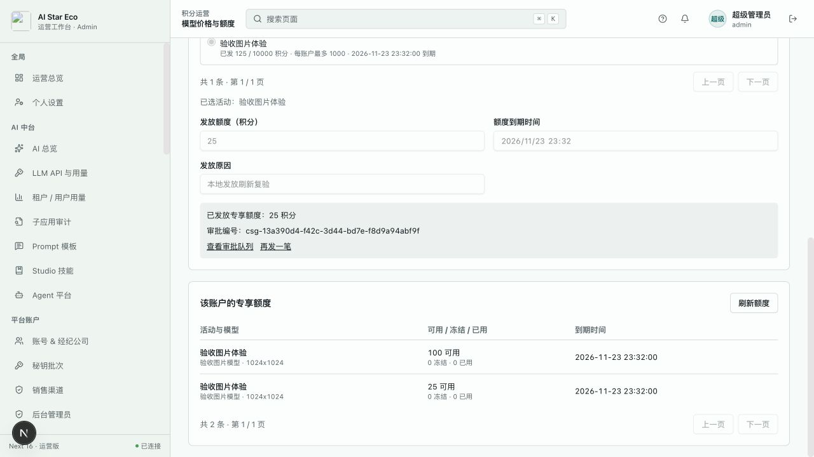

# 模型计费后台本地验收 · 2026-10-25

状态：独立 worktree `codex/model-scoped-credits` 的局部开发验收，未提交发布。完整范围和未完成项见 [方案](../model-billing-design.md)。

## 测试环境

- 后端绑定 `127.0.0.1:18086`，隔离 H2 内存库，dev 配置、开发种子数据、Hibernate 建表；不连接生产数据库。
- 后台 Next 开发服务 `127.0.0.1:13008`，`NEXT_PUBLIC_USE_MOCK=0`，通过真实 API 代理连接上述后端。
- 浏览器通过开发免认证身份访问，只证明页面/代理/API/数据路径。后台角色权限另由真实 Spring MVC 测试验证，不将开发免认证视为正式登录验收。
- 未运行模型任务、调用付费供应商或变更线上价格。本次未以真实供应商生成质量作为验收目标。

## 浏览器实际路径

1. 从积分运营的「模型价格与额度」进入，选择已开放的本地测试图片渠道和 `1024x1024` 规格，创建标准价 10 积分/张；列表保存后显示同一名称、模型、规格及单价。
2. 在「客户折扣」创建八折，全体客户适用并允许折后抵扣专享额度；后台持久值为 `factor=0.8`。
3. 在「免费活动」创建图片体验活动：最多发放 10000 积分、每账户最多 1000、资源总量 100 张、每账户每日 10 张、并发 1，限定上述图片模型规格，明确起止时间。
4. 「发放与查询」选择种子客户 Luna 的个人账户，发放 100 积分，出现已发放回执及同活动、同模型规格的 100 可用批次。
5. 发现回执后活动已发总数仍显示旧值。修复后重新走页面发放 25 积分，活动自动显示已发 125；账户批次表显示 100 与 25 两笔，而非把两笔挤进普通余额。
6. 由后端接口重读数据库投影：价格 10、折扣 0.8、活动 issued=125、批次可用合计 125。发放前后的普通钱包完整响应相等，total/license=500、gift/recharge/pending=0，连 updatedAt 也未改变。
7. 新标签页的浏览器错误/警告日志为空。截图中后台旧 logo 资源缺失属于既有外壳问题，本次未修改。

原始测试数据投影：[API 证据](model-scoped-credits-admin-validation-20261025/api-evidence.json)。只含本地种子账户与测试业务数据，无令牌、密钥或登录响应。

## 自动回归

- `apps/admin/src/app/finance/model-billing/page.test.tsx`：9 项通过，涵盖服务端目标配置、财务角色只读、优惠换算、冲突保留草稿/版本、精确日期、活动资源单位、服务器分页、账户查询失败恢复、网络中断刷新后同编号重试、成功刷新及无钱包客户配置折扣。
- 原 `finance/adjustments/page.test.tsx`：4 项通过，确认普通赠送/超管规则/权限及专享审批展示未回退。
- `EnterpriseLifecycleScenarioTest` 中模型计费的 5 项 MVC 场景通过，涵盖权限、分页、配置审计/版本、消费账户排除企业资金账户、合法模型目录/禁用/无效地址、个人优惠对象不存在拒绝和无钱包对象可查、专享发放及企业成员查询。
- `specs/openapi.yaml` 已同步目标、个人、消费账户及企业选项的类型与路径，并成功解析 YAML。逐项对比原契约，旧 schema/path 没有缺失，既有语义仅增加专享账本类型、grantId 及审批说明。
- 四门通过：`pnpm typecheck:all`、`pnpm typecheck:admin`、后端 `./mvnw compile -q -o`、`pnpm check:api-contract`。契约脚本仍输出已有未落地接口警告，退出为 0；不将其误报为新模型计费接口失败。`git diff --check` 通过。测试计数和命令摘要见 [检查记录](model-scoped-credits-admin-validation-20261025/checks.json)。

## 验收边界

这里只证明后台配置、人工发放和查询链路。其余模型受理适配、用户确认报价/仅免费模式、激活码及注册自动发放、实付拆分和消费全链路仍未完成；不能按本文将整个功能标记完成或直接发布。此次隔离服务验证后已关闭，内存测试数据不会保留为运行环境。
