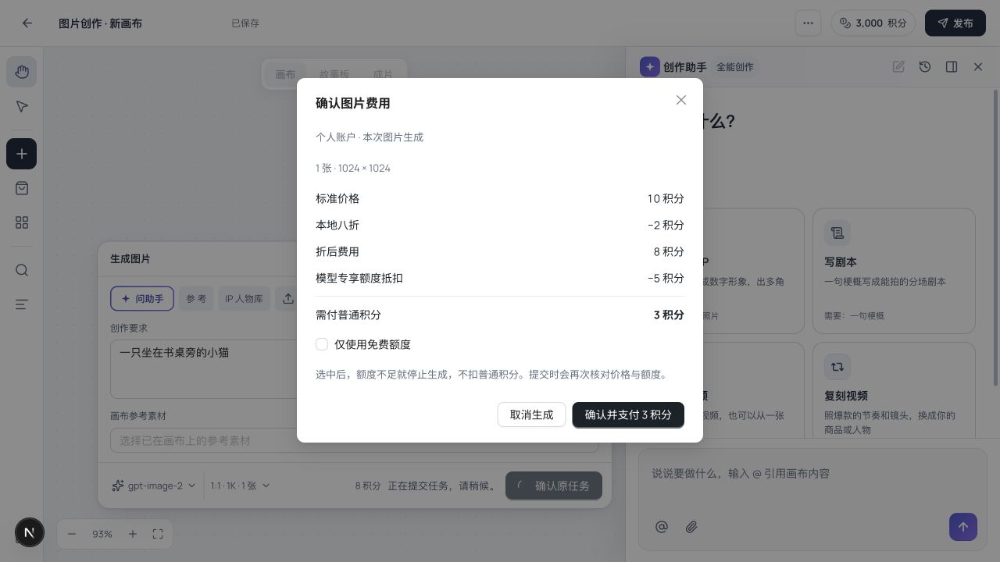
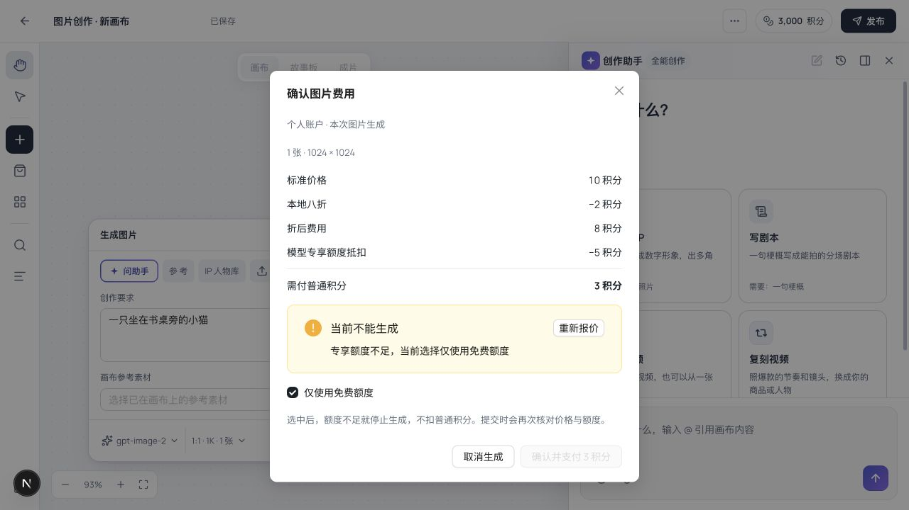
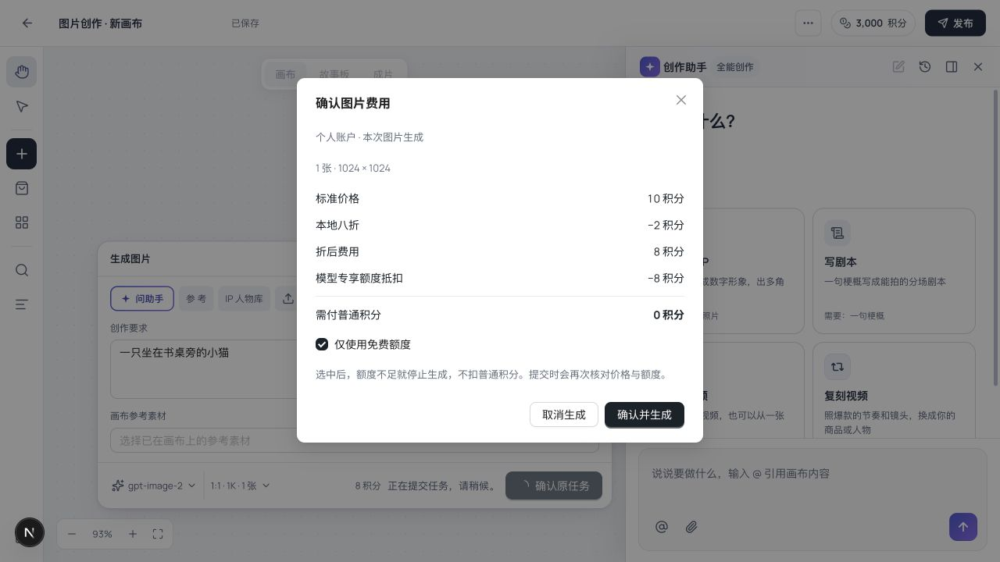
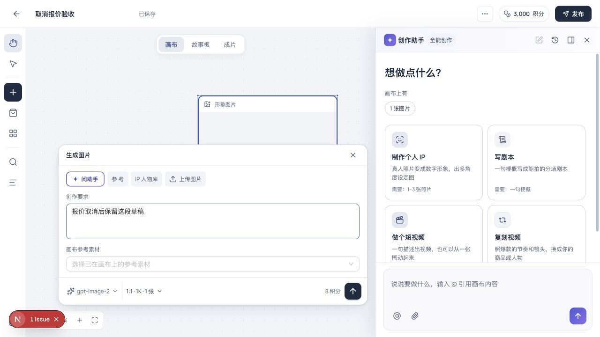

# Studio 图片报价确认本地验证 · 2026-10-25

独立 worktree `codex/model-scoped-credits`，局部开发验证，未发布。完整范围与未完成项见 [方案](../model-billing-design.md)。

## 本次行为

图片的显式生成、节点生成、Studio 图片生成共用各自原受理编译器报价；不建钱包、发月赠、保存 doc、创建任务、授权或冻结。确认后受理校验付款账户、模型/渠道/规格、用量、价格与优惠决策摘要、普通积分付款上限与仅免费选择。报价后赠款减少不能导致自动增加余额扣款；原受理请求恢复原确认。

旧基础价为零、新价格表有正价时，内部基础单位仍能驱动冻结及部分结算，用户成交价取模型快照。实际消费金额在任务/流水界面的完整投影仍待实现，不把内部基础金额当成实付。

## 真实浏览器路径

- 后端 `127.0.0.1:18087`：隔离 H2 内存库、dev 种子账号；Next Studio `127.0.0.1:13009`，真实 API、legacy 开发登录、企业前端开关关闭，证明个人报价独立于企业开关。
- 本地测试图片模型只配置不可调用的测试 HTTPS 地址、假 key，未提交供应商任务。通过管理 API 设置 10 积分标准价、八折、专享活动并给种子工作室发 5 积分。
- 登录种子「星光经纪」，从首页图片创作进入新画布，填要求，选开放的 1:1 / 1024×1024，点生成。弹窗显示标准 10、优惠 2、折后 8、专享抵扣 5、普通补差 3。
- 勾「仅使用免费额度」后，服务端重新报价，显示专享不足并禁用确认按钮。后台再发 10 积分，点重新报价变成抵扣 8、普通 0，选择仍保持仅免费。
- 最后取消，没有确认生成。走查发现取消原先会显示生成失败，已修为恢复原草稿。新画布重新验证取消、刷新、再打开图片面板，文字与规格保留，无失败标记、无确认原任务提示。
- API 回读：普通钱包完整响应在报价前后相同，余额 3000；专享共 15、冻结/消费为零；取消后的项目运行列表为空。页面日志只有周边既有 Antd `maskClosable` 弃用警告，不将其报作零日志。

本地投影：[API 回读](model-scoped-credits-quote-validation-20261025/api-evidence.json)，不含登录令牌、供应商密钥或真实客户数据。

## 自动验证

后端 128 项通过：`EnterpriseLifecycleScenarioTest` 26、`ScopedCreditServiceIntegrationTest` 25、`ModelPricingServiceTest` 6、`IpRunServiceTest` 41、`IpRunWorkerTest` 26、`ProductRouteTableCoverageTest` 4。

新增真实 MVC 场景验证三个只读报价、报价不改 doc/钱包/任务、配置正价覆盖零基础价、冻结真实成交额、受理重放恢复原确认、价格变化拒绝新请求及他人项目隔离；企业只读报价验证零普通余额可用成员专享，并受企业模型策略限制。核心事务验证报价后赠款被占用不会多扣普通余额，账户/模型/用量/价格变化拒绝，原请求幂等保持免费选择。worker 使用 mock 阻止任何供应商调用。

前端 128 项通过：工作台、付款选择、报价弹窗与请求恢复共 108；生成桥接和批量计划共 20。覆盖免费切换立即禁用旧报价、丢弃过时响应、错误重试、仅免费不足、零补差确认、重复点击、未知网络保留原确认、明确回滚重新报价、已受理恢复、fixture 跳过、取消恢复草稿，以及失败新请求清除旧确认的实现。批量面板取消恢复和旧画布工具的完整交互仍需继续验证。

四门与 `git diff --check` 通过：全仓类型、后台类型、后端离线编译、API 契约。OpenAPI 已解析并核验新增 schema、请求字段和三条 POST 路径。契约检查仍保留既有未落地接口警告；没有新增缺失路径/方法。详见 [检查数据](model-scoped-credits-quote-validation-20261025/checks.json)。

## 边界与清理

本次浏览器只确认报价、免费不足、取消与刷新恢复，没有消费终态或供应商质量验收。H3/Seedance 视频的用户报价与后台规格目录、其他模型入口、自动发放、实付明细与原来源恢复仍待完成；不能宣布整个功能完成。旧画布工具的报价取消回滚也需继续覆盖。

本地两个服务与浏览器测试标签已关闭；Next 自动改写的 tsconfig 已恢复。测试运行目录在 `/tmp/scoped-image-quote-runtime`，未把登录令牌落盘。没有提交、推送、部署或修改生产价格。
