# 创作助手对话动静与快捷答复 · 本地验收（2026-10-20）

> 状态：**本地实现与验收，未发布**（仅 web-aiavatar，无后端 / API 改动）。分支 `dev/studio-assistant-dialogue-ux-20261020`，基于 main `7b4aedc6`。

## 用户反馈（改前）

| # | 反馈 | 截图 |
|---|---|---|
| 1 | 对话没有动效，看不出 AI 在思考还是在干嘛 | 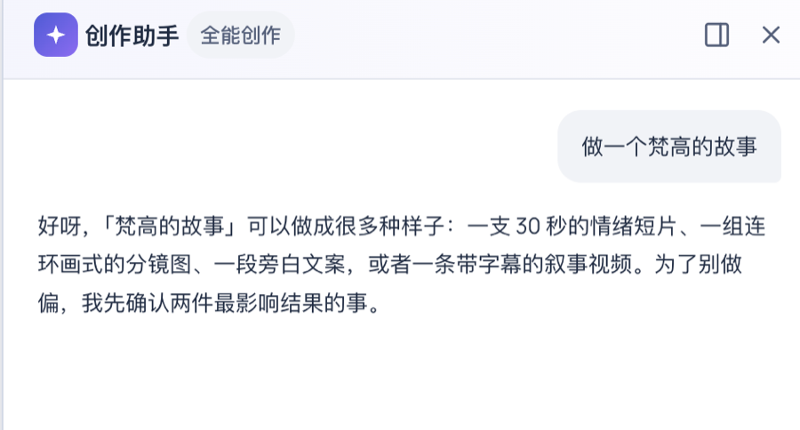 |
| 2 | 「放进画布」「从这里重新开始」一直常驻，太重 | 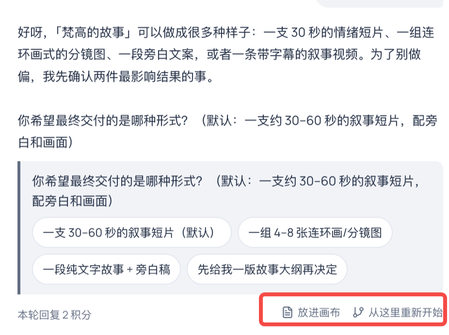 |
| 3 | 点快捷答复只是追加到输入框，点两个就堆两行 | 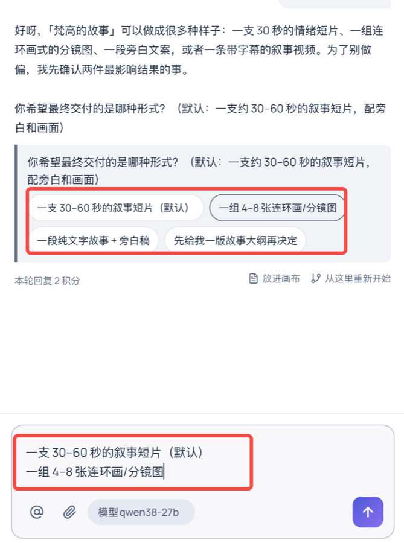 |
| 4 | 工作记录（「查看画布」）像一个要去点的按钮 | 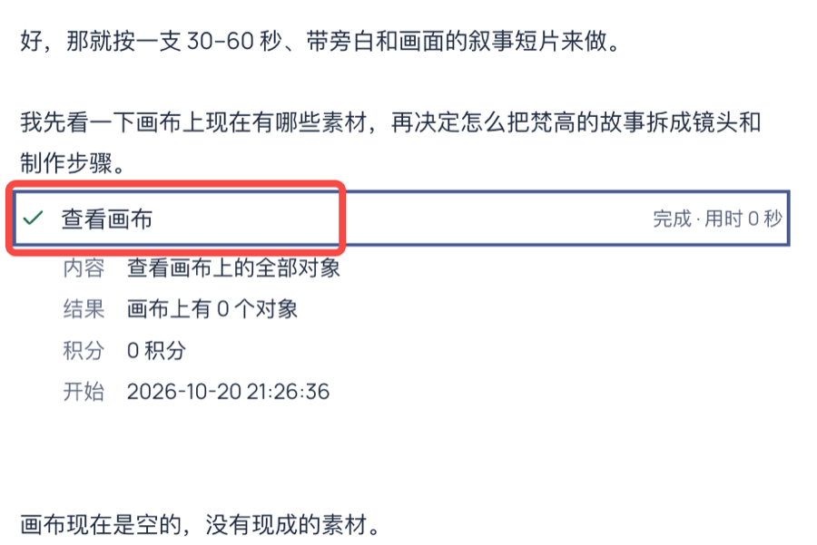 |

## 改动

1. **进行中状态**：`dialogueActivity`（`src/canvas-bridge/studio-dialogue-store.ts`）只按事件流推出阶段：已受理还没回话 →「正在思考」，正文流入 →「正在回复」（正文末尾闪光标），工具跑完但回合没结束 →「正在思考」。跑工具时由那一行工作记录自己转圈并写「进行中 · 已用 N 秒」。回合完成、失败、停止即消失。等待超过 3 秒补一个本页看到的真实秒数。不显示任何编出来的思考内容或百分比。组件 `src/ip/studio-dialogue-activity.tsx`；`prefers-reduced-motion` 下动效全部关闭。
2. **回复操作**：「放进画布」「从这里重新开始」改为 28px 图标按钮（读屏名字 + 悬停提示），手机 36px。最新一条回复常显，旧的在桌面上悬停或键盘移到这条消息时出现，手机常显；你的气泡的「从这里重新开始」放在气泡左边、不占气泡高度。带问题、方案、确认卡或修改建议的回复不给「放进画布」；同样内容已在画布上时显示「在画布上查看」（定位，不重复建节点）。
3. **快捷答复直接发送**：问题选项、后续建议、方案里的「改用这个做法」单击就作为一条用户消息发出。走同一条发送链路（先存画布、outbox、同 clientMessageId 重试、拒收处理），**不带**草稿里 @ 的引用和附件、**不清**草稿；ref 锁防同一时刻连点两次；发送中按钮禁用；发出后问题按「之后有你的消息」判为已回答（`answeredAfter`，服务端不标），选项收起，不会第二次回答同一个问题。服务端明确拒收时，只有输入框为空才把这句放回去供修改。
4. **工作记录**：从带框的 `
` 卡改成左侧细竖线的一行（进行中 AI 色并转圈、完成打勾、失败红色并直接写原因），整行无悬停反馈；只有右边的小箭头（`aria-expanded` / `aria-controls`）展开详情。

## 验证

### 自动化

- `pnpm --filter @ai-star-eco/web-aiavatar typecheck`：通过。
- `pnpm check:api-contract`：通过。
- web-aiavatar 全量 vitest：135 个文件、1056 个用例全部通过（第一次与开发服务器同时编译时有 3 个与本改动无关的 5 秒超时，重跑全绿）。
- 新增 / 改写的用例：
  - `studio-assistant.test.tsx`：选项与建议直接发送且不动草稿和引用；连点只发一次；已回答后选项收起；受理后「正在思考」、正文到达变「正在回复」、回合结束消失；拒收后回填空输入框并重新开放选项；「改用这个做法」直接发送；工作记录只有一个展开按钮、默认收起；已在画布上的回复显示「在画布上查看」。
  - `studio-dialogue-store.test.ts`：`dialogueActivity` 的等待 → 工具 → 继续 → 回复；完成、失败、停止三种结束；以卡片收尾时不显示；`answeredAfter` 对已发送和在途消息的判断。

### 浏览器走查（演示模式，无头 Chrome，1440×900 桌面 / 375×812 手机）

演示模式的节奏和失败分支是为截图临时调慢、临时加的，已还原，没有提交。

| 检查项 | 桌面 | 手机 |
|---|---|---|
| 阶段顺序：正在思考 → 正在回复 → 工具进行中 → 正在思考 → 正在回复 → 结束 | 通过 | 通过 |
| 失败：工具标红并写原因，回合标「这一轮没有完成」，进行中提示消失 | 通过 | — |
| 先写草稿「草稿：结尾想加一句旁白」，再连点两次「洗衣液」 | 只发出一条「洗衣液」，草稿原样保留 | 同左 |
| 旧回复的「从这里重新开始」：默认透明度 0，键盘聚焦后 1 | 通过 | 手机常显 |
| 面板横向溢出（scrollWidth / clientWidth） | 479 / 479 | 349 / 349 |

### 改后截图

| 状态 | 截图 |
|---|---|
| 正在思考 | 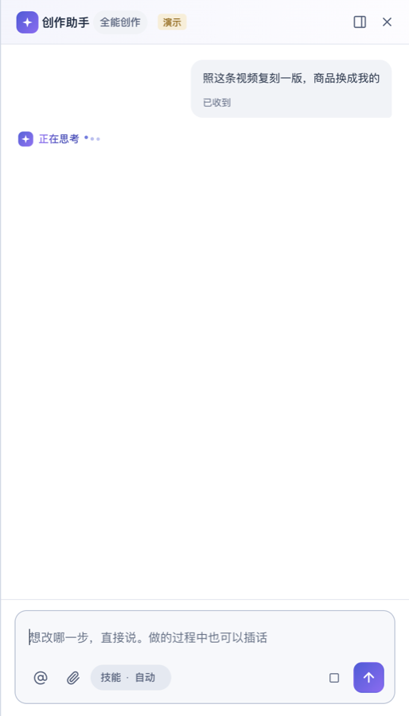 |
| 正在回复（正文光标） | 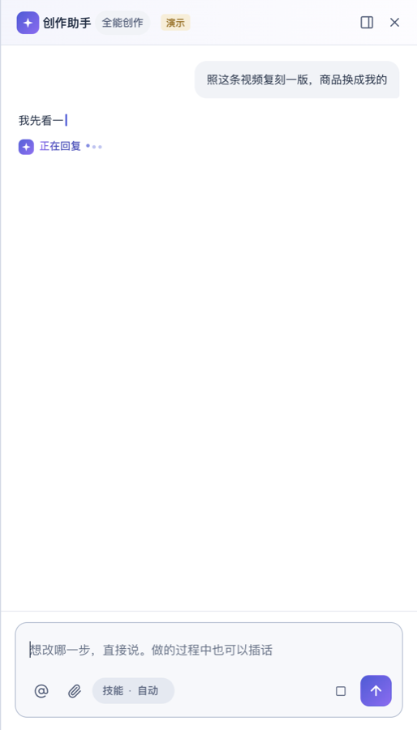 |
| 工具进行中 | 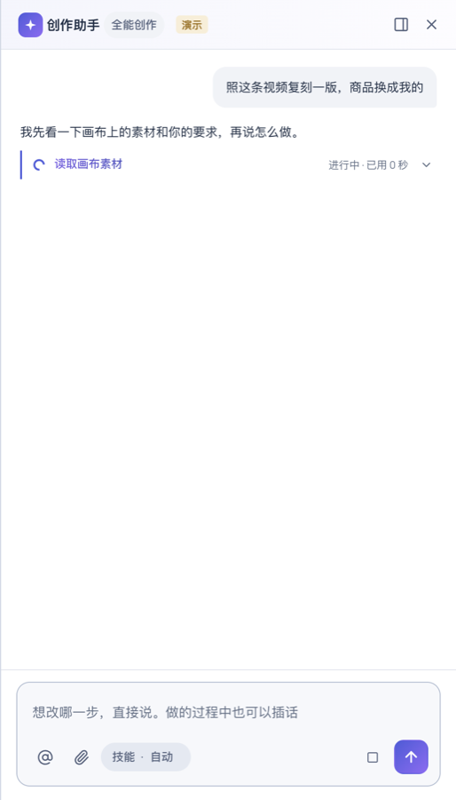 |
| 回合结束：问题、建议、右下角图标 | 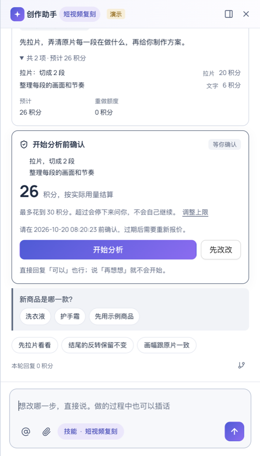 |
| 点选项直接发出，问题标已回答，草稿保留 | 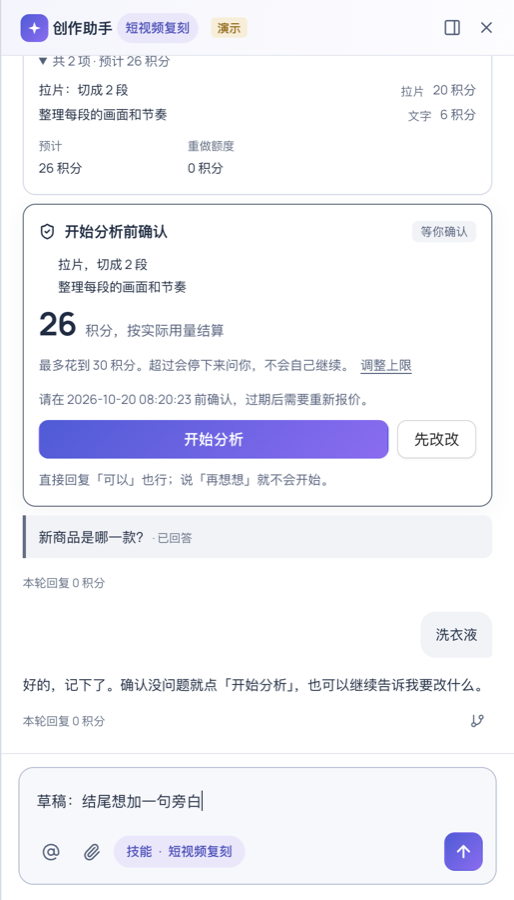 |
| 小箭头展开工作记录详情 | 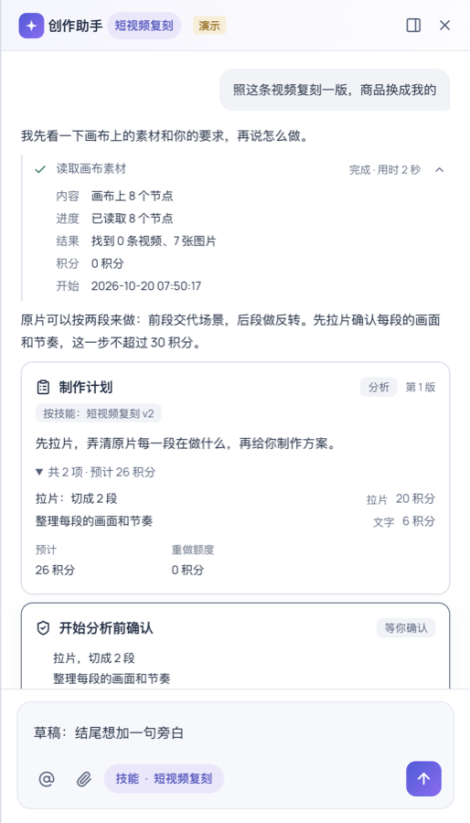 |
| 失败 | 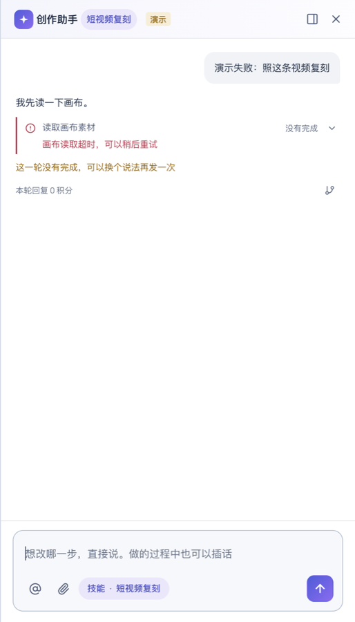 |
| 手机：工具进行中 | 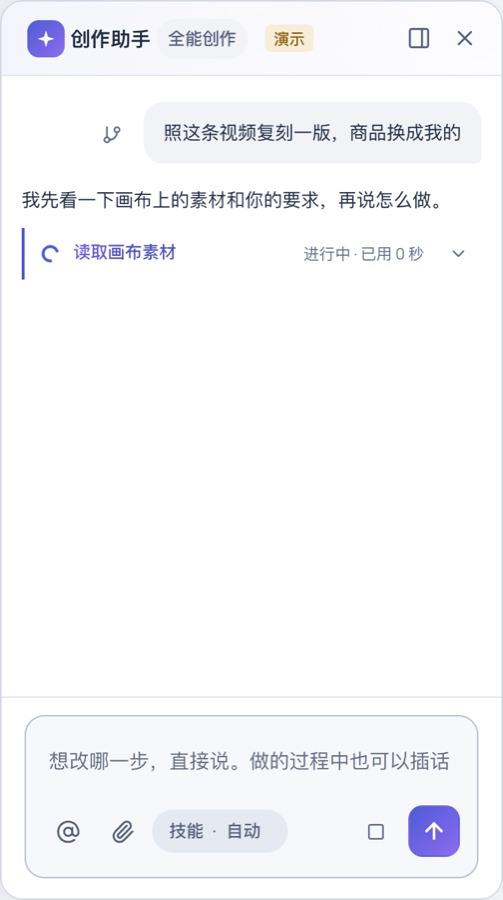 |
| 手机：直接发送后 | 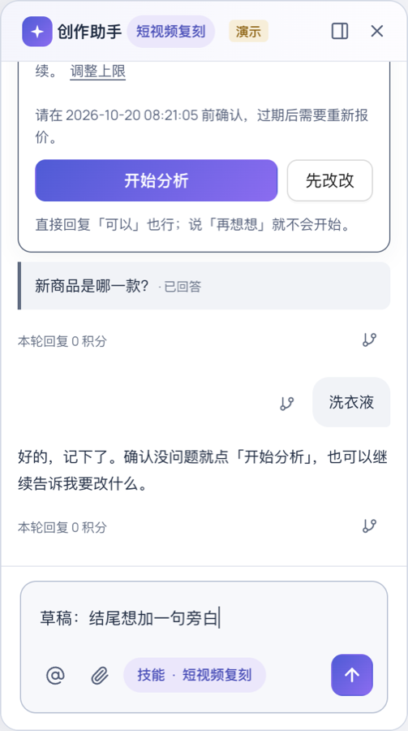 |

## 独立评审（Codex，只读）后的修正

| 发现 | 处理 |
|---|---|
| outbox 的 `afterSeq` 是事件游标、`message.seq` 是消息序号，两者比较几乎恒为真，一条早先没送达的消息会让新问题直接显示「已回答」 | `answeredAfter` 不再拿 outbox 和 `seq` 比：只认「这条回复结束后、正在发送」的消息；回合进行中插的话（queued / applied）不算回答 |
| 第一条快捷答复受理后，建议仍可点，再点一次会用新的消息键再发一条 | 你说过话之后，那条回复下的建议收起；同一句快捷答复还在发送、或已发出但还没有回复时不再重发 |
| 后台制作总结（EXS）的回合会顶掉 `activeTurnId`，结束时清空，正在等的真实回复的提示随之消失 | `dialogueActivity` 改为看所有仍在流式的回复（本页收到过事件的，或正是线程当前回合的），再看「已受理还没回话」 |
| 回合失败 / 停止时没收尾的工具还在转圈计时 | 这种工具行显示「没有完成 / 已停止」，不再转圈 |
| 工具行每秒更新的秒数在 live region 里，读屏会反复播报 | 只有「进行中」这几个字在 `role=status` 里，秒数 `aria-hidden` |

以上均补了测试（`studio-dialogue-store.test.ts`、`studio-assistant.test.tsx`）。

## 没有覆盖的

- 没有连真实后端和真实模型走一遍（本次只授权本地修复与验证，不做付费生成）；真实服务端从受理到首个事件的等待时间更长，「正在思考」会停留更久，并在 3 秒后显示已等秒数。
- 演示数据里没有长文字回复，「放进画布 / 在画布上查看」的切换只由单测覆盖，没有截图。
