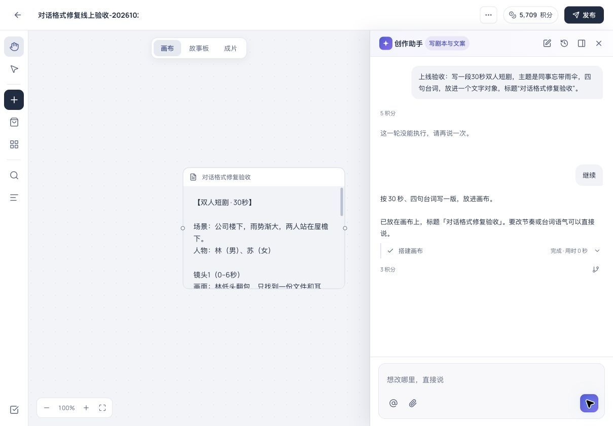

# Studio 对话格式与中断修复 · 生产发布

- 2026-10-23 发布 `20261023-studio-dialogue-recovery`，范围 `server,web-aiavatar,admin`。
- 功能先合入并推送 main，从干净 main `ce21cc8e00cdbed09210860c772b707e1688ca06` 构建。其他开发中的导演台等改动未带入。
- JAR 本地/线上 SHA-256 一致：`94b2a020719234d05e7bfbbc481b852d4db5a061c48d65303a08bb0afb0efb86`。
- Studio BUILD_ID `43rTgq8JpT9hBFiXexcAU`；OIDC 正式模式、企业入口沿用 `1`、mock/dev-login 关闭。未修改运行时密钥或生产配置，无数据库迁移。

## 修复

线上用户两轮（`IPR-b84f128b6fb546749283`、`IPR-2f77de9fb21d4ed59221`）均有完整剧本文字，但模型将动作 JSON 多写一个 `}`；三次格式纠正无效，0 次工具执行后显示“这一轮没能执行，请再说一次”。

仅当删除一个字符串外的冗余 `}` 能得到唯一 JSON 解释时，直接恢复完整动作，保留正文、连线与所有参数；歧义、截断、重复键、冲突参数仍拒绝，不会半批执行。属性式动作也统一解析并隐藏。最终无法恢复的提示说明是模型执行格式错误及内容已保留。

对话累计额度与普通文本额度分离，默认输入 1048576 / 输出 65536 Token，后台可调整；普通文本不变。真实用量计费。用户确认继续受限任务后，在本次批准金额内不再因输入/输出分配、步数、调用/工具次数、10 分钟阈值反复暂停；停止、真实预算和制作授权保持。

## 验证

- 干净 main：136 项后端回归、80 项前端回归通过，工作区/后台类型、离线 Java 编译、API 契约全绿。
- 原两轮六条完整供应商回复全部恢复，逐字核对剧本文字，流式不泄露动作；这项包含原始内容的临时回放不提交客户正文到仓库。
- 确定性 HTTP/SSE、H2 与账本集成：46 步/45 工具续接、越过原 Token 分配仍完成，1 条助手回复、1 次冻结，幂等重发不增加调用/扣费；重复动作、停止、真实预算保护通过。
- `deploy-release.sh` 完成；自带 verify 全绿，服务、公共路径、后端 API、字体和 nginx 检查通过，Studio/后台公网页面均 200。GitHub 未产生此提交的自动 workflow run，未将本地结果冒充 CI。

## 真实线上路径

新建独立画布 `IPP-52c03d5c`，同一真实 Qwen 端点 `ai-studio-jusuan-qwen38`，只验收文字，不重投客户已有媒体任务。

1. 上线前请求四句台词的 30 秒短剧，原运行 `IPR-a754b2de97454cc3b5b4` 复现同一错误：3 次调用、0 工具、画布空、5 积分。
2. 发布后在同一对话只发送“继续”，`IPR-272e59b59185474b83f4`：模型仍在动作数组后多写一个 `}`，新解析器直接恢复，创建 1 个完整文字节点；再一次调用完成回复。合计 2 次模型调用、1 工具，`reason=completed`、无 limit。
3. 新运行快照确认独立额度 1048576 / 65536、maxCost=260；实际输入12664 / 输出309 Token、扣3积分，未额外进行格式重试。
4. 浏览器确认“搭建画布 · 完成”和完整正文，服务端文档 1 个节点；刷新仍存在。旧历史故障提示保留以免修改历史，新回复没有故障提示。

[线上验收画布](https://aiavatar.aibuzz.cn/projects/IPP-52c03d5c)

