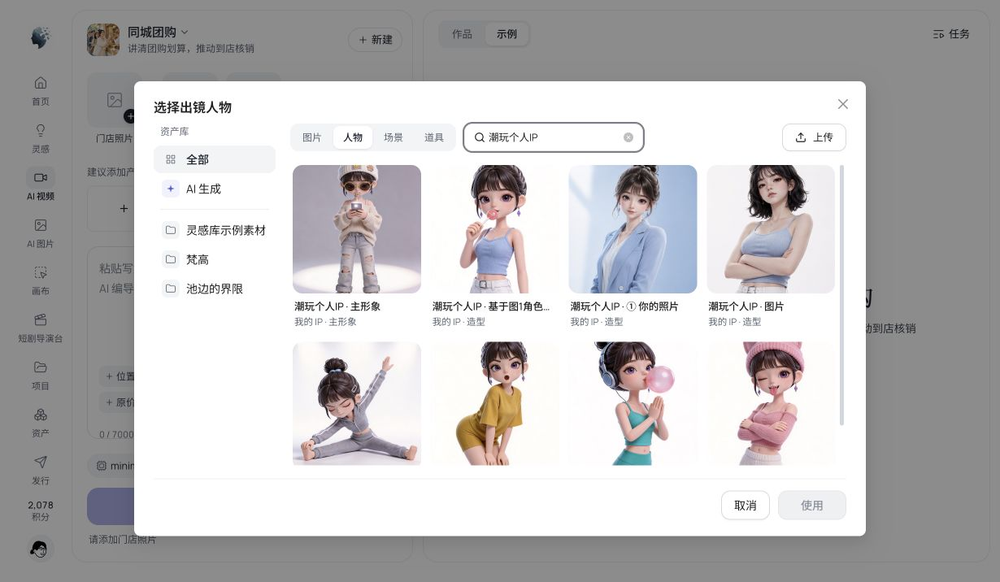
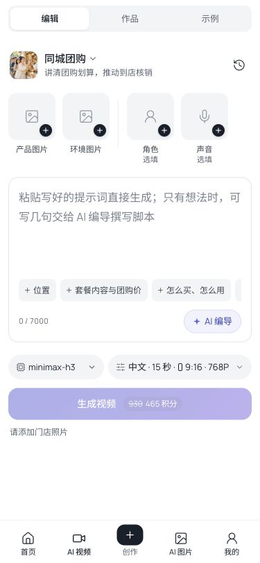
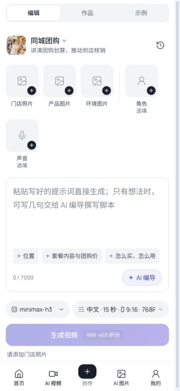

# Studio 反馈 5、7、8 修复发布

记录日期：2026-11-07，America/Los_Angeles；生产机时间为 2026-11-08 CST。

- 合并 PR：[#169](https://github.com/pokocat/AIStarEcosystem/pull/169)。构建 main：`1e3aa4bb74a670673ab1d97f77a81d6fe7f3477c`。
- 发布：`20261107-studio-feedback-578-1e3aa4bb7`，只更新 `web-aiavatar`，保留 main 已有功能。后端、数据库及模型配置未变。
- Mac mini 干净主线快照构建，队列 `170ccaa350bf` 退出 0；真实 API、ID 登录、企业开关保持生产配置。正式 `deploy-release.sh` 完成，`verify.sh ALL GREEN`。
- 前端于 2026-11-08 15:08:05 CST 启动，active，NRestarts=0。BUILD_ID：`twZDpAg-ykyiFKrnDus_O`，与制品一致。
- 制品 SHA256：`a84da73660ca471269d4efdf993f2bef5a55f732ad8ebaf49288d6920ba916cb`。本地 `dist/deploy/<发布号>/` 与生产 `/opt/ai-star-eco/releases/<发布号>/` 均保留校验文件及制品。

## 修复与验证

| 反馈 | 修复 | 验证 |
| --- | --- | --- |
| 5 人物选择缺已有 IP / 三视图 | 全部人物合并本人 IP 主形象、历史版本、衍生图，角色卡版本逐张可选，保留准确素材与版本；自建库保持范围，AI 生成空态引导到全部人物 | 线上搜索原先缺失的「潮玩个人IP」，显示主形象和 7 张造型；选中「去掉墨镜。穿芥末黄…」准确带回，刷新仍有角色图。本地三视图夹具验证精确 key，375px 无溢出 |
| 7 团购图片上传引导 | 增加产品图片 / 环境图片，分别说明用途、打开对应标题的现有选择框，共用总张数限制 | 线上两个入口均正确打开，均有上传按钮；集成测试覆盖连续添加及重开草稿，375/1280/1440 宽引导组件预览通过 |
| 8 失败重新编辑丢脚本 | 按任务快照中已采用正文补回脚本节点，避免悬空 scriptId 使恢复逻辑丢弃提示词；手机返回编辑面 | 原录屏与完整组件回归定位采用脚本分支。线上失败任务 `PEX-9caea05b1848414ca167` 重新编辑到独立草稿 `IPP-de820734`，3068 字脚本保留，换为 Fast 并刷新后正文及模型仍保留 |

线上验收未点生成 / 重试 / AI 改写，积分始终为 2078，原任务和原草稿保留。另有素材验收草稿 `IPP-1e59f99a`。以上两个验收草稿未产生模型费用。

原反馈账号的具体三视图未逐张核对；三视图 exact key 使用本地回归验证，线上使用当前账号同类 IP 的独立造型。没有重跑原 Fast 付费任务，也未再次上传文件；上传沿用既有通路，本次新增两处引导。

## 检查与空闲窗口

- 远程队列 `90021a6544a2`：全工作区串行类型检查、后台类型检查、后端离线编译、API 契约、Studio 全量 226 文件 / 1944 项测试全部通过。
- CI 首次暴露既有模板视频测试的异步时序依赖。现显式延迟制作计划回包、等待视频出现；队列 `416f4ec03879` 的 4 项用例和类型检查通过。
- 最终 PR CI [42457068950](https://github.com/pokocat/AIStarEcosystem/actions/runs/42457068950)：两组 Studio 测试、前端构建与浏览器、API 契约和聚合 CI 全部通过；后端作业按变更范围跳过。
- 上线前 07:02、07:05、07:07 UTC 三次只读检查：近 5 分钟 40 条后台轮询、0 次主动操作；`ip_run`、视频 Job、运行中执行计划均为 0。日志覆盖完整窗口，保留后台轮询计数。
- 07:07:43–07:09:00 UTC 发布窗口 nginx 访问日志无 5xx。公开 `/`、`/login`、`/video`、`/image`、`/assets`、`/api/config`，兼容 aiavatar 域的视频和资产页均 200；服务、API、代发健康检查与 nginx 配置检查通过。
- 后端启动时间仍为 2026-11-08 09:31:39 CST；JAR SHA256 仍为 `1748df604cc7f81bb15b920f16c27f54bfd9428242e3d7925a262d8a61f61cda`。

飞书原文档的 5、7、8 状态已依次更新并回读，最终 revision 160；原截图和录屏 token 保留。文档：[问题反馈](https://ji6siiy0q6l.feishu.cn/wiki/VxpewJSTri8F49kkHedcwgXjntd)。

## 回滚

前一前端制品 `/opt/ai-star-eco/releases/20261108-director-video-playback-7121e8ada/web-aiavatar.tar.gz` 已核对 SHA256：`3e59df814d6fffbe0498bd3c3a2767b94004e9a7f65b66b0143fbb5709a3b0a2`。需要时用正式部署脚本仅恢复 web-aiavatar；不重启后端、不恢复数据库、不重新提交生成任务。

旧页面刷新后加载新版。新发现的 TaskThumb / SignedImage 嵌套按钮告警仍单独记在 TODO，不计入本次三项修复。

## 线上截图

## 团购上传占位调整（2026-11-07）

用户纠正：产品图片、环境图片应放在上方原图片素材区，使用两个上传占位，不另做下方引导卡。

- PR [#170](https://github.com/pokocat/AIStarEcosystem/pull/170)，构建 main `a01c7da4cb1efcbe0517a8580032069344d439c2`，干净主线制品 `20261107-groupbuy-inline-slots-a01c7da4c`，仍只部署 web-aiavatar。
- 团购图片添加入口改为同一 `.scene-media-row` 内的产品图片、环境图片两个方框，复用现有图标、加号、选择和上传；删除 `SceneImageGuide` 组件与全部专用样式。编导页也使用同一排素材。没有新增图片分类入参或必填条件。
- Mini 队列 `33452c7d85dd` 退出 0：全仓串行类型、后台类型、后端离线编译、API 契约，以及 4 文件 / 66 项场景回归通过。最终 PR CI [42459848026](https://github.com/pokocat/AIStarEcosystem/actions/runs/42459848026) 的两组全量前端测试、构建和浏览器、契约及聚合全部通过。
- 正式构建队列 `2a046633adf0` 退出 0，制品校验通过。SHA256 `24282f22831b99c84badb923c6d6cfe34a50915194c80a2fa168f2d6e9246a21`，BUILD_ID `wP3j3lZWAiSSdXkuliuMa`，生产与制品一致。
- 第一轮准备发布时发现线上还有页面操作和草稿保存，因此未部署。07:51:43 UTC 再查：近 5 分钟 40 条后台轮询、0 主动操作、3 类生成任务全部 0 后才开始切换。
- 前端于 2026-11-08 15:52:01 CST 启动，active / NRestarts=0。`deploy-release.sh` 完成，`verify.sh ALL GREEN`，公开页面及全部服务健康检查通过。后端启动时间及 JAR 校验和仍与前一发布一致。
- 07:51:43–07:53:38 UTC nginx 日志有 1 次启动探测 `GET /` 502（UA `curl/8.7.1`、无 referrer），随后 verify 成功；此窗口没有浏览器 UA 的 5xx。不称为无中断发布。
- 线上桌面截图确认两个上传占位在最上方、与角色和声音同排；点击产品/环境分别打开对应选择框，均有上传按钮。375px 下两处占位均 68×68，处在素材组内，页面 scrollWidth=375，无横向溢出；已恢复浏览器默认视口。未创建新草稿、上传文件或触发生成，积分仍为 2078。
- 飞书仅更新第 7 项并回读至 revision 161，原截图 token 保留。第 5、8 项未改动。
- 前一回滚制品仍是本记录首版 `20261107-studio-feedback-578-1e3aa4bb7`，校验和见开头；必要时仅恢复该前端制品。

## 保留门店照片并新增两个占位（2026-11-08）

用户进一步明确：原有门店照片必须保留，产品图片、环境图片是在旁边新增的两个占位。上一版误替换了原入口，本次补回，三个图片入口在同一个素材区并存。

- PR [#171](https://github.com/pokocat/AIStarEcosystem/pull/171)，构建 main `721e0287335141cd54a16db16137f4974e1707a0`，正式制品 `20261108-groupbuy-keep-store-721e02873`，只更新 web-aiavatar。
- Mini 检查队列 `343fc9ba5eff` 退出 0：全仓串行类型、后台类型、后端离线编译、API 契约通过；4 文件 / 66 项场景回归通过。用例依次从门店、产品、环境入口添加图片，验证三个 key 保存且重开草稿保留，不触发生成。
- 最终 PR CI [42461119265](https://github.com/pokocat/AIStarEcosystem/actions/runs/42461119265)：两组全量前端测试、生产构建及浏览器、API 契约和聚合检查全部通过。
- 干净 main 构建队列 `4602fa3c2bac` 退出 0，制品校验通过。SHA256 `1d055c39ed022436472fdd2b5f60e043db9ceda2ed23b15980d5563e7cea081d`，BUILD_ID `f377UP8N7VuA-4DzFviU3`，线上回读一致。
- 08:06:33 UTC 发布前复查：近 5 分钟 40 条后台轮询，0 主动操作，三类生成任务均为 0。前端于 2026-11-08 16:07:02 CST 启动，active / NRestarts=0；部署脚本成功，`verify.sh ALL GREEN`。后端启动时间、JAR 校验和保持本记录初版所列值。
- 08:06:33–08:08:34 UTC 日志有 1 次启动探测 `GET /` 502（UA `curl/8.7.1`），随后验证成功，没有浏览器 UA 的 5xx；不称为无中断发布。
- 线上确认门店照片、产品图片、环境图片三个占位同时显示，原门店入口可打开选择框及上传按钮。375px 下三格均 68×68，x=12/90/168、y 相同，全部在素材组；页面无横向溢出，已恢复默认视口。未创建草稿、上传文件或生成视频，积分仍为 2078。
- 飞书只更新第 7 项并回读至 revision 162，保留原截图，第 5、8 项未改动。
- 回滚制品为前一前端 `20261107-groupbuy-inline-slots-a01c7da4c`，SHA256 `24282f22831b99c84badb923c6d6cfe34a50915194c80a2fa168f2d6e9246a21`；仅回滚前端，不改数据库或重新提交生成。

