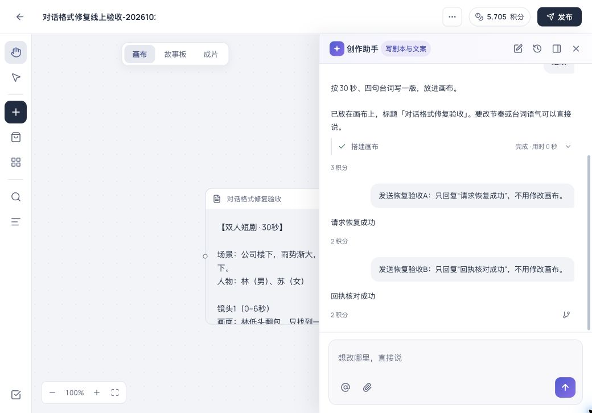

# Studio 消息发送恢复 · 生产发布

- 日期：2026-10-23。Release ID `20261023-studio-message-delivery`，仅 `web-aiavatar`。
- 功能提交 `78c03cd6`，先快进合入并推送 main，从干净 main `0e39e68b46ee24e2f74b321affe26aacdf6c2bbc` 构建。
- BUILD_ID 本地/线上一致：`5V_kebJOK4LByI_mHNgNK`。正式 OIDC，企业入口沿用 `1`，mock/dev-login 关闭。
- 后端未再次发布，仍为[对话格式与额度修复](studio-dialogue-recovery-release-20261023.md)的 JAR，SHA-256 保持 `94b2a020719234d05e7bfbbc481b852d4db5a061c48d65303a08bb0afb0efb86`。

## 原因与行为

前端将 `session.send` 的未知结果改写成普通字符串“消息可能没发出去…”，丢失原 HTTP/网络错误及真实 logId，统一显示 CLIENT_ERROR；也没有核对已经受理但回执丢失的消息。部署重启时线上确有短暂 502，但该报错本身不能唯一证明具体网络原因，旧前端已经抹掉了原因。

现在先从当前线程只读快照按 `clientMessageId` 核对；已受理直接恢复。未确认时使用同一消息编号与完整请求，按 2/4/8/16 秒退避，最多 5 次提交，保留模型、技能、已批准报价与付款选择；业务明确拒绝不重试，离开当前画布后停止补发。通用网关 503 不再误当确定拒绝。

持续失败保留原消息及手工重试，提示真实错误码与服务器实际返回的 logId；没有服务器 logId 时展示真实消息编号，不制造追查号。手工重试被明确拒绝时恢复原文与引用，不丢草稿。计费配置改变则刷新模型报价、保留草稿，等用户再次发送，不擅自提高已批准金额。

## 验证

- 6 个相关前端文件共 160 项通过：发送/会话/线程/错误详情/传输/状态投影，含回执丢失只读核对、请求丢失同正文重试、持续失败诊断、手工重试拒绝恢复、报价刷新和离开画布中止。
- 工作区和后台类型、API 契约、后端离线编译检查通过。GitHub 未产生该提交的自动 workflow run。
- 正式构建、部署与 verify 全绿。只重启 Studio 前端；未修改密钥、生产配置或数据库。

## 真实浏览器故障注入

同一独立验收画布 `IPP-52c03d5c`、同一真实 Qwen 端点，未修改客户原项目或重投任何媒体任务。只对验收 tab 的精确消息路径注入网络故障，随后清空拦截规则。

| 场景 | 消息编号 | 实际任务 | 线上结果 |
|---|---|---|---|
| 请求在到达后端前断开 | `pGZJycqKXQcZqeszWaXPs` | `IPR-e2e3f6daec214c95805c` | 自动补发原编号，回复“请求恢复成功” |
| 后端返回 HTTP 200 后回执断开 | `wvv-lt-Q1QDVOP0Sc7CSp` | `IPR-b674be92b8a84e12ae87` | 只读核对已有消息，回复“回执核对成功” |

两例均未点击重新发送；各只有 1 条用户消息、1 个 run、1 次模型调用、1 笔 FREEZE、1 笔 SPEND（各2积分）、1 笔 UNFREEZE（各258积分），没有重复受理或收费。刷新仍保留两条完整问答，无新 CLIENT_ERROR 提示。旧历史协议失败提示保留。

