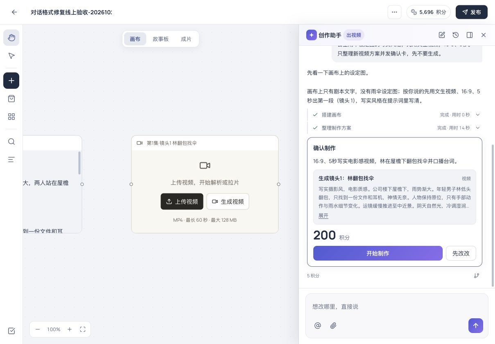

# Studio 出图后接视频续接修复 · 2026-10-23

## 线上证据

画布 `IPP-d395bde4`：用户要求按第1集剧本出第一段视频，引用场景与人物设定图。`IPR-934a115ea590418ea2a3` 和 `IPR-8f07b9b28ad54804a08e` 的输入仍绑定 `image-generation`；`propose_plan` 返回 `STUDIO_SKILL_OPERATION_NOT_ALLOWED`。同批 `request_approval` 随后取历史图片计划发卡，两次后续回复均显示图片完成 30 积分，视频步骤未启动。排查对客户原记录仅 SELECT；未重投原付费媒体任务。

## 修复

- 视频产物优先于素材关键词；规划工具对上下文续接的具体 brief 再路由，按原锁、技能和制作授权边界绑定。
- 规划失败继续本轮纠正。确认卡只使用本轮成功保存且方法/阶段一致的计划，旧图片计划不能冒充新视频计划。
- 用户侧不再显示内部阶段报错；可恢复信息引导模型自行纠正，保留原内容与素材。

## 验证与发布

本地 93 项后端回归全通过（含 HTTP/SSE、H2 与实际账本集成）；用真实故障形状验证同批规划失败与旧卡拦截后，在同一轮第二步成功切到视频、保存计划并且只发 1 张新视频确认卡。全仓类型、后台类型、后端编译和 API 契约检查通过。

已先合入并推送 main，从干净 main `e27daf5bfa3f636d0e82c3d28c4374fcfad2095a` 构建。发布 `20261023-studio-stage-continuation`，仅 server，无迁移、生产配置或客户数据补写。`deploy-release.sh` 与 `verify.sh ALL GREEN`；线上/本地 JAR SHA-256 一致：`4393422d264837eacf8214ff815bb4c76128c6a84309ee9ee90ef36557ad08f5`。服务 MainPID `2021572`，NRestarts=0，已同步 release-id/release-sha 标记。

发布前对当前图片端点的 6 张等待票据暂缓派发，保留原派发时间，等待在途 `IPR-df9e9f3e` / `IPR-02f3b8c9` 都成功完成后才切换服务；发布完成已恢复原派发时间、FIFO 正常继续。不取消任务、不重提供应商请求、不动积分冻结。旧 JAR、标记、票据恢复 SQL 和客户任务前后摘要保存在生产 `/opt/ai-star-eco/backups/studio-stage-continuation-20261023/`。客户 `IPP-d395bde4` 全部任务状态、费用与输入/输出哈希前后完全一致。

## 真实线上对话验收

独立验收画布 `IPP-52c03d5c`，新线程 `IPT-da1dd8d49a424d0e95ff`。只做方案与确认入口验收，没有点击付费媒体「开始制作」。

1. 发布前先准备办公室雨伞宣传图的方案，`IPR-179b7693d49e4005a2b7` 成功给出 30 积分图片确认卡，未开始生成。
2. 发布后同线程要求「按第1集剧本出第一段视频，沿用设定图风格，文生视频 16:9、5秒」，`IPR-31ad8ccfcf93451c98e7` 自动绑定 `video-generation`，创建一个空视频对象，成功整理视频计划与 200 积分确认卡，有「开始制作 / 先改改」。没有阶段不允许报错。
3. 旧图片卡状态 `superseded`，页面显示「已更新 / 已有新的报价，见下方」；新视频卡 `pending`，指纹 `2035958a865109af1994ff47c19757d57dfe010b3fc1fba0650679e787dd2fde`。刷新后保持相同状态与确认入口。
4. 视频方案这轮共 3 次模型调用 / 3 次工具，实际对话 5 积分；账本只有 1 FREEZE（260）、1 SPEND（5）、1 UNFREEZE（255），只有 1 个 hold。验收画布媒体 run 总数为 0，没有重复出图或提前出视频。

验收边界：真实 Qwen 验证跨类型方案、报价、旧卡失效和持久恢复；真实故障批次失败后同轮纠正用受控回放验证。没有替客户发送消息或启动客户原视频任务。

