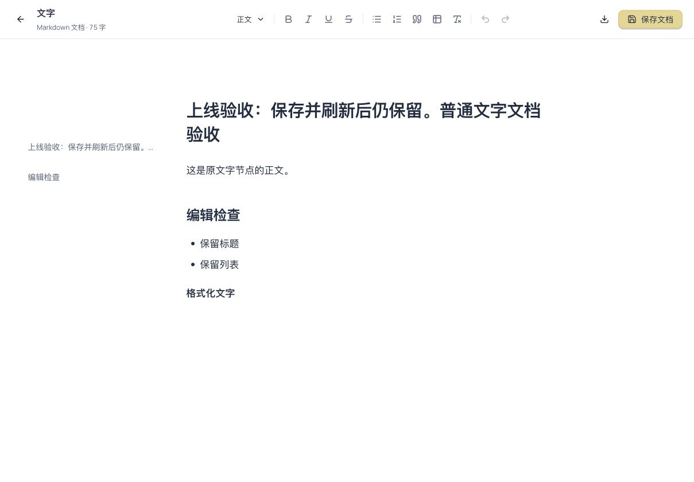

# Studio 普通文字文档编辑统一 · 生产发布与验收

- 日期：2026-10-22。
- 发布范围：仅 `web-aiavatar`。
- 功能提交：`2c4cff28`；合入并推送 main 后，从干净 main `bd3a9df229f090b70088be81fee3e87b49a53240` 构建。
- Release ID：`20261022-studio-text-document`。
- BUILD_ID：`aLmT_nLdgo9s9yRxdpfOZ`，本地与线上一致。
- 后端未发布，`aistareco-server` PID 仍为 `1728015`。

## 行为

普通文字在画布浮层与故事板详情中点「展开编辑」，均进入已有的富文本文档界面。支持标题、格式、列表、表格、目录与 Markdown 导出；保存仍写回原节点的 `metadata.content`。解析／拉片文档通过原组件复用同一外壳，不给普通文字强加剧本结构。

「收起编辑」与 Esc 先保存，成功后回原浮层／故事板详情；失败保留文档供重试。未改变生成、计费、模型选择或后端接口。

## 验证

- 干净 main 上工作区类型、后台类型、后端离线编译、API 契约检查通过。
- 4 个相关测试文件覆盖 105 项用例通过；首轮高负载时图片参数回归在 15 秒超时，单项重跑 1.6 秒通过，未放宽仓库测试配置。
- 开发工作区全量测试发现的后台审计页原生选择框守门失败已在 TODO.md 记录，本次不修改后台。
- `build-release.sh web-aiavatar` 生产构建通过；mock/dev-login 关闭，OIDC 正式 issuer，企业入口沿用生产构建值 `1`。
- `deploy-release.sh` 完成，自带 `verify.sh` 全部健康、公共路径、服务 API、字体与 Nginx 检查通过。
- `https://aiavatar.aibuzz.cn/projects` 返回 200；公网文档编辑脚本与本地 SHA-256 一致。

## 线上用户流程

使用新建独立画布 `IPP-bcbaf1bf`（「文档编辑上线验收-20261022」），没有改动用户原有画布。

1. 普通文字输入含标题、列表和加粗的 Markdown；展开后显示完整格式工具栏、真实标题目录与排版正文。
2. 在富文本视图手动编辑，保存文档，收起回原浮层，再展开仍保留改动。
3. 整页刷新后重新读取同一画布，原文字节点仍为 1 个；修改后的正文与原列表／加粗均保留。
4. 故事板打开同一文字的详情、展开文档，仍显示已保存的正文；收起返回原详情，随后正常回到画布。
5. 验收前后可用积分均为 5,717；未提交模型任务，控制台 error 数为 0。手机布局与真实模型生成不在本次验收范围。

## 制品与回退

- 制品：`dist/deploy/20261022-studio-text-document/web-aiavatar.tar.gz`。
- 制品 SHA-256：`b8c6b6c7c535c5199103fb6579fd8da2085fc18368eaeb652865b7ad0848f260`。
- 公网脚本：`/_next/static/chunks/3215.c496e0c784d3f85d.js`。
- 脚本 SHA-256（本地与公网）：`d1632c458f71e78b2ce0633b050f6836c643372f820262f60a8e4c49c8aae18b`。
- 前端服务 active、PID `1788705`、NRestarts=0；服务目录 release-id / release-sha 已标记本次发布。
- 独立备份：`/opt/ai-star-eco/backups/studio-text-document-20261022/web-aiavatar`（108MB），旧版 `20261022-studio-node-editor-actions` / `cf91ae0e`。
- 需要回退时恢复该前端目录并重启 `aistareco-web-aiavatar`，复查 BUILD_ID、公共路径和服务健康；无需数据库／后端回退。本次未执行回退。
