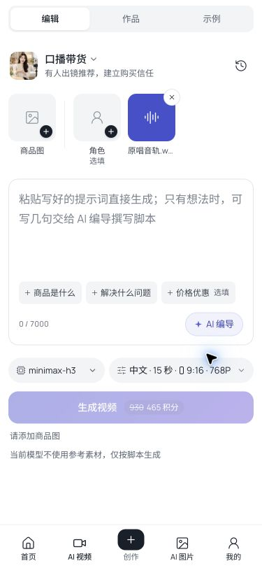

# AI 视频声音选中显示 · 生产发布与验收

2026-11-08 完成声音选中显示修复，并按用户最终要求将选中卡片改为紫色重点色背景、白色声音图标。卡内不放文字，下方保留真实声音名称，长名称省略并提供完整悬停标题。空态保留麦克风与加号；可继续更换或移除声音。

## 发布真值

| 项目 | 已验证值 |
| --- | --- |
| 最终代码 | `7be9bb8a81b7bf628aba6a9a441a500c65a301e6` |
| 主分支合并 | `968a8e95f49d559d7291a459ba077791530febc6` |
| PR | [#172](https://github.com/pokocat/AIStarEcosystem/pull/172)、[#173](https://github.com/pokocat/AIStarEcosystem/pull/173)、[#174](https://github.com/pokocat/AIStarEcosystem/pull/174)，均已合入 |
| 最终发布 | `20261108-studio-voice-accent-7be9bb8a` |
| 服务 | 仅 `web-aiavatar`，未重启后端 |
| 生效时间 | 2026-11-08 14:06:28 UTC |
| Next BUILD_ID | `3XXF-j204_lqJx9Wfkii6`，部署包与运行目录一致 |
| 制品 SHA-256 | `c18b2f568d2234ad130b6d88e7be1f4981bb979e6063b3df52dcae2e50ff4b4d`，本地与生产发布目录一致 |

独立工作区从最新主分支创建，只移入本次修复，保留原工作区已有的复刻、后端等修改。发布前核对聊天状态和生产发布进程，没有并行发布。构建沿用现网 OIDC、企业功能开启和真实 API 配置；制品内没有 `.env*` 文件。

## 修复与检查

声音原本已经选中并能移除，但素材格仍渲染空态。改为明确选中态，并在保存时保留资产名称。旧草稿重新选择同一份音频时同步更新已有节点标题，保留节点 ID，不重复新增音频节点。

- Mac mini 全应用回归：226 个文件、1950 项测试通过；旧资产选择器异步断言曾失败一次，同代码重跑通过。
- 最终样式：3 个相关场景测试文件、50 项测试、类型检查、接口契约及生产构建通过，远程任务 `506d5ab25508`，退出码 0。
- 最终 PR [CI](https://github.com/pokocat/AIStarEcosystem/actions/runs/42487761660)：完整应用测试两组、接口契约、类型检查、生产构建和汇总全部通过。CI 的浏览器交接步骤按范围未选中，真实线上 UI 验收见下。
- `deploy-release.sh` 仅发布前端，退出码 0；[健康检查记录](evidence/studio-voice-selection-20261108/verify.txt)为 ALL GREEN。

首次功能修复已先发布 `20261108-studio-voice-c5d56bde`。其初次本机域名健康探测因解析线路超时失败；使用临时 `--resolve` 指向同一生产 IP、保留正常 TLS 校验后重验通过。最终重点色发布直接通过完整健康检查。

## 线上 UI 验收

入口 `https://aistar.aibuzz.cn/video?scene=ecom-talking`，通过真实已登录会话创建仅用于声音选择的草稿 `IPP-87f13a4b`。没有提交模型生成，积分保持 2078。

| 操作 | 结果 |
| --- | --- |
| 资产库选择「原唱音轨.wav」 | 素材位显示声音名称，选中态无加号 |
| 旧草稿重选同一声音并刷新 | 名称保留为「原唱音轨.wav」，选中状态保留 |
| 更换「原片音频.m4a」 | 名称与所选声音一致 |
| 移除声音 | 恢复空态和加号 |
| 最终重点色版本刷新 | 紫色底、白色声音图标，卡内文字为空，名称保留 |
| 手机 375 × 812 | `data-layout=mobile`，选中底色与图标一致，页面宽度和滚动宽度均为 375 |

[DOM 核对](evidence/studio-voice-selection-20261108/voice-accent-verification.json)：选中背景 `rgb(70, 80, 207)`，图标 `rgb(255, 255, 255)`，卡内 `textContent` 为空；桌面与手机均无空态加号。验收结束已恢复浏览器默认视口。

