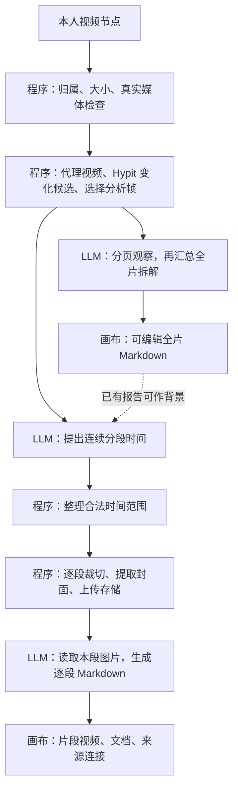
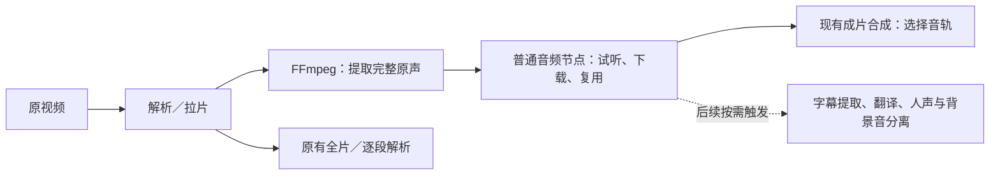

# 视频拉片技术分享：媒体工程、模型理解、成本与音频补全

> 整理日期：2026-10-17。面向产品、前后端、模型接入与运维同事，建议分享时长 25～30 分钟。
>
> 状态：第 1～6 节记录 2026-10-17 梳理时的线上基线与配置；第 7 节按用户反馈收简，记录原声提取与已有验收；音频增量已于2026-10-17发布，版本与未追加业务验收的边界见发布记录。不自动做 ASR、字幕或人声／背景音分离。

## 1. 从产品结果理解系统

用户从视频节点选择「素材拆解 → 解析／拉片」，确认后设置面板关闭，任务进度留在画布节点。解析产生可编辑的全片创作拆解；拉片产生连续的视频片段和逐段 Markdown，完成一段即落地一组节点。

这套能力由三个部分协作：程序负责真实媒体和时间，模型负责理解内容与创作表达，画布负责组织、查看和编辑产物。

| 能力 | 当前状态 |
|---|---|
| 全片创作拆解 | 已实现：创意命题、视觉基因、创作骨架、核心创作手法等 Markdown |
| 分段拉片 | 已实现：1～8 个叙事／动作片段、真实裁切、逐段解析、画布落地 |
| 精确逐镜切分 | 尚未实现；一个片段可以包含多个镜头 |
| 原声保留 | 已实现：裁切 MP4 保留存在的原音轨 |
| 独立音频资产、自动字幕、声音理解 | 尚未接入拉片流程 |
| 根据拆解自动生成新视频 | 属于后续显式创作操作，当前拉片不会自动生成新视频 |

全片解析与分段拉片是两项可独立提交的任务。拉片可以直接开始；已有全片报告时，使用当前保存的 Markdown 作为背景，不必重新生成报告。用户编辑过的结果继续保留。

## 2. 当前系统流程：程序与 LLM 的分工



### 2.1 视频证据由程序准备

当前输入限制为 60 秒、128MiB。服务端检查素材归属，用 ffprobe 读取真实时长与媒体信息，再运行随项目引入的 Hypit 媒体代码。

Hypit 固定版本为 `dc2b7a8f31b1ef1443a79ca448548d69e3ceb6a0`。我们使用本地源码与适配器，不调用 Hypit 云端或渲染服务。

处理过程：

1. 制作最长边约 640px 的代理视频，保留原片时间戳。
2. 解码代理视频原始帧，计算明显视觉变化候选。
3. 优先选择变化前、变化时、变化后的画面，保留片头片尾，再补时间空隙。
4. 最多保留 64 张分析帧，每页最多 8 张组成联系表，附真实时间戳。

亮度突变会单独标记，闪电不直接等于切镜。变化候选也不代表精确镜头边界。

全片报告最多另外展示 4 张可复用参考图；这 4 张是画布产物数量，不是模型分析帧的总数。

### 2.2 全片解析：先观察，再汇总

每页图片调用模型记录可见内容，再通过一次汇总调用生成全片创作拆解；汇总时附独立尾帧，减少只依赖中间文字描述带来的信息损失。

设分析图片页数为 P，则全片解析调用次数为 `P + 1`，最多 9 次。所有调用使用同一模型端点，共用任务的输出预算和积分结算。

### 2.3 分段拉片：模型规划，程序裁切，模型逐段解释

模型根据联系表、时间戳、视觉变化和可选全片报告，提出 1～8 个连续段落。程序约束时间有限、递增、在真实片长内并覆盖片尾。规划缺失或无法解析时，按非闪光的视觉变化候选兜底。

每段由 FFmpeg 从原视频真实裁切为最长边不超过 1280px 的 H.264/AAC MP4，另抽一张 JPEG 封面。存在的原音轨会保留；ffprobe 检查产物可读性和时长，当前允许目标时长误差 0.3 秒。

随后模型读取该段范围内的采样图片，生成：

- 镜头构造：原片时间、画面骨架、摄影机、调度构图与焦点。
- 段落表达：叙事、视觉变化、剪辑节奏；当前声音明确标为未分析或创作建议。
- 视频生成 Prompt：规格、主体、场景、镜头序列、运镜、光色材质和约束。

**裁好的 MP4 当前供用户播放复用；模型仍读取图片，没有直接读取这些 MP4，也没有听音频。**

设最终片段数为 S，新任务的模型调用次数为 `1 + S`：一次规划，之后每段一次解析。任务内顺序处理，逐段保存检查点；显式继续时复用已完成文档和已裁切媒体。

### 2.4 程序检查什么

保留素材归属、真实时间、可解析分段、媒体产物、Token 用量与计费检查。模型对情节、摄影和主题的判断不做语义硬判，也不拿恐龙范例的故事结论强行校验正文。

画布使用稳定节点 ID 增量落地视频、文档和连接，保存 storageKey，展示时签名 URL；刷新或恢复不重复建组、不覆盖用户已编辑文档。查看、编辑、导出 Markdown 不产生新的模型调用。

## 3. 历史示例：恐龙 Demo 的执行记录

本节保留历史流程和成本证据，不再作为本轮本地验收素材。2026-10-17 用户指定后，后续本地真实媒体测试改用 `1792081443234..mp4`，原文件不进入仓库。

| 项目 | 实测结果 |
|---|---|
| 原片 | 17.067 秒，3840×2160，30fps，H.264/AAC，约 33.2MiB |
| 原始帧与变化 | 512 帧，15 个 Hypit 视觉变化候选 |
| 最终分析图片 | 52 帧，7 页联系表 |
| 历史拉片结果 | 5 段，5 个真实视频、封面及逐段 Markdown |
| 裁切视频 | 1280×720，均有音轨；视频文件合计约 6.9MiB |
| 编辑恢复 | 已验证保存、刷新、播放、文档编辑与导出 |

按这一规模，全片解析为 8 次模型调用，五段拉片为 6 次；两项都运行，共 14 次调用。两项任务目前各自抽帧，尚未共用跨任务的证据缓存。

历史五段任务实际扣 11 积分，使用的是 Agnes。当前 Qwen 端点只完成过独立文字与图片连通性验证，不能把旧任务的内容质量和费用写成 Qwen 的同片实测结论。历史验收以流程和媒体产物为主，模型内容尚不能宣称达到用户范例的准确度。

证据见[功能记录](ip-studio-recreation.md)、[培训手册](training/studio-film-study.md)、[发布记录](studio-film-study-production-release.md)与[模型切换记录](studio-upload-chat-repair-20261016.md)。

## 4. 资源使用与成本口径

| 资源 | 消耗位置 | 扩量时关注什么 |
|---|---|---|
| CPU | 视频解码、缩放、变化分析、裁切重编码、封面生成 | 多任务并发、重复解码；单个 FFmpeg 的线程限制不是全局并发限制 |
| 内存与临时磁盘 | 视频、解码帧、拼图、裁切文件 | 峰值、临时文件清理、失败退出 |
| OSS | 原片、片段、封面及参考图 | 保留周期、复用、删除策略 |
| 网络 | 素材读写、发图给模型、播放下载 | 图片请求体、跨服务流量、播放次数 |
| 数据库 | IpRun、输入输出、检查点、画布文档 | 文档体积、轮询与保存频率 |
| 外部模型 | 图片／文字输入、分析文字输出 | Token、请求数、并发额度与供应商失败 |

当前媒体处理无需自建 GPU，模型算力由供应商提供。没有调用 TTS、AI 生图或 AI 视频生成。

### 4.1 用户积分

2026-10-17 只读核对的线上场景为 `studio.script`，固定端点 `ai-studio-jusuan-qwen38`，模型别名 `qwen38-27b`，候选图片上限 9。全片解析、分段规划、逐段解析共用这一端点。

当前用户售价：输入 0.18 积分／千 Token，输出 1.08 积分／千 Token。汇总同一任务所有调用后统一向上取整：

```text
实际积分 = ceil((输入 Token × 0.18 + 输出 Token × 1.08) / 1000)
```

| 假设累计用量 | 实际积分 |
|---|---:|
| 输入 20K，输出 4K | 8 |
| 输入 30K，输出 5K | 11 |
| 输入 50K，输出 8K | 18 |

当前单项任务预算为输入 65,536、输出 8,192 Token，最多先冻结 21 积分，成功后按实际用量结算并释放剩余部分。全片解析与分段拉片分别结算。图片处理产生的输入 Token、提示词、重复传入的全片背景都计入用量。

### 4.2 平台成本

用户积分售价、供应商采购价、服务器成本分别管理。新 Qwen 端点沿用原客户端积分费率，尚未按新供应商成本重新核价；旧模型的采购价不能直接套用。

```text
单任务平台成本
  = 各模型调用的供应商费用
  + 媒体处理算力分摊
  + 存储、请求与网络费用
  + 失败、重试及其他运营分摊
```

目前没有完整的单任务 CPU 时间、内存峰值、临时空间和流量账单，无法准确报每条的人民币成本。用户冻结释放，也不代表供应商已经执行的请求没有成本。

建议补充记录各阶段耗时、源片规格、分析帧数、图片字节数、各次 Token、产物字节数、供应商账单关联和复用命中情况。日志保留标识与用量，不记录密钥或签名媒体 URL。

## 5. 效果取决于哪些能力

| 能力 | 在恐龙片中的具体作用 |
|---|---|
| 时序与动作理解 | 判断挑战、攻击、失败和新对峙的先后关系 |
| 主体连续性 | 区分霸王龙、成年迅猛龙和幼崽，追踪跨镜头主体 |
| 摄影与剪辑理解 | 分清主体运动和运镜，解释低机位、轮廓光与节奏 |
| 音画联合理解 | 分析雷声、吼叫、音乐停顿与闪电、攻击的配合 |
| 指令与格式稳定性 | 输出合法分段和易读、可编辑的中文 Markdown |

当前有三处信息瓶颈：

1. 约 640px 的代理画面已经丢掉部分细节，之后放大图片无法恢复原片纹理与小字。
2. 离散抽帧、每段最多 9 图，可能漏掉快速连续动作；画面变化也不能精确代替镜头边界。
3. 8,192 输出 Token 是整项任务共享。规划占 768，五段时每段约 1,484，八段时约 928，详细拆解容易过短。

改进方向是增加关键位置的原片清晰帧、接入音视频理解或音频证据、按段配置输出预算；与此同时维持真实媒体与时间检查。强模型需要拿到足够的信息。

## 6. 模型选择与价格参考

以下是按 2026-10-17 查阅的官方能力和价格提出的候选，尚未做我们的同片质量对比。聚算的 `qwen38-27b` 是当前供应商端点别名；百炼官方 `qwen3.8-omni-flash` 是另一条接入，能力声明和价格分别核实。

| 候选 | 建议位置 | 官方能力依据 |
|---|---|---|
| Qwen3.8-Omni-Flash | 国内音视频分析优先候选 | 文本、图片、音频、视频输入，文本输出，1M 上下文；[官方文档](https://help.aliyun.com/zh/model-studio/qwen-omni) |
| Gemini 3.8 Flash | 视频理解对照组，比较效果和成本 | 支持视频与音频处理；静态方式默认抽帧，快速动作仍需配置采样；[官方文档](https://ai.google.dev/gemini-api/docs/video-understanding) |
| GPT-6.1 Sol | 图片证据分析、创作归纳与文档生成对照组 | 图片输入、结构化输出；不直接接收音视频，需要配合抽帧和转写；[官方文档](https://developers.openai.com/api/docs/models/gpt-6.1-sol) |

假设累计计费输入 30K、输出 5K Token，使用标准在线调用，不计缓存和额外推理用量：

| 模型 | 每百万输入／输出 Token | 上述假设计费用量 |
|---|---|---:|
| Qwen3.8-Omni-Flash，中国内地 | ¥0.8／¥2.7 | ¥0.0375 |
| Gemini 3.8 Flash，当前优惠 | $0.75／$3.75 | $0.04125 |
| GPT-6.1 Sol | $2／$10 | $0.11 |

这不是同一视频的报价：不同模型计算图片、音视频 Token 的方式不同，推理 Token 也可能计费；接入渠道还可能有不同价格。Gemini 表中优惠截至 2026-12-31。价格来源：[百炼](https://help.aliyun.com/zh/model-studio/model-pricing)、[Gemini](https://ai.google.dev/gemini-api/docs/pricing)、[OpenAI](https://developers.openai.com/api/docs/models/gpt-6.1-sol)。

建议以同样素材、相近证据和可比输出预算做一次人工对比：恐龙动作片、有人声的口播片、字幕密集片。分别记录动作理解、主体连续性、声音／字幕、摄影表达、耗时和实际采购成本。这个对比用于选型，不新增模型语义硬判流程。

## 7. 按产品边界收简：拉片只提取原声

2026-10-17 用户补充小云雀截图后调整范围：拉片附带提取原声即可；字幕提取、翻译、人声与背景音分离等放在音频节点，后续由用户单独触发。此前将 ASR 列为拉片必经步骤的建议撤回。

### 7.1 本轮产品与工程行为



- 不增加设置项或弹窗。解析／拉片受理后，有音轨则自动提取一份完整原声。
- FFmpeg 将第一条音轨解码成 48kHz、双声道、16bit PCM WAV，保留混合声音；不降噪、不调音量、不转写、不拆人声和 BGM。格式统一便于普通音频、成片合成及现有 WAV 输入复用，不增加新的有损编码。
- 没有音轨时记录 `absent`，不创建静音占位。音轨本身静音时仍可提取，不声称检测了人声。
- 原声保存为本人资产，`output.sourceAudio`带来源、状态、storageKey、真实时长和字节；URL仅出wire签名。
- 原声先保存检查点，后续模型失败不丢失结果。继续分段时复用服务端同本人、同项目、同目标节点和同原片的快照。
- 前端创建普通音频节点，标题为「视频名 · 原声音频」。同一原片的全片解析与拉片复用已存在音频节点；轮询不覆盖用户改名或重建已删除节点。
- 提取阶段显示「正在提取原声音频」，无新增 LLM 调用、ASR 服务或提取积分项，原有解析仍按原规则收费。

完整混合音轨包含原片对白、音乐和环境音，不能把它标成已经分离干净的 BGM。操作截图中的产品名称也不作为我们完成音源分离的证据。

### 7.2 音频怎样用于新视频

现有成片合成已经支持从画布普通音频节点选择 `packaging.voiceoverStorageKey`，用它替换成片音轨。提取的原声节点可直接出现在这个列表中，用户显式选择后再合成；音频不能长于成片，替换音轨不会重新匹配口型。

现有 Studio 原生视频的「全能参考」链路已支持 image／video／audio，`StudioVideoService`会按所选模型合同检查音频格式、大小、时长和数量，再通过供应商素材上传或音频参考字段传入。选择支持音频的模式时，原声节点可作为参考；部分模式还要求同时提供图片或视频。未支持音频的首帧／尾帧等模式仍不能混入音频。

作为生成参考不保证原样保留音轨；希望复用原声音轨时，使用「先生成画面，再用原声合成」。恐龙全片约17秒，不能仅因音频节点已存在就承诺满足所有模型的参考音频时长限制，也不能自动截断原声。

WAV 格式也符合现有口型入口的音频格式要求，但是否适合驱动人物取决于素材本身；混合雷声或配乐并不等于有效人物对白，不自动提交口型任务。

### 7.3 后续工具归音频节点

| 工具 | 处理方式 | 当前边界 |
|---|---|---|
| 字幕提取 | ASR：识别人声，输出带时间的文本 | 后续独立模型、报价、编辑与导出；拉片不自动执行 |
| 画面已有字幕 | 读取文本字幕轨，或用 OCR 提取烧录文字 | 与人声转写区分来源，后续按需开放 |
| 音频翻译 | 转写／翻译，可能再合成语音 | 独立动作，不随拉片消费 |
| 人声与背景音分离 | 音源分离模型 | 产物可能有残留，不能用 FFmpeg 提取音轨冒充 |
| 音乐／音效理解 | 音频或音视频理解模型 | `audioAnalyzed=false` 当前保持不变 |

媒体提取机制参见 [FFmpeg stream selection](https://ffmpeg.org/ffmpeg.html#Stream-selection)。ASR 后续如需选型，再核实时间戳和语言能力，参考[语音识别文档](https://help.aliyun.com/zh/model-studio/speech-recognition)。本轮不配置 ASR 供应商和售价，也不把这些后续工具做成禁用的假功能按钮。

### 7.4 资源与验收

原声提取只新增 CPU、文件读写与音频存储。48kHz、双声道、16bit PCM 约 11.52MB／分钟，不含 WAV 头；当前视频上限为 60 秒，体积有界。无新的供应商推理费用。

本轮本地验收结果：

- Java 17 对本次涉及的 8 个服务类定向编译通过；JUnit Console 运行 60 项相关用例全部通过，覆盖原声、分段裁切、全片报告、资产归属与签名、合成替换音轨等。
- 本轮素材改为用户自己的 `1792081443234..mp4`：720×1280，H.264/AAC，原片15.071995秒、4,124,607字节。中断前启动的媒体测试已完成4项通过；实际提取15.092979秒WAV，48kHz双声道PCM，2,897,976字节，时长差约0.021秒。产物在本机 `.studio-e2e/recreation-audio/user-video-20261017/source-original.wav`，原文件和产物不进仓库。
- 有声／无音轨／静音素材、提取失败与恢复复用通过。音频存储使用测试替身，真实FFmpeg读写媒体；没有将其表述为生产OSS端到端验收。
- 前端共 58 项相关回归通过，覆盖原声落地、跨同源任务去重、改名保留、删除不重建、全片分组布局、签名恢复、视频参考与原有设置；AiAvatar类型检查通过。
- API契约检查通过；Impeccable对两个修改面板的机械扫描为空。浏览器控制连接超时，未完成本轮页面实操和截图；不将组件检查替代浏览器验收。
- 未调用收费供应商、未新增用户扣费。用户随后要求直接提交发布，不再追加测试或页面验收；实际发布状态见[原声提取发布记录](studio-source-audio-release-20261017.md)。

上述验证不代表字幕或音效理解已实现。用户已要求直接发布，因此真实页面上的解析／拉片 → 原声播放／下载 → 选择音轨合成流程仍待后续补验；本次已发布，不据此宣称页面全链验收通过。

## 8. 分享时可直接使用的代码导航

路径相对仓库根目录，状态以代码和最新配置为准。

| 真源 | 职责 |
|---|---|
| `tools/hypit-media/entry.ts` | Hypit 原始时间帧解码和视觉变化适配 |
| `apps/server/src/main/java/com/aistareco/aep/ipstudio/service/StudioHypitMedia.java` | 媒体运行时与调用 |
| `apps/server/src/main/java/com/aistareco/aep/ipstudio/service/StudioVideoSampler.java` | 分析帧选择 |
| `apps/server/src/main/java/com/aistareco/aep/ipstudio/service/StudioRecreation.java` | 素材快照、图片证据、全片报告处理 |
| `apps/server/src/main/java/com/aistareco/aep/ipstudio/service/StudioFilmStudy.java` | 分段规划、裁切、逐段 Markdown |
| `apps/server/src/main/java/com/aistareco/aep/ipstudio/service/StudioSourceAudio.java` | 本地新增：完整原声提取，无模型调用 |
| `apps/server/src/main/java/com/aistareco/aep/ipstudio/service/StudioWorkflowService.java` | 准入、任务受理、预算与恢复 |
| `apps/server/src/main/java/com/aistareco/aep/ipstudio/service/StudioWorkflowWorker.java` | 模型编排、检查点、累计用量和结算 |
| `apps/server/src/main/java/com/aistareco/aep/service/AiChatTokenPricing.java` | 用户 Token 费率、冻结上限和实际费用计算 |
| `apps/web-aiavatar/src/canvas-bridge/studio-film-study.ts` | 分段产物增量落地画布 |

分享讨论可以围绕三个问题展开：边界检测为什么归程序、连续动作和音画为什么需要更完整的模型输入、为什么用户售价与单任务采购成本必须分开记录。
