> 实施更新（2026-10-16）：用户已授权界面重构；部分方案已在本地接入，实际能力与【待建设】边界见 [本地实施与验收](releases/studio-workspace-refactor-validation.md)。本文保留设计目标，不代表所有规划功能均已实现。

# Studio 六项导航与关键页面图片设计

日期：2026-10-16。状态：图片设计稿，未接入应用，未修改业务代码。

本批按 [导航与内容组织定稿](studio-information-architecture.md) 制作，结合 [实际页面核对](audits/studio-commerce-current-page-audit-2026-10.md)，以现有创作页、IP 管理页及人物选择器截图为视觉参考。交付为十一张独立 PNG，没有可点击原型。此前拼版图及两张 v2 图仍保持撤回状态。

一级导航统一为：**首页｜画布·自由创作｜场景·专项创作｜灵感｜资产｜发行**。

## 图片目录

| 图片 | 评审重点 |
|---|---|
| [一级导航与自由画布](design/studio/studio-v3/01-navigation-canvas.png) | 六项完整导航；原画布管理布局和自由创作语义保留 |
| [场景工坊](design/studio/studio-v3/02-scenes-workshop.png) | 剧情带货、爆款复刻、短剧、音乐并列；背后均为模板画布入口 |
| [资产里的我的 IP](design/studio/studio-v3/03-assets-my-ip.png) | 我的 IP 第一且默认；保留 IP 卡片、搜索与状态筛选 |
| [完整 IP 详情](design/studio/studio-v3/04-assets-ip-detail.png) | 人物设定、形象版本、关联声音、相关作品四部分均可达 |
| [画布内就地选 IP](design/studio/studio-v3/05-inline-ip-picker.png) | 人物选择保持在原项目上下文，不绕行资产页 |
| [发行首页](design/studio/studio-v3/06-distribution-overview.png) | 本人各类成片共用；草稿、来源和选择成片入口清楚 |
| [发布准备](design/studio/studio-v3/07-distribution-editor.png) | 成片、文案、商品、账号和时间计划；未填完也能保存草稿 |
| [矩阵账号](design/studio/studio-v3/08-distribution-accounts.png) | 可用、需重新授权、尚未开放的绑定动作分别表达 |
| [商品连入剧本](design/studio/studio-v3/10-canvas-product-script.png) | 原画布内拖入商品、连接剧本、指定场景和修改要求 |
| [改稿预览与采纳](design/studio/studio-v3/11-script-product-review.png) | 复用现有剧本编辑器，先预览、后采纳 |
| [发布记录](design/studio/studio-v3/09-distribution-records.png) | 草稿与平台任务分开，没有真实结果时如实显示空态 |

## 一级导航与自由画布

沿用原地球标识、IP Studio 品牌、浮动顶栏、搜索、积分和账号区域。原“创作”改名后仍管理同一批画布，保留状态筛选、搜索、排序和网格。图中的“已发布”仍指原画布/IP 资产发布状态，不作为发行结果。

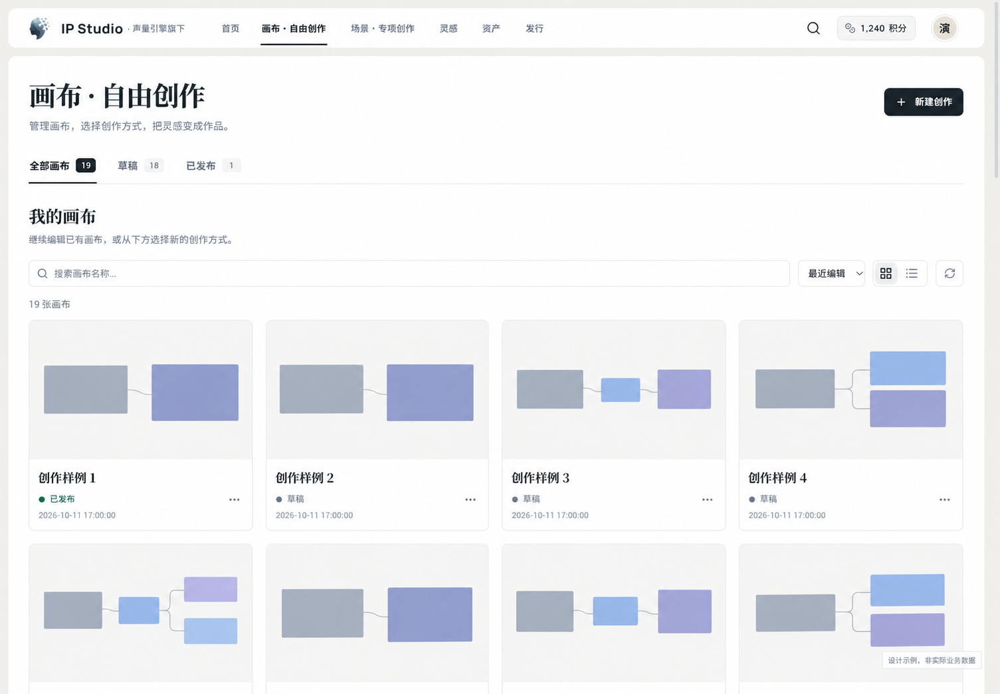

## 场景工坊

一级当前态为“场景·专项创作”，进入后的页面标题为“场景工坊”。剧情带货与新增爆款复刻为模板画布入口，短剧与音乐未接通时显示后续开放。使用同一模板预览/副本机制，创建后统一进入原画布列表，不另建专项项目管理。场景说明先表达用户的创作目的，具体拖入和连接操作留在画布内提示。

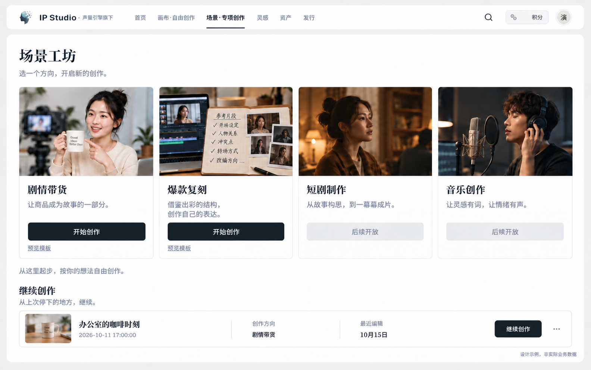

## 资产默认我的 IP

资产分类第一项“我的 IP”默认选中，其他分类为创作素材、生成与上传、声音。人物按 IP 身份管理，形象素材与视频仍是关联资产。原列表的搜索、标签、状态、排序与视图控件保留；状态筛选调整为工具栏下拉，避免和资产分类叠成两层大页签。

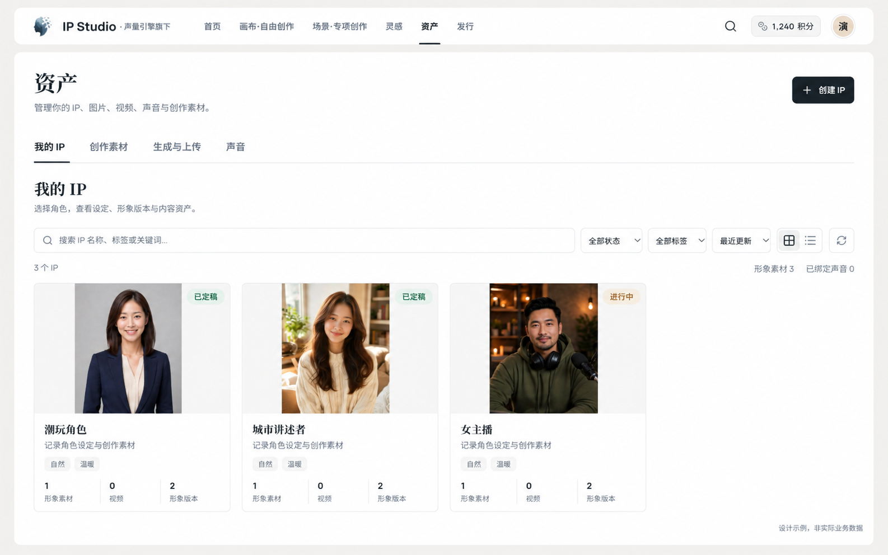

## IP 详情

沿用列表内打开详情的方式，不另造一套人物档案。详情将四类内容明确为可达页签，同时在人物设定页保留版本、声音、作品的入口。声音缺失时显示尚未绑定，不补造试听。底部延续设定编辑、进入画布生成形象和导出设定能力。

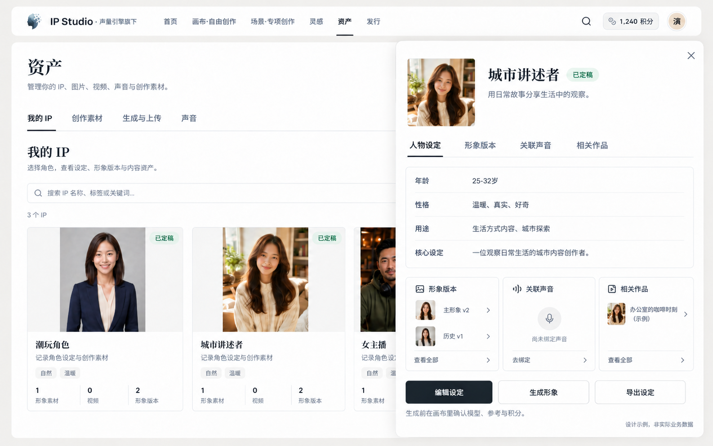

## 画布内就地选择

从画布直接打开“我的 IP”，背景保留原生画布和节点。选择人物和精确形象版本后回到原节点，未绑定声音也明确显示；取消不清空草稿。原独立带货建项表单已撤销，不新建另一份人物库。

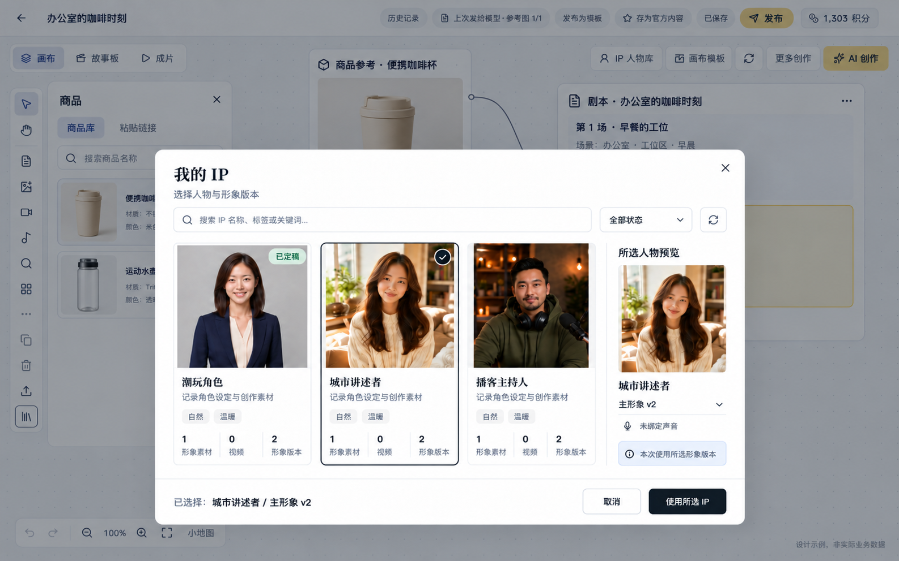

## 商品连入剧本

在原生全屏画布中打开商品浮层，将商品参考及植入要求连接到剧本。选中第2场后提出局部修改，预览前不改变原稿。图中并排呈现商品库、参考节点、要求节点和原剧本；这是一张操作状态设计，不增加独立选品路由。

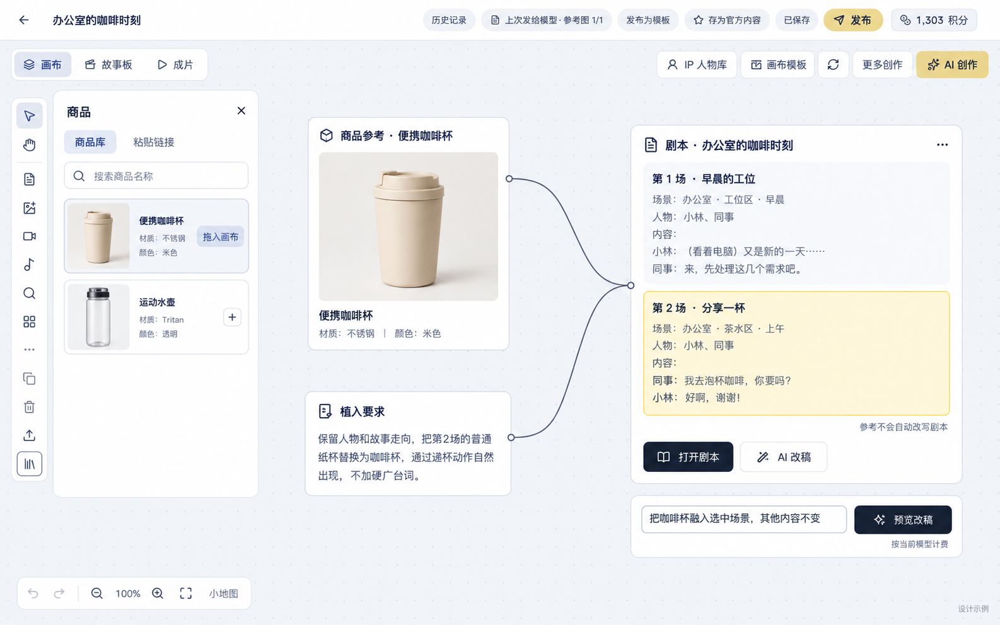

## 改稿预览与采纳

沿用当前全屏剧本编辑器，展示本次参考、修改范围、改稿对话和AI版本。用户采纳前保留当前稿；采纳或放弃沿用原机制，下游画面与视频不会自动重做。

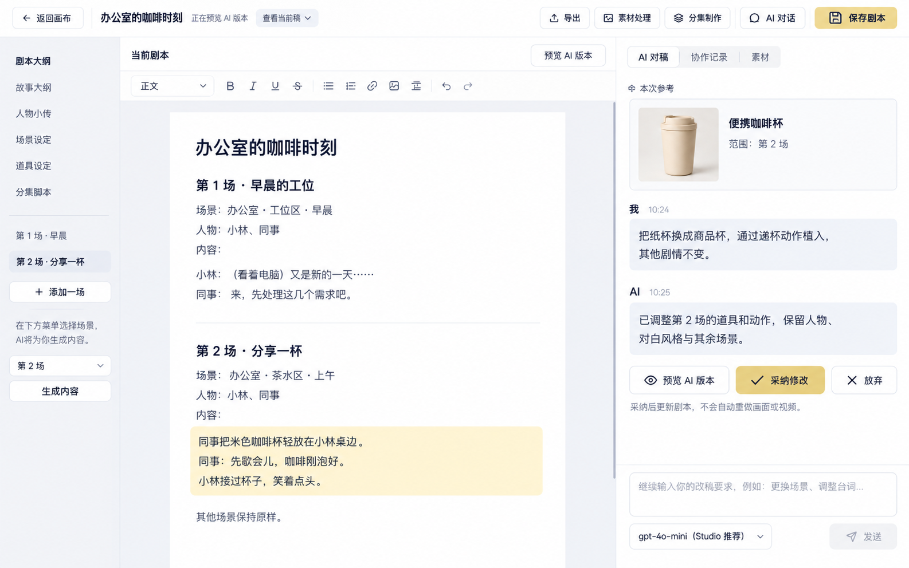

## 发行首页

发行不挂在带货内。作品可显示剧情带货等创作方向提示；实际来源始终是原生画布，不引入带货项目实体。图中展示剧情带货与自由画布两种标记，普通作品不要求关联商品。主动作是选择已有成片；发布草稿能继续编辑。没有自动发布能力时，界面说明当前可做的保存、下载与复制。

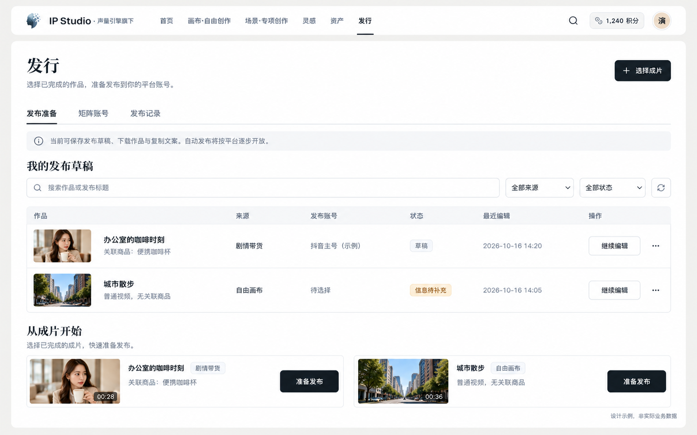

## 发布准备

左侧预览确定的原成片与商品，右侧编辑标题、正文、话题、目标账号与时间计划；右上唯一主动作“保存草稿”。时间和账号不作为草稿保存的硬性必填。商品信息只为后续发布准备，挂载结果不能提前承诺。下方保留“仅保存计划，不会自动发布”。

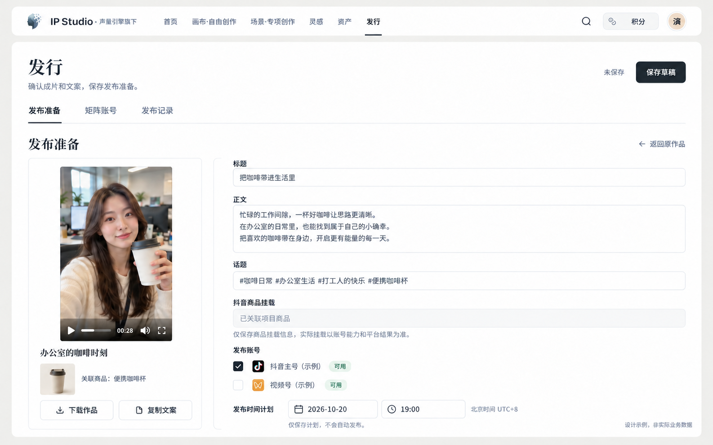

## 矩阵账号

本人已有账号按平台和状态筛选；不可用账号不能伪装成可执行目标。绑定和重新授权未开放时显示不可用及原因，仍允许用户回到草稿并手动发布。不使用假二维码、粉丝数或虚构绑定成功来填充页面。

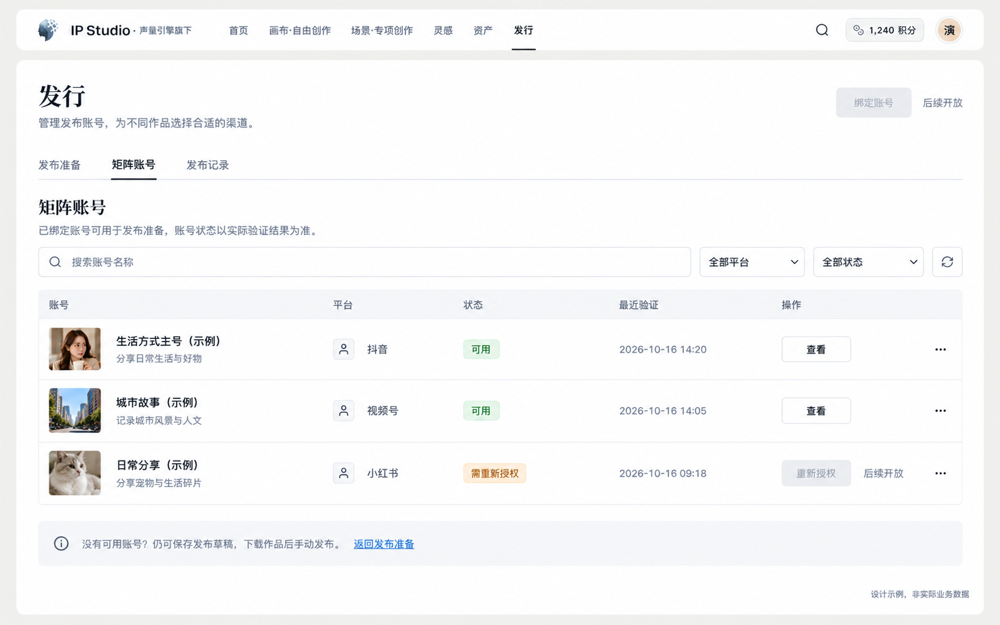

## 发布记录

草稿记录与平台发布结果分别管理。当前设计阶段展示草稿样例与平台记录空态，不模拟真实发布成功。后续平台接通后才展示按账号划分的实际任务和外部结果；下载或复制不会改变成“已发布”。

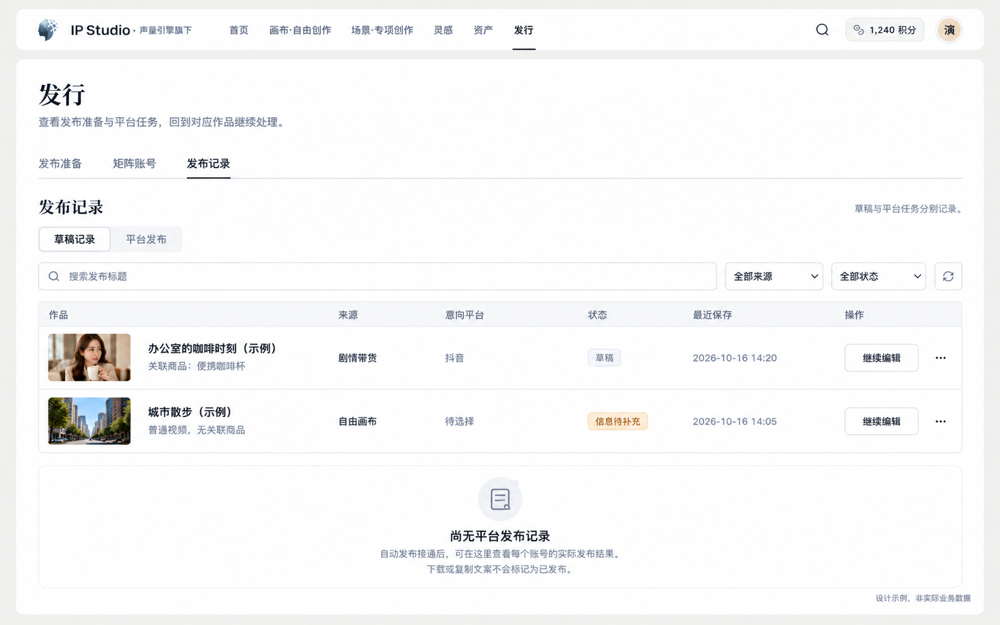

## 视觉和交付说明

本批采用保留现有界面的增量设计，颜色、品牌、标题层级、白色内容面、细边框和主要控件沿用 Studio。`design-taste-frontend` 用于现状审视、留白与视觉一致性，`gpt-taste` 用于构图、图片层级、标题和按钮可读性；不将营销页滚动叙事套进产品工作台。

所有人物、项目、素材数量、时间与积分均为设计样例或参考截图中的演示数据，不代表真实账户与业务状态。生成图里的平台小图标不作为实现资产，实际开发继续复用现有组件和真实品牌资源。图片用于页面布局与信息层级评审，具体像素、对比度、动效和交互需在未来实现时核验。

这批是桌面关键页面图。手机导航与布局没有在本批图片中完成，不将桌面六项直接塞进手机底栏；现有文档中的手机规则继续作为后续约束。

使用内置 imagegen 生成与定向修订。最终图片及其生成要求保存在 [图片目录和提示词清单](design/studio/studio-v3/manifest.json)。已检查新增与替换图片均为有效 PNG，并逐张查看核心导航、默认分类、IP 完整信息和发行状态边界；未执行应用构建或业务测试。
