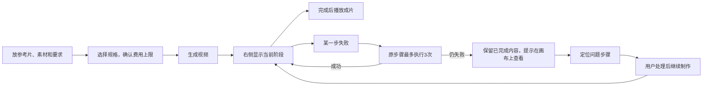
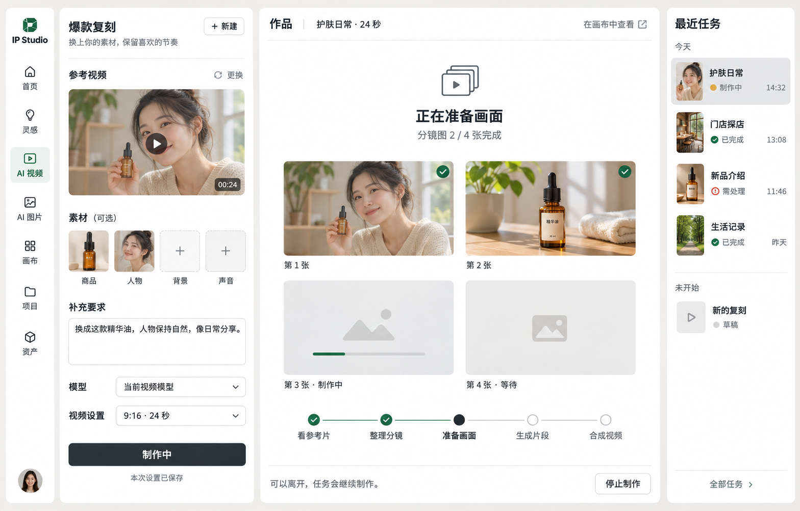

# AI 视频与爆款复刻：流程对比和界面方案

日期：2026-11-06（北京时间）。状态：按本方案本地实现与验收，未发布；不恢复此前暂停的部署。调研部分记录改造前的对比。

用户已确认：一个步骤**包含首次在内，总共最多执行 3 次**；已经完成的步骤不重跑。

## 1. 这次要解决什么

用户在左侧放好素材、填好要求，开始制作后留在当前页。右侧简单展示正在做什么，完成后直接播放成片。普通视频、长视频、爆款复刻遵循同一种操作方式，中间需要几步由后台处理。

正常制作不要求用户进画布。画布用来查看细节、修改和处理持续失败的步骤。刷新、换页、进画布再返回、从最近任务打开，都回到同一个任务和真实状态，不新建任务、不重新扣费。

这是现有 AI 视频页的交互扩展，沿用 IP Studio 的视觉体系；访客模式为 Operate。不是重做首页、导演台或品牌系统。

## 2. maolong 实际观察与差距

本次重新查看用户已打开的 [maolong 爆款复刻页](https://maolong.da-ai.cc/toolbox/depth-video-clone)，切换复刻方式并展开视频设置，对照我们线上 AI 视频页及当前代码。

| 环节 | maolong 可见行为 | 我们当前行为 | 本次方案 |
|---|---|---|---|
| 页面结构 | 左侧配置、中间预览、最右最近任务，三个固定区域 | 左侧编辑、右侧作品；“最近”藏在按钮里 | 保留左侧配置，右侧拆成主要展示区和窄任务栏 |
| 复刻入口 | 深度复刻、分镜复刻、元素替换，在同一表单内切换 | 爆款复刻把要求交给助手，跳画布后启动 | 表单内完成配置并启动后台制作，不自动跳转 |
| 素材 | 商品、人物、背景、声音可选，参考视频必选；上传位与说明集中 | 有场景素材和要求，但复刻后续交互落在画布 | 参考视频突出；替换素材按现有场景能力展示，原地校验 |
| 参数 | 模型与视频设置紧邻生成按钮；设置含比例、分辨率、音频、时长 | 参数已有；普通出片、长视频、助手接力三条入口体验不同 | 用户始终点一次“开始制作”；内部执行方式不改变页面动线 |
| 过程与结果 | 预览区初始展示效果示例 | 普通视频、分段执行、助手进度各有呈现；真实任务曾丢失入口 | 统一呈现当前任务，阶段与产物来自后台记录 |
| 历史入口 | 最近任务常驻右侧，已有草稿可点开 | 当前“最近”主要列草稿名称和时间，不是每次制作 | 按制作任务列封面、名称、状态、时间；草稿单独标注 |
| 离开与恢复 | 本次可见已有草稿入口 | 文档场景字段曾被画布保存覆盖；恢复修复已提交、尚未部署 | 服务端任务始终可找回，画布文档缺展示字段也不能让任务消失 |

**观察边界**：maolong 当前账号显示 0 积分，本次没有上传私人素材或启动付费生成。其生成中的动效、失败重试、完成状态及跨页恢复未做真实任务验收；下面的状态方案是我们的设计，不作为对方已实现的事实。

不照搬三种复刻名称。我们现有“爆款复刻”继续使用已接通的分析、改编与生成能力；“精准元素替换”“原动作完整保留”等承诺，只有对应模型和素材路径实测支持后才单独开放。

## 3. 主流程



- 普通视频只展示真实存在的步骤；无需凑齐五个阶段。
- 长视频：写分镜脚本 → 生成分镜图 → 生成片段 → 合成成片。已有脚本可复用时不再写一遍。
- 爆款复刻：分析参考视频 → 写分镜脚本 → 生成分镜图 → 生成片段 → 合成成片。分析、方案编排及检查在后台推进，不需要先打开助手对话再逐段确认。
- 方案仍按原片、新素材和模型能力动态编排；不能为了一键流程，把每条片子固定成相同段数或技术路线。
- 普通视频价格确定，生成前只展示费用；长视频和爆款复刻费用不固定，同时展示上限（含允许的重试余量）。后台都不超出已确认上限。分析后若确认无法在上限内完成，原地说明并等待用户处理，不默默降低规格或追加消费。

## 4. 布局与视觉

```text
┌──────┬──────────────────┬──────────────────────────┬────────────┐
│ 导航 │ 爆款复刻   ＋新建 │ 作品                     │ 最近任务   │
│      │                  │ 护肤日常 · 24 秒         │            │
│      │ 参考视频         │                          │ ● 生成中   │
│      │ [封面 / 更换]    │      正在生成分镜图      │   护肤日常 │
│      │                  │   [真实分镜图逐张出现]   │            │
│      │ 商品 人物 背景   │                          │ ✓ 已完成   │
│      │ 声音（按需）     │  分镜图 2 / 4 张完成     │   门店探店 │
│      │                  │                          │            │
│      │ 要改成什么样？   │ 分析 — 分镜 — 分镜图     │ ! 需处理   │
│      │ [补充要求]       │              — 片段 — 成片│   新品介绍 │
│      │                  │                          │            │
│      │ 模型  视频设置   │ 可离开此页面，后台继续   │ 全部任务   │
│      │ [生成视频]       │ 停止生成  在画布上查看   │            │
└──────┴──────────────────┴──────────────────────────┴────────────┘
```

### 左侧：配置保持紧凑

桌面参考宽度：导航 76 px、配置 360–420 px（与 AI 图片页相同）、最近任务 196 px，展示区使用剩余空间。按内容决定收缩，避免为了常驻三栏把视频挤窄。参考视频位在替换素材之前，要求输入框之后紧接模型与规格，主按钮固定在配置区底部。

保留“帮我写脚本”作为可选辅助，不强制把用户带进聊天页。原有改脚本能力保留，默认收起完整脚本，用户需要时在配置区展开。

### 中间：作品是主角，动效只解释状态

跟新版场景页（`studio-scenes.css`）：白底、冷色细线、18 px 卡片、正文 13 px、辅助文字 12 px、状态标题 16 px；生成按钮和等待态用场景页的 AI 紫色，其余主操作用深墨。颜色用场景页令牌：绿色表示完成，红色表示失败。

- 整个流程区位置稳定，不因一个阶段结束把下一阶段推到屏外。
- 当前阶段用一个活动标记和轻微明暗变化；完成步骤打勾，未来步骤保持灰色。状态切换约 180–240 ms，不用光球、粒子、机器人头像、霓虹连线或流式“思考中”。
- 分镜图做好一张就出现一张，生成片段时对应缩略图显示真实完成数量。产物过多时只露出前几张和总数，展开看全部。
- 图片和视频供应商没有真实百分比时，显示“分镜图 2/4 张完成”“视频片段 1/3 段完成”，不造匀速进度条、不猜“还剩 30 秒”。
- 当前阶段允许轻量循环动效；页面隐藏时停动效，任务继续。尊重减少动态效果设置，状态变化仍可读。
- 完成后，过程区原地让位给播放器；竖片完整呈现，横片正常铺开，不裁主体，不自动出声。主操作“下载视频”，次操作“重新编辑”“在画布上查看”；制作过程收成可展开的一行。

### 右侧：最近任务可直接打开

标题“最近任务”，按提交时间分“今天 / 更早”。一行包含缩略图、可读名称、状态和时间；明确高亮当前打开的任务。进行中任务状态随后台更新，完成后补成片封面，不能再把每次子任务都排成一条。

草稿放在独立的“未开始”区，避免把已完成视频和未提交配置混在一起。同一个草稿生成两次，要有两条制作记录，各自打开自己的配置快照、进度和结果。

宽度不足时，最近任务变成右上“任务”按钮和侧栏；手机提供“编辑 / 作品 / 示例”切换，任务历史从右上打开，运行中的任务在页内保留简短状态入口。桌面/手机形态继续服从 `html[data-layout]`，宽度仅用于区域能否容纳。

## 5. 状态、文案和操作

| 状态 | 主要展示 | 操作 |
|---|---|---|
| 未开始 | “放入参考视频，换上你的素材。”；示例可切换查看 | 生成视频 |
| 提交中 | “正在创建任务…”；按钮防重复 | 等待受理，不允许再提交一条 |
| 排队 | “正在排队，有空位后开始。”；有真实位置才展示位置 | 停止排队 |
| 分析 | “正在分析参考视频”；已用时 | 停止生成、在画布上查看 |
| 生成 | “正在生成分镜图”“正在生成片段”；展示真实产物与数量、已用时 | 停止生成、在画布上查看 |
| 自动重试 | “「第 2 段视频」失败，稍后自动重试（第 2 次，共 3 次）。” | 等待，或停止生成 |
| 三次仍失败 | “第 2 段视频没有完成”“已尝试 3 次，仍未完成。”，有产物时注明已完成的内容已保留 | **在画布上查看**；旁边说明具体失败原因 |
| 需要修改输入等 | “参考视频暂时读不了，请换一个文件。”“积分不足，补充后可继续。” | 对应的更换素材、充值、处理入口，不空跑三次 |
| 受理结果不明 | “这一步的结果暂时还没确认，正在查询原任务。” | 继续查询原任务；确认不了时去画布查看，不再次生成 |
| 已完成 | 成片播放器；时长、画面放左侧本次设置，真实消耗放次要位置 | 下载视频、重新编辑、在画布上查看 |
| 已停止 / 部分完成 | “已停止，做好的内容已保留。” | 查看已完成内容、在画布中打开 |
| 页面读取失败 | “暂时没读到最新状态，正在重新连接。”；保留最后一次已知状态和更新时间 | 重试读取，不重新制作 |

避免“智能创作引擎启动”“多模态协同”“灵感正在生长”“正在施展魔法”等措辞。对用户说正在做什么、卡在哪、还能做什么。技术错误详情按需展开，不能只给错误码，也不把整段上游报错挤在主画面里。

## 6. 重试与转入画布

1. **每个步骤总计最多 3 次**：首次 + 2 次自动重试。只重做失败步骤，已成功的前置步骤及其他片段保持原结果。尝试次数、下一次执行时间由服务端保存，刷新、换页或服务重启都不重置。
2. 暂时性失败按退避等待再试，建议约 60 秒、120 秒，由后台调度。前端只显示真实的等待/重试状态，不承担计时后重新提交的职责。供应商明确拒收的排队恢复继续复用现有准入规则，不让两个机制同时重交。
3. 超时但可能已受理的任务，先查原任务；读取失败不能当作生成失败。无法确认受理结果时不创建新的付费请求。素材、权限、积分、模型配置等明确需要用户处理的原因直接提示，不机械地重复三次。
4. 第三次仍失败，停止依赖该结果的后续制作，不把残缺片段合成完整成片。无关且已受理的任务按现有规则完成和结算，已做好的内容不丢。
5. “在画布上查看”进入同一项目，打开任务详情并定位失败步骤对应节点；节点尚未投影出来时，从原任务恢复对应展示。问题节点标明尝试记录、失败原因及已完成产物。不能只把用户丢到一张缩放很小的整幅画布里。
6. 画布保留“返回视频页”入口，带回任务定位。只是查看、刷新或返回不触发生成；修改素材后，由用户明确点“继续生成”，核对输入版本和剩余预算，再接着处理受影响的步骤。
7. “任务失败重试”和“效果不满意重做”分开。可播放、有效的成片交付给用户，不因审美判断自动丢弃或反复重做收费；检查意见可在过程详情里查看。

## 7. 任务恢复必须做到的事

页面选中的是**任务**，不只是项目：同一项目可有多次制作。任务必须能关联到原生执行记录、输入快照、输出和原项目；草稿文档只存编辑内容和展示需要的引用，不能成为找不回任务的唯一入口。

| 用户动作 | 返回后应看到什么 |
|---|---|
| 生成中刷新 | 同一个任务，重新读取当前阶段和尝试次数，后台继续执行 |
| 去资产/首页，再回 AI 视频 | 回到最近查看的任务；右侧历史仍可打开其他任务 |
| 直接打开任务链接 | 对应任务的配置快照、进度或视频；不能只打开同名草稿 |
| 从右侧最近任务点开 | 切换中间结果区和左侧“本次设置”，进行中的其他任务继续 |
| 点“新建”后再打开旧任务 | 新草稿先保留，旧任务仍读自己的输入与结果 |
| 在画布上查看后返回 | 同一任务及最新状态；已完成步骤和错误记录均在 |
| 画布自动保存 | 不覆盖或丢掉视频页需要的场景字段、任务引用和条件 |
| 网络暂时中断 | 保留最后状态、提示重连；恢复后读同一任务，无重复生成 |
| 服务重启 | 按既有受理和恢复规则处理，已受理任务不盲目重提 |

历史任务的输入按提交快照展示，标注“本次设置”；点“重新编辑”复制成新草稿，原任务不变。不能像当前部分重用操作一样悄悄使用编辑器里后来换过的素材。

2026-11-09 界面调整：“重新编辑”统一放在左侧“本次设置”面板底部，生成中、成功、失败、暂停和停止均保持同一位置；成片下方不再重复显示。手机端从“设置”标签进入同一入口，点击后打开新草稿并回到编辑页。

路由需要同时表达场景、项目和当前任务；具体参数名在实施时和既有 `scene-query.ts` 对齐。返回地址与任务 ID 可出现在链接中，授权、素材地址和模型凭据不放进去。

## 8. 实施差距与边界

| 现有基础 | 需要补齐 |
|---|---|
| `SceneVideoStudio.handoff` 组织复刻起点后跳画布 | 页面直接受理后台任务；复用现有复刻技能和执行器，但补齐无画布/无对话挂载时的分析、计划与制作接续 |
| 分段长视频已有服务端执行与恢复 | 自动重试从当前最多执行 2 次调整为总共 3 次；确认失败类型、次数与费用上限贯穿各阶段 |
| `scene-segmented-row.tsx` 可读阶段和部分产物 | 共用任务展示，补齐复刻、普通出片和各类等待/失败/完成状态 |
| `SceneRecent` 查询场景草稿 | 最近制作任务按次呈现；任务是既有执行/原生生成记录的投影，不复制计费账本或另存一套可漂移的状态 |
| 已提交的进度恢复修复 `3055fc215` | 修复尚未上线；它能保留场景字段、找回部分旧长视频入口，不能视为本提案已经实现 |
| 画布已具备任务、节点和产物 | 从视频页进入后定位具体问题，并提供带任务上下文的返回入口 |

执行应在服务端持续推进，不创建隐藏浏览器页或要求“后台挂着一张画布”。页面关闭后仍能运行，画布只是另一种查看、编辑同一任务的界面。具体执行记录复用方式及必要的索引/接口在实施时确定。

### 验收场景

- 普通视频、跨模型时长上限的长视频、爆款复刻，各自在当前页启动、看状态、播放结果，不强制跳转。
- 指定步骤首次/第二次失败后成功、连续三次失败；同时验证成功步骤不重跑，刷新后次数不清零。
- 供应商已受理但响应丢失、读状态失败、明确拒收排队、积分不足分别验证；不能统统转换为付费重试。
- 在分析、出图、出片、合成阶段分别刷新、换页、进画布再返回，并从任务链接和最近任务打开。
- 同一草稿连续制作两次，分别打开；新草稿未提交时切历史再返回，编辑内容仍在。
- 完成后的可播放/下载地址过期可重签；库里保留媒体 key，历史视频不依赖原来那条临时 URL。
- 三次失败进入画布时准确定位问题，返回视频页保持同一任务；只有明确“继续制作”才恢复后续付费步骤。
- 桌面宽屏、窄窗口和手机均能看任务、状态、结果；键盘可打开历史和返回，减少动态效果时仍可理解过程。

## 9. 界面示意



示意图仅展示视觉和布局，使用生成的示例人物、商品和任务，不代表真实任务或成片验收。图中第三张分镜上的短线表示等待动效，实际实现不能把它当成供应商百分比进度；无真实进度时使用往返移动或明暗变化。

## 10. 本地实现与验收

三种视频制作已按本文在本地统一实现；执行与计费沿用原生记录，页面不再为复刻自动跳画布。实现范围、真实本地任务、测试与截图见 [本地验收记录](releases/studio-video-task-local-validation-20261106.md)。未部署。

## 11. 评审后的修正（2026-11-06）

首版以 `DESIGN.md` 的暖灰为基准，和新版场景页对不上，并有三处会卡住用户。修正后：

- 失败页「在画布上查看」此前黑底黑字（`.ip-brand-surface a` 盖掉了单 class 的字色），已修。
- 配置卡恢复 420 宽，规格和场景面板不再被裁切；主按钮、卡片圆角、字号、颜色都回到场景页样式。
- 模型回的内容解析不了（`STUDIO_RAW_ONLY`）时，「重试这一步」用新的请求编号重做这一步，算一次尝试。此前继续后又读回同一条原文，点了没有反应。
- 「作品」不再嵌套，「最近」下拉并入最近任务。手机切换栏是「编辑 / 作品 / 示例」。
- 进度只露最近 4 项，其余收起；停下来后不留空占位。排队位次读运行记录，已用时是真实的。
- 按钮和状态回到全站叫法（生成视频、生成中、停止生成、重新编辑）。任务名带用户写的主题。操作失败走统一错误弹窗，时间用 `formatDateTime()`。
- 同一次失败在视频页和画布用同一个说法（`videoTaskProblemTitle` / `videoTaskProblemText`），标题用进度条上的阶段名，内部步骤名只留在生成记录里。
- 生成中用场景页的 AI 占位和星标；进画布后自动定位到成片或问题节点，整理方案的 JSON 不再摆到画布上。
- 视频任务里读不懂的检查不挡成片。
- 留下的问题见 `TODO.md`「AI 视频任务页」。

## 12. 停下来的任务在视频页接着做（2026-11-07）

线上 `PEX-9caea05b1848414ca167`：第 1 段分镜图的生成服务没回结果，积分已退，原因里写着「可以重新生成」，视频页却只有「在画布上查看」。此前视频页只在「结果读不了」（`STUDIO_RAW_ONLY`）时给「重试这一步」。

现在视频页和画布上的任务条按同一条规则显示（`videoTaskResumeLabel`，`canvas-bridge/studio-video-tasks.ts`），与服务端「继续」的判定一致：

- 停下等用户（`needs_user`）、有失败或待处理的步骤：「重试这一步」，旁边保留「在画布上查看」。暂停的任务或没有具体步骤：「继续生成」。
- 不给按钮、只给「在画布上查看」：预算不够（要先追加预算）、这一步用到的素材不在这次制作里（要先决定素材）、这一步已试过 3 次（服务端只接受在画布上修好的这一步），以及超时、已停止、已结束的任务。
- 画布上的任务条在暂停和停下等用户时都给按钮（在画布上修好这一步后也能继续），名字跟视频页一致。

## 13. 进度页和 AI 编导的界面调整（2026-11-07 用户反馈）

- **进度页**：状态、进度条和操作（停止生成 / 重试这一步 / 在画布上查看）放在上面，做出来的图放在下面一行，放不下就横向滑，不折行。操作旁只写已消耗的积分。
- **只摆图**：有分镜图的任务只摆分镜图，视频那一步不占格子（做好之前只是一个空框，成片出来后整片在上面播）。没有图的任务（直接出视频）照旧摆视频。
- **生成按钮下**：不再写「视频 X 积分，分镜图 Y 积分，其余按实际用量结算，最多 Z 积分」和「当前模型单段最长…将分 N 段」。按钮上写约数，上限放悬停提示；怎么分段只在时长设置里写。直接出视频时的「优化提示词按实际用量另计」、模型赠款抵扣、个人和企业账户价不同也放悬停提示；按钮下只留生成不了的原因（积分不足、暂时无法生成）。
- **示例页**：右侧场景介绍不再列做法（那是写给模型的拍法，按标点切开后成了半句话），只留示例图、场景名和一句说明。
- **AI 编导的开头建议**：21 个视频场景各改成六条短的开场思路（如「直击产品核心痛点」「用反常识观点开场」），编导页那一栏只有约 380 宽，两列等宽排三行、不截断。点一条是换掉输入框里的内容，不接在后面；选中的那条有选中样式。文字在 `ipstudio/scenes.json` 的 `ideas`，线上没有后台另存的场景目录，所以要发 server 才生效。
