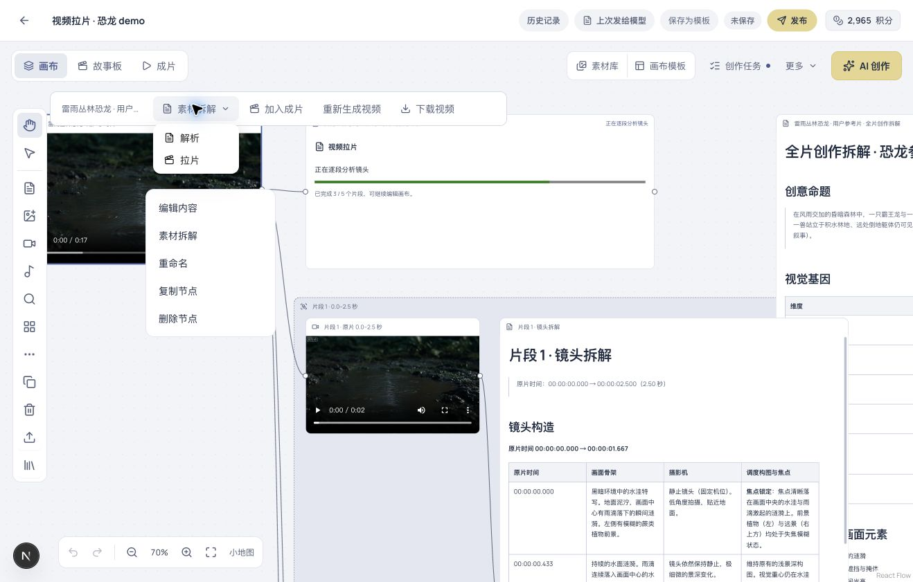
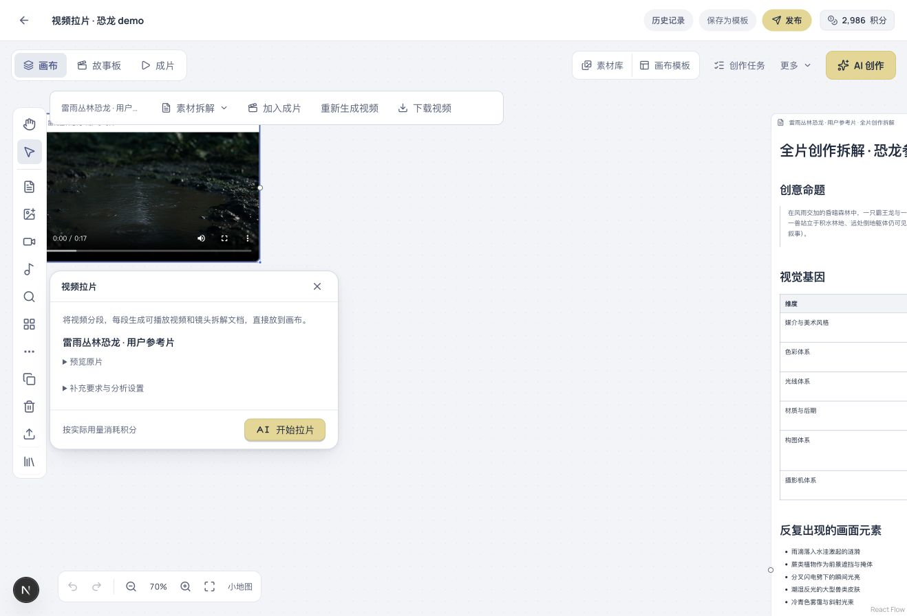
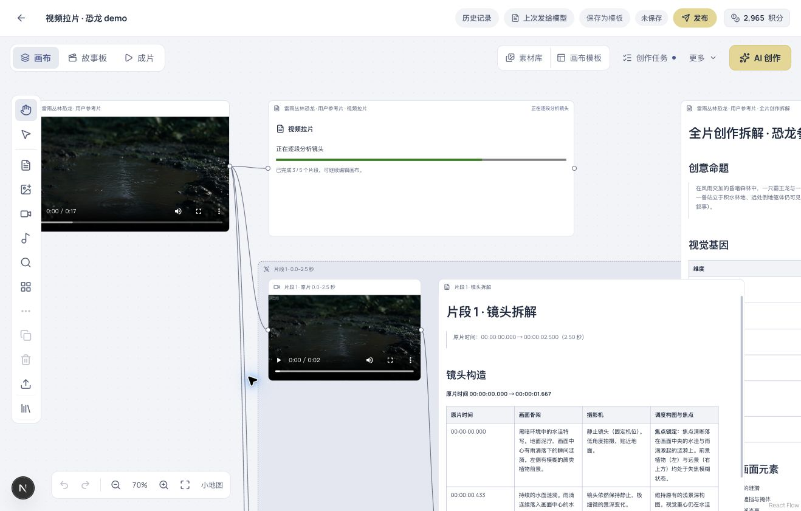
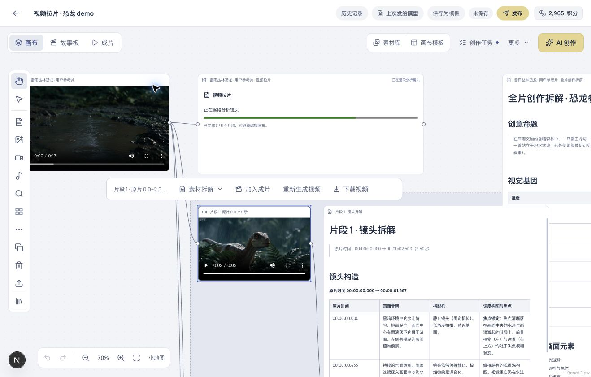
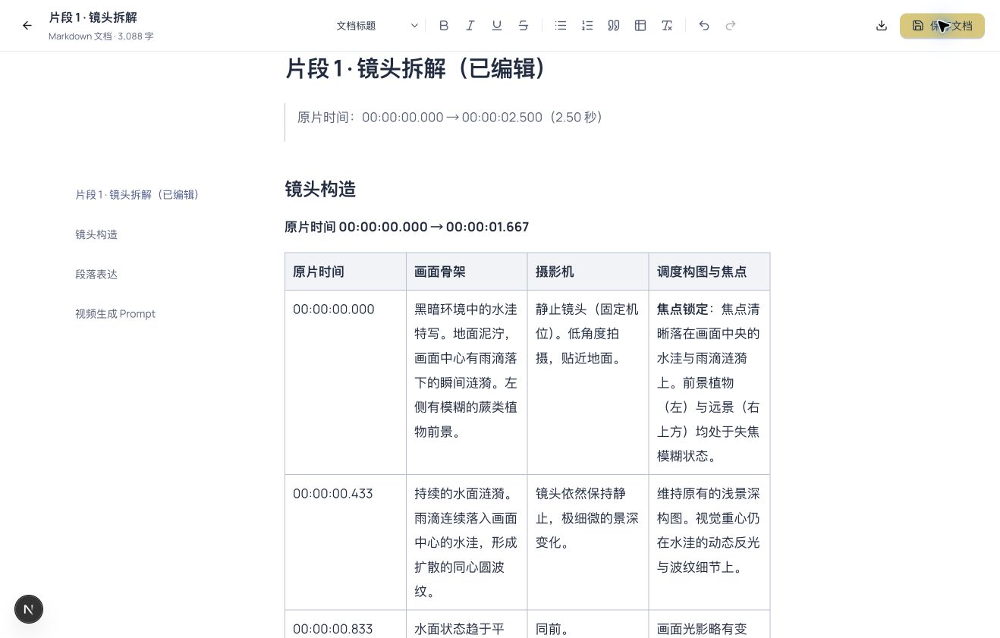
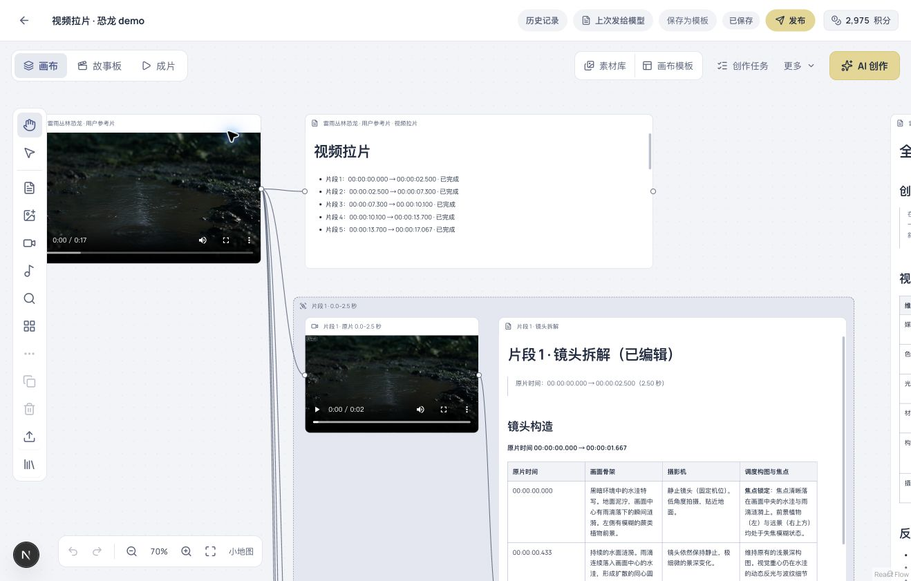

# 视频拉片操作手册

2026-10-15 · 本地版本实操截图 · 恐龙参考片 demo

从一条参考视频出发，得到连续的视频片段，以及每段对应的镜头拆解 Markdown。每段的视频与文档在画布中成组展示，可以播放、编辑和继续复用。

演示画布：[视频拉片 · 恐龙 demo](http://localhost:3017/projects/IPP-4043f2ef)。需要本地服务运行，并使用有权访问该画布的演示账号登录。本文截图来自实际操作，未替换模型正文。

## 1. 在视频节点上打开「拉片」

打开包含参考视频的画布，右键视频节点，选择 **素材拆解 → 拉片**。

「解析」生成全片创作拆解；「拉片」进一步分段、裁切视频并逐段分析。已有全片文档时，也可以选中文档，点击 **继续拉片**，沿用已保存的全片内容作为背景。

## 2. 确认视频并开始

小面板自动绑定刚才的视频，无需再次上传。核对视频名称，需要时填写分析重点，展开设置选择可用的视觉模型，再点击 **开始拉片**。

确认后面板关闭，画布新增一个「视频拉片」节点。打开面板、阅读文档不会启动分析；点击开始才会提交任务。

当前支持 60 秒、128 MiB 以内的视频。片段数由本次分段结果决定，最多 8 段。

## 3. 在画布上查看进度

「视频拉片」节点会依次显示读取画面、划分片段、裁切视频和逐段分析的状态。每完成一段，画布就会新增对应的视频和 Markdown 文档，不必等全部结束。

等待期间可以继续查看画布。刷新页面会恢复同一任务，避免再次点击开始。

## 4. 播放裁切后的片段

每组包含左侧的 **片段 N · 原片** 视频和右侧的 **片段 N · 镜头拆解** 文档。点击视频中的播放按钮即可检查这一段。节点名称标出它在原片中的起止秒数，播放器显示裁切后片段自己的播放时间。

找不到某一段时，点击左侧工具栏的 **查找节点**，搜索「片段 1」或其他段号，点击结果即可定位。

视频片段保留原片已有的声音。本版分析读取画面，声音分析尚未接入。

## 5. 编辑、保存和导出拆解文档

双击片段文档正文，或选中后点击 **打开文档**，进入与剧本相同的 Markdown 文档编辑器。

左侧标题导航可以跳转到「镜头构造」「段落表达」「视频生成 Prompt」。正文支持标题、列表、引用和表格编辑。

修改后点击右上角 **保存文档**；也可以按 ⌘S（Windows 为 Ctrl+S）。点击下载图标 **导出 Markdown**，将当前正文保存为 `.md` 文件。左上角返回箭头会保存后回到画布。

图中在第一段标题末尾添加了「（已编辑）」，并已保存；刷新画布后该修改仍然保留。

## 6. 查看全部结果

完成后，「视频拉片」节点列出所有片段的原片时间范围与完成状态，画布保留原片、全片文档及逐段结果。每段连线为 **原片 → 片段视频 → 镜头拆解**。

这次约 17 秒的恐龙视频实际生成了 5 段：

| 片段 | 原片范围 | 结果 |
|---|---|---|
| 1 | 0.000–2.500 秒 | 视频＋Markdown |
| 2 | 2.500–7.300 秒 | 视频＋Markdown |
| 3 | 7.300–10.100 秒 | 视频＋Markdown |
| 4 | 10.100–13.700 秒 | 视频＋Markdown |
| 5 | 13.700–17.067 秒 | 视频＋Markdown |

## 遇到中断时

网络短暂中断时，先刷新或重新打开画布查看原任务。任务明确失败时，在原「视频拉片」节点中选择 **继续拉片**；系统复用已完成片段和已裁切视频，继续处理未完成部分。继续操作仍会使用模型，按界面费用提示确认。

本轮实测覆盖正常完成、任务中刷新恢复、视频播放、文档保存、Markdown 导出及完成后刷新；失败续跑另有自动化测试覆盖。

当前尚无手动修改分段时间、独立 BGM 提取或自动角色提取入口。

## 培训素材

本文配图按 `01` 至 `06` 编号，原始截图保存在同名目录。配套 HyperFrames 教学视频已按「入口 → 确认 → 进度 → 播放 → 编辑 → 完成」制作，约1分47秒，1920×1080、30fps，配聚算中文女声和字幕。可编辑工程在本地 `.studio-e2e/film-study-tutorial/`，成片与字幕交付到本机 Movies 下的「拉片教学」目录；媒体文件不提交到代码仓库。
