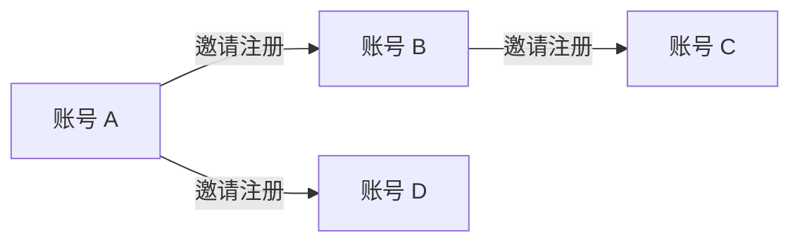

# 统一账号邀请关系方案

> 版本：v0.3 简化版 · 2026-10-17
> 状态：仅方案，未实现、未部署。
> 本版按用户最新要求收简：只记录邀请关系。

## 1. 要做什么

在统一账号中心 `aibuzz-id` 记录“谁邀请了谁”。使用全局 UID，所有应用共用，不放在 Studio 或任何单独产品里。

第一期只有三个能力：

1. 账号拥有自己的邀请码和邀请链接。
2. 新用户通过邀请入口注册时，记录邀请人与被邀请人。
3. 查询“谁邀请了我”和“我邀请了哪些人”；运营可以按 UID 追查原始邀请链。

例如 A 邀请 B、B 邀请 C，数据库保存两条关系即可，不额外保存整条链或层级。

## 2. 最小数据结构

账号表 `id_user` 增加唯一的 `invite_code` 字段。由账号中心生成随机码，不编码手机号或 UID；可在首次使用时补齐，无需先为所有存量账号生成。

分享链接示例：`https://id.aibuzz.cn/i/<invite_code>`。

新增一张 `id_referral` 表：

| 字段 | 含义 | 约束 |
|---|---|---|
| `invitee_uid` | 被邀请账号的原始 UID | 主键，一个账号最多一位注册邀请人 |
| `inviter_uid` | 邀请账号的原始 UID | 必填，建立索引用于查询直接受邀账号 |
| `created_at` | 关系建立时间 | 必填 |

没有邀请人的账号不插记录。无需保存 NONE、根节点、关系版本或额外的注册决定表。关系不包含应用、产品、企业或租户维度。

## 3. 注册时怎么记

```text
打开账号中心的邀请链接
→ 显示邀请人，进入已有注册流程
→ 验证短信或微信身份
→ 实际创建新 UID 时，一并插入邀请关系
→ 如果识别为已有账号，正常登录，不新增或改写关系
```

邀请码通过账号中心已有的注册会话/授权请求传到真实建号位置，由服务端按码查询邀请人；客户端不能直接指定 UID。每个注册流程使用自己携带的码，其他标签页不覆盖当前请求。

账号与关系写入同一个真实建号事务。短信当前使用独立事务建号，不能等登录成功后再补一次写入；微信创建分支同理。并发注册以成功建号的事务为准，重试不能覆盖。

扫码、小程序等入口沿用已有登录机制。只有能将邀请码可靠传入真实建号事务的入口才声明支持邀请注册，不通过应用登录回调补绑，也不为本期重建整套扫码流程。记录以真实创建账号为准，不把“完成电脑扫码登录”或“进入某应用”当成注册。

## 4. 几条必要规则

| 场景 | 行为 |
|---|---|
| 新账号带有效邀请码注册 | 记录一条关系 |
| 新账号没有邀请码 | 正常注册，不插关系 |
| 已有账号点击邀请链接 | 正常登录，不补绑、不改邀请人 |
| 邀请码无效或邀请账号不可用 | 明确提示，允许选择继续普通注册，不显示邀请成功 |
| 自己邀请自己 | 拒绝写入关系 |
| 重复请求 | 同一账号只保存一条关系，重试回读原结果 |
| 老用户导入、系统/体验账号创建 | 不附带邀请码，不进入邀请注册写入路径 |
| 换手机号、使用其他应用 | UID 不变，原关系不变 |

“没有记录”只表示没有记录注册邀请，不表示可以事后补绑。写入只挂在新账号创建流程，不提供通用补绑接口，因此无需为全部老账号做归因基线迁移。

## 5. 查询与账号合并

查询直接读表：

- 谁邀请了我：按 `invitee_uid` 查询。
- 我邀请了谁：按 `inviter_uid` 分页查询。
- 追查邀请链：运营逐级查询邀请人，设置查询上限，超过时明确返回截断。

普通用户只看自己的直接关系和必要展示资料；运营沿用账号体系的受权服务方式，不能向任意产品客户端开放全生态记录。第一期不做关系树可视化、全量导出或多级人数统计。

**账号合并只保留原始记录，不迁移邀请边、不重算关系。** X 合并到 Y，原来的“A 邀请 X”保持原样，历史查询可注明 X 已合并至 Y；它不变成“A 邀请 Y”，也不把 X 邀请的人自动算作 Y 邀请的人。合并状态直接读取现有 `id_user.merged_into_uid`，无需新映射表。

本期追踪的是“当时谁邀请了哪个账号”，不承诺计算合并后的有效上下级。注销或停用也不删除原始关系，展示时按账号现状脱敏。

## 6. 落点与范围

代码、数据和接口归 `aibuzz-id`。Studio 等应用最多放一个跳转到账号中心的入口，不保存或决定关系。

本期不增加邀请事件流、异步任务、投影表、快照版本、图算法或独立服务，也不修改现有产品 outbox。军师、公社已有的业务推荐、企业邀请和积分逻辑保持原有职责，不把本表当作它们的新真源。

以后确实需要奖励、活动归因或复杂统计时，再增加对应能力。现在只稳定保存 UID 与时间。

这是对原“归因留在产品侧”约定的小范围调整：跨应用的账号注册邀请放在账号中心，产品业务归因仍留产品侧。实施时同步账号仓 README/AGENTS 与注册接入说明，本次不变更运行契约。

## 7. 最小验收

- A 邀请 B，B 邀请 C，两条记录可查，能追查 C → B → A。
- 同一账号进入不同应用，邀请关系不变。
- 普通注册和老账号登录不意外生成邀请关系。
- 重复/并发注册只产生一个账号与一条确定关系；写入故障没有半成品。
- 无效邀请码、自邀和未授权查询有明确结果。
- 账号合并后原始记录仍可查询，不发生自动改挂或关系重算。

本次只检查文档；以上是实现后的验收要求，尚未运行。

## 8. 上一版评审的适用范围

[Astra 独立评审](unified-account-referral-astra-review-20261017.md)针对 v0.2 完整方案，保留作为历史参考，并非对本简化版的重新评审。真实首建事务、已有账号不误绑、隐私和业务隔离的提醒仍适用；关系投影、私有事件流、全图重建不再纳入本期。

实施位置参考：[账号模型](../../aibuzz-id/src/main/java/com/aibuzz/id/model/IdUser.java)、[短信建号](../../aibuzz-id/src/main/java/com/aibuzz/id/user/IdUserService.java)、[微信建号](../../aibuzz-id/src/main/java/com/aibuzz/id/wechat/WechatIdentityResolver.java)、[账号合并](../../aibuzz-id/src/main/java/com/aibuzz/id/phone/PhoneBindingService.java)。邀请码字段和邀请表仍为设计建议，尚未实现。

## 9. 复核：以后能否用本体查看整体邀请链

可以。当前三个关系字段已经具备节点标识、连接方向和时间，无需为未来本体增加字段或新表。建议现在明确概念，真正需要查看关系网时再实现展示或本体映射。

| 概念 | 语义 | 当前存储映射 |
|---|---|---|
| Account（账号） | 一个全局 UID 对应一个账号节点，不直接等同自然人 | `id_user.uid` |
| RegistrationInvitation（注册邀请事实） | A 邀请 B 注册这件事 | 一行 `id_referral`；现有唯一 `invitee_uid` 可用于派生稳定事实标识 |
| registrationInvitedBy（直接注册邀请人） | B 的直接邀请人是 A | `invitee_uid → inviter_uid` |
| 邀请发生时间 | 注册邀请事实的时间 | `created_at` |

图上可按更直观的“邀请人 → 被邀请人”画箭头；查询字段 `registrationInvitedBy` 采用反方向，映射文档必须注明，不能混用。

例如保存 A 邀请 B、B 邀请 C、A 邀请 D，后期读取这些行即可画出：



复核需要保留的边界：

- 直接邀请和间接路径分开：C 的直接邀请人只有 B；A 到 C 的路径可以查出，但不能因此再写一条“A 直接邀请 C”。直接邀请关系不声明为传递关系。
- “整体”指系统已记录的账号注册邀请图。上线前未记录、普通注册及其他产品的业务推荐，不会由本体自动补出。没有关系记录不证明这个人从未受过邀请。
- 账号合并单独显示为 `mergedInto` 关系，不将账号节点直接当作完全相同的实体合并，也不改写原始邀请边。否则会重新引入已经删除的关系重算和成环问题。
- 单邀请人、自邀拒绝、新建账号才可写入等规则由数据库与注册服务保证。本体负责定义含义与组织查询，不替代事务和唯一约束。
- 权限仍由账号服务控制。整体图是受权运营视图，普通用户不因此获得全生态关系查询权。

普通数据库查询也能先画邀请链；本体有价值的阶段是需要把账号、注册邀请、企业成员等不同概念放在同一张图上解释时。届时仍须把各类关系分开命名，不能把它们都叫“上下级”。公社已有 [本体到数据表的映射](../../ai-society/ontology/MAPPING.md) 可参考，但其中会员推荐、三级路径和成长值属于产品业务，不迁入全局账号模型。

推荐路线：现在仍按一张关系表记录；后期先提供只读关系图，再按实际跨域查询需要增加本体映射。没有要求现在引入图数据库、推理引擎或新的同步链路。

参考：[W3C RDF 图模型](https://www.w3.org/TR/rdf11-concepts/#data-model)定义以主语、关系、宾语表示事实；[OWL 2 Primer](https://www.w3.org/TR/owl2-primer/)说明本体中的关系与推理语义。这里采用其建模思路，不要求第一期运行 RDF/OWL 系统。

## 10. 前端页面

具体页面、文字线框和异常反馈见 [统一账号邀请前端设计](unified-account-referral-frontend.md)。主体只有账号中心的“我的邀请”和公开邀请落地页，现有注册流程保留邀请提示；Studio 只提供跳转入口。未来整体关系图作为受权只读展示，不增加关系写入真源。本次仍仅文档，未实现页面。
